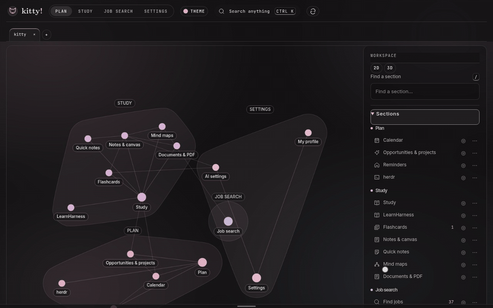
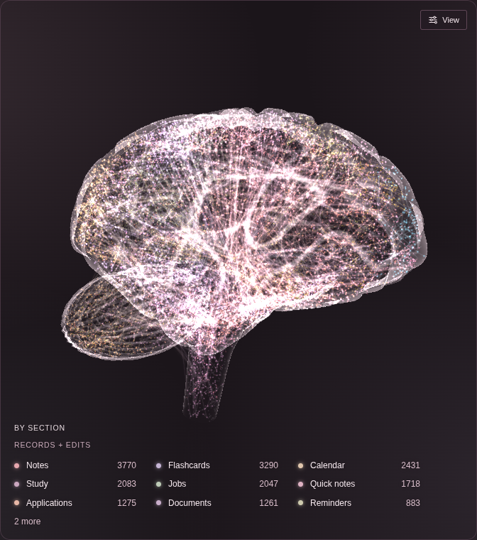
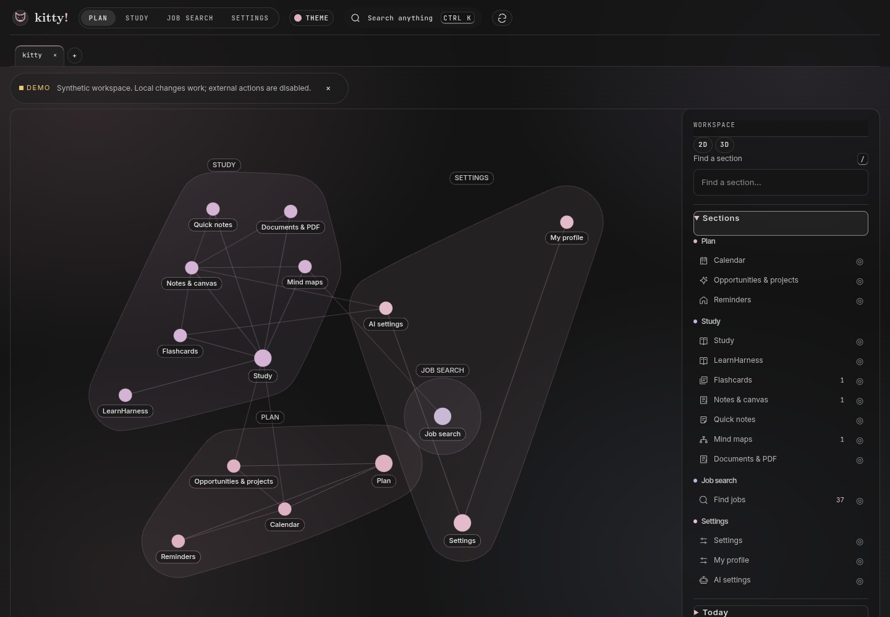
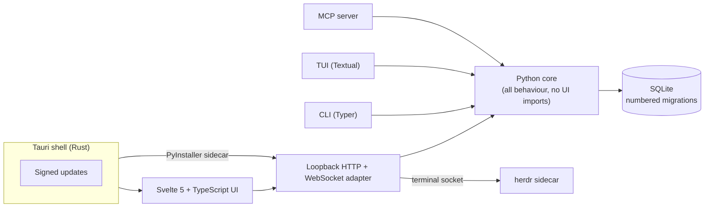

# rika!

A local-first desktop workspace. Notes, documents, study tools and planning live
in one SQLite database on your machine and are connected in a navigable
knowledge atlas. A bundled terminal and an optional job-application assistant
plug in as modules.



**[Download for Linux](https://github.com/ZacharySF/kitty-releases/releases/latest)**
(signed AppImage and .deb with in-app updates) ·
**[Full guide](docs/GUIDE.md)** · **[Behaviour spec](docs/SPEC.md)**

## What it does

| Module | What you get |
| --- | --- |
| **Workspace** | Block-based notes with stable block IDs, `((block))` references and `[[wiki]]` links, backlinks, canvas, mind maps, documents and PDFs, flashcards, study, calendar, tasks, quick notes in floating windows |
| **Terminal** | A pinned [herdr](https://github.com/herdrdev/herdr) session in a resizable dock, streamed into the window over a same-origin WebSocket; open omp, Claude or Codex coding agents in labelled tabs with live activity; optionally drive a separately installed [Stencil Tern](https://stencil.so/tern) on rika!'s own Tern session: pane list with live and exited state in the dock, run a command line, focus a pane, capture a pane to a quick note |
| **ApplyAI** (optional) | Job discovery from public boards, triage, application preparation, a tracker and reports. It fills forms but **never submits an application** and never invents facts about the applicant |
| **Core** (always on) | A Brain home (every record and edit as a glowing point in a neural-network brain) or a 2D atlas, tabs, command palette, themes, settings, module selection |

Modules can be turned on or off; disabled modules disappear from navigation,
routes, workers and MCP tools while their data stays intact. Add-on modules install
from a GitHub release in Settings → Modules, checked against the release's SHA-256
([docs/MODULES.md](docs/MODULES.md) explains how to publish one).





## Architecture



One rule holds the layout together: nothing under `src/kitty/core/` imports a UI
framework, so the website, desktop app, CLI, TUI and MCP server all call the
same functions against the same database.

## Engineering notes

- **Edits are never silently lost.** Pages, folders and block outlines carry a revision;
  a save against a stale revision is rejected, and a second window editing the
  same note offers *Load latest* or *Keep mine* instead of overwriting.
- **References point at rows, not copies.** Block references resolve the
  authoritative block at read time, with parent-cycle checks and bounded
  expansion.
- **History is append-only where it matters.** Application status changes are
  events; undo appends a reverting event instead of rewriting history.
- **The local server is not an open door.** It binds to loopback, checks the
  exact Host and Origin, requires a custom header on every mutation, and requires
  a per-launch secret only rika!'s own windows hold on every API call and
  WebSocket, so a local program that forges the headers still gets nothing.
- **It ships.** Tauri builds signed Linux installers in CI and the app updates
  itself, including through an `appimage-run` launcher on NixOS.
- **Browser automation without a framework.** ApplyAI drives Firefox through its
  own WebDriver BiDi client and stops at every human boundary: sign-in
  challenges, consent, unknown answers and the final submit.

## Run it

Requirements: Python 3.12 with [uv](https://docs.astral.sh/uv/), Node 22+.

```bash
uv sync
npm --prefix web ci && npm --prefix web run build
uv run kitty-web --demo        # disposable workspace with synthetic data
```

Open the printed `http://127.0.0.1:…` address (not `localhost`: the server
checks the exact Host). To use a real workspace, run `uv run kitty init` and
`uv run kitty-web`. The [guide](docs/GUIDE.md) covers modules, the desktop
build, configuration and every command.

## Develop

```bash
uv run pytest -n auto          # Python core, web adapter, TUI and browser tests (~6 min)
npm --prefix web run check     # svelte-check / TypeScript
cargo test --manifest-path desktop/Cargo.toml
```

CI runs the Python tests, the frontend check and the web unit tests on every pull request.

## Built on

rika! integrates these projects rather than reimplementing them; credit for
their features belongs to their authors.

- [herdr](https://github.com/herdrdev/herdr) (Apache-2.0): the terminal
  multiplexer behind the Terminal module, bundled at a pinned version.
- [LearnHarness](https://github.com/amosblomqvist/learnharness) (AGPL-3.0): the
  upstream learning app opened from Study, run as a separate local server in a
  cross-origin frame. Its licence and corresponding source ship with the desktop
  app.
- [Grinstead and Snell's *Introduction to Probability*](https://math.dartmouth.edu/~doyle/docs/prob/)
  (GNU FDL): its exercises, used as a textbook source in Math, ship with their
  licence and source note in `third_party/grinstead-snell/`.
- [Tauri](https://tauri.app), [Svelte](https://svelte.dev),
  [Textual](https://textual.textualize.io) and
  [3d-force-graph](https://github.com/vasturiano/3d-force-graph).

## License

[MIT](LICENSE). Bundled third-party components keep their own licences.
