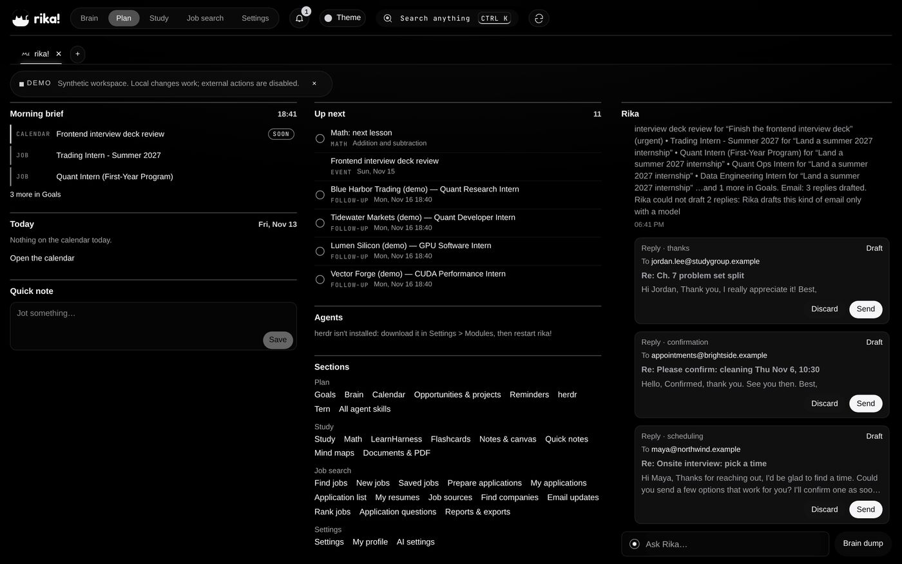
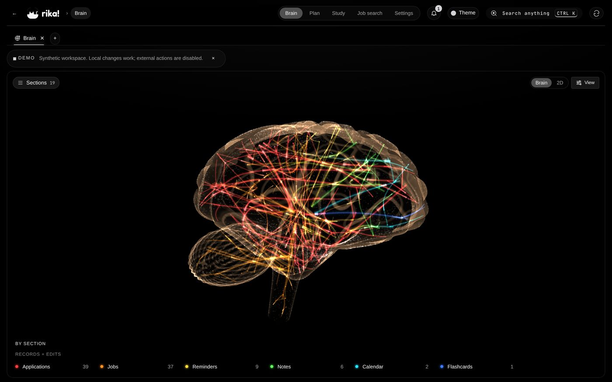
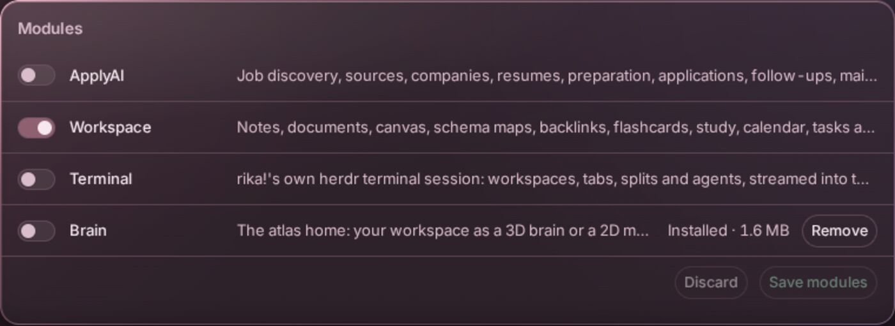
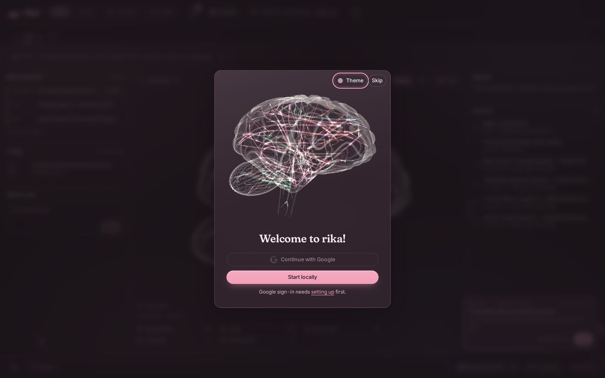
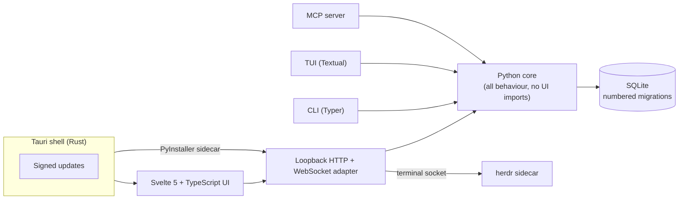

<p align="center">
  
</p>

<p align="center">
  Notes become connections. Connections become something you can build.<br>
  A local-first desktop workspace for your notes, documents, study and plans.
</p>

<p align="center">
  <b><a href="https://github.com/ZacharySF/kitty-releases/releases/latest">Download for Linux ↗</a></b>
  &nbsp; / &nbsp; <a href="#quick-start">Take it for a spin</a>
  &nbsp; / &nbsp; <a href="docs/GUIDE.md">Read the field guide</a><br>
  <sub>AppImage + .deb · Signed updates · MIT licensed</sub>
</p>

<p align="center">
  <a href="#your-workspace">Your workspace</a> ·
  <a href="#modules">Modules</a> ·
  <a href="#quick-start">Quick start</a> ·
  <a href="#architecture">Architecture</a> ·
  <a href="#reference">Reference</a>
</p>

<br>

<p align="center"><b>A little less scattered. A lot more connected.</b></p>

<p align="center">
  
</p>
<p align="center"><sub>Home: what's next, everything you've got, and Rika on the right with your replies already drafted.</sub></p>

<br>

## Your workspace

### Your mind isn't a filing cabinet.

A paragraph can belong to a project, a question and next Tuesday's study session.
rika! gives those connections somewhere to live: one SQLite database on your
machine, with an atlas instead of another pile of tabs.

### 01 &nbsp; Catch the thought

Write in blocks. Link a page with `[[wiki]]` links or refer to the exact passage
with `((block))` references. Follow backlinks, spread an idea across a canvas,
or turn it into a mind map.

Documents, PDFs and floating quick notes stay in the same workspace.
You don't have to know where an idea belongs before you write it down.

### 02 &nbsp; Give it somewhere to go

Keep flashcards and study beside the material you're learning. Put the next
step on your calendar or task list. Switch themes, open another tab, or use
the command palette to move without losing your place.


### 03 &nbsp; Follow the thread

Every record and every edit becomes a glowing point in the **Brain**: a
neural-network map of everything you've written, studied and planned. Prefer
flat ground? Switch to the **2D** map. Same records, different ways to find
your bearings.


<p align="center"><sub>The Brain as its own view. Demo workspace, synthetic data.</sub></p>

<br>

## Modules

### A workspace, not a fixed collection of tools.

Keep the parts you use. Turn off the parts you don't.
Add a terminal when you're building, enable ApplyAI when you're looking for work,
or download the Brain when you want to see it all at once.



| Module | What it brings |
| --- | --- |
| **Workspace** | Notes and block references, documents and PDFs, canvas, mind maps, flashcards, study, calendar, tasks and floating quick notes. |
| **Terminal** | A pinned [herdr](https://github.com/herdrdev/herdr) session in a resizable dock. Open omp, Claude or Codex in labelled agent tabs with live activity. |
| **ApplyAI** · optional | Public-board job discovery, triage, application preparation, tracking and reports. It fills forms but **never submits an application** and never invents facts about the applicant. |
| **Brain** · download | The atlas home: your workspace as a 3D brain or a 2D map. Installs from **Settings → Modules** and opens as its own view. |
| **Core** · always on | Tabs, command palette, themes, settings and module selection. |

### From a thought to a terminal

The Terminal module streams herdr into the window over a same-origin WebSocket.
Keep a session in the dock or open the full herdr view, with coding agents in
their own tabs.

If you separately install [Stencil Tern](https://stencil.so/tern), rika! can
also drive its own Tern session: list live and exited panes, run a command,
focus a pane, or capture one to a quick note.

### Leave the clutter. Keep the data.

Disabled modules disappear from navigation, routes, workers and MCP tools;
**their data stays intact**. Install add-ons from a GitHub release in
**Settings → Modules**, checked against the release's SHA-256.
The [module guide](docs/MODULES.md) explains the format and how to publish one.

<br>

## Quick start

**Just want the desktop app?** [Download the latest Linux release](https://github.com/ZacharySF/kitty-releases/releases/latest).
Choose the AppImage or .deb; signed updates are built in.

<p align="center">
  
</p>
<p align="center"><sub>First launch: one button to start locally. No account needed.</sub></p>

### Run from source

Requirements: Git, Python 3.12 with [uv](https://docs.astral.sh/uv/), and Node 22+.

```bash
git clone https://github.com/ZacharySF/kitty.git
cd kitty
uv sync
npm --prefix web ci
npm --prefix web run build
uv run kitty-web --demo
```

The demo uses a **disposable workspace with synthetic data**. Open the printed
`http://127.0.0.1:…` address, not `localhost`: the server checks the exact Host.

For a real workspace:

```bash
uv run kitty init
uv run kitty-web
```

The [full guide](docs/GUIDE.md) covers modules, the desktop build, configuration
and every command. The repository and CLI still use the `kitty` name.

## Architecture



One rule holds the layout together: nothing under `src/kitty/core/` imports a UI
framework, so the website, desktop app, CLI, TUI and MCP server all call the
same functions against the same database.

## Engineering notes

- **Edits are never silently lost.** Pages, folders and block outlines carry a revision;
  a save against a stale revision is rejected, and a second window editing the
  same note offers *Load latest* or *Keep mine* instead of overwriting.
- **References point at rows, not copies.** Block references resolve the
  authoritative block at read time, with parent-cycle checks and bounded
  expansion.
- **History is append-only where it matters.** Application status changes are
  events; undo appends a reverting event instead of rewriting history.
- **The local server is not an open door.** It binds to loopback, checks the
  exact Host and Origin, requires a custom header on every mutation, and requires
  a per-launch secret only rika!'s own windows hold on every API call and
  WebSocket, so a local program that forges the headers still gets nothing.
- **It ships.** Tauri builds signed Linux installers in CI and the app updates
  itself, including through an `appimage-run` launcher on NixOS.
- **Browser automation without a framework.** ApplyAI drives Firefox through its
  own WebDriver BiDi client and stops at every human boundary: sign-in
  challenges, consent, unknown answers and the final submit.

## Develop

```bash
uv run pytest -n auto          # Python core, web adapter, TUI and browser tests
npm --prefix web run check     # svelte-check / TypeScript
cargo test --manifest-path desktop/Cargo.toml
```

CI runs the Python tests, the frontend check and the web unit tests on every pull request.

## Reference

| Looking for… | Start here |
| --- | --- |
| Setup, configuration and everyday use | [Full guide](docs/GUIDE.md) |
| Exact behaviour and contracts | [Behaviour spec](docs/SPEC.md) |
| Building and publishing an add-on | [Module guide](docs/MODULES.md) |
| Linux installers and release notes | [Desktop releases](https://github.com/ZacharySF/kitty-releases/releases/latest) |

## Built on

rika! integrates these projects rather than reimplementing them; credit for
their features belongs to their authors.

- [herdr](https://github.com/herdrdev/herdr) (Apache-2.0): the terminal
  multiplexer behind the Terminal module, bundled at a pinned version.
- [LearnHarness](https://github.com/amosblomqvist/learnharness) (AGPL-3.0): the
  upstream learning app opened from Study, run as a separate local server in a
  cross-origin frame. Its licence and corresponding source ship with the desktop
  app.
- [Grinstead and Snell's *Introduction to Probability*](https://math.dartmouth.edu/~doyle/docs/prob/)
  (GNU FDL): its exercises, used as a textbook source in Math, ship with their
  licence and source note in `third_party/grinstead-snell/`.
- [Tauri](https://tauri.app), [Svelte](https://svelte.dev),
  [Textual](https://textual.textualize.io) and
  [3d-force-graph](https://github.com/vasturiano/3d-force-graph).

The README wordmark uses [Fraunces](https://fraunces.undercase.xyz), by Undercase
Type, with a subset embedded under the [SIL Open Font License](docs/assets/OFL-Fraunces.txt).

## License

[MIT](LICENSE). Bundled third-party components keep their own licences.
