<p align="center">
  
</p>

<p align="center">
  Notes become connections. Connections become something you can build.<br>
  A local-first desktop workspace for your notes, documents, study and plans.
</p>

<p align="center">
  <a href="https://github.com/ZacharySF/rika/releases/latest"></a>
  <a href="https://github.com/ZacharySF/kitty/actions/workflows/ci.yml"></a>
  
  <a href="LICENSE"></a>
</p>

<p align="center">
  <b><a href="https://github.com/ZacharySF/rika/releases/latest">Download for Linux ↗</a></b>
  &nbsp; / &nbsp; <a href="#quick-start">Take it for a spin</a>
  &nbsp; / &nbsp; <a href="docs/GUIDE.md">Read the field guide</a><br>
  <sub>AppImage + .deb · Signed updates · MIT licensed</sub>
</p>

<p align="center">
  <a href="#at-a-glance">At a glance</a> ·
  <a href="#your-workspace">Your workspace</a> ·
  <a href="#rika">Rika</a> ·
  <a href="#make-it-yours">Make it yours</a> ·
  <a href="#modules">Modules</a> ·
  <a href="#quick-start">Quick start</a> ·
  <a href="#under-the-hood">Under the hood</a> ·
  <a href="#reference">Reference</a>
</p>

<br>

<p align="center"><b>A little less scattered. A lot more connected.</b></p>

<p align="center">
  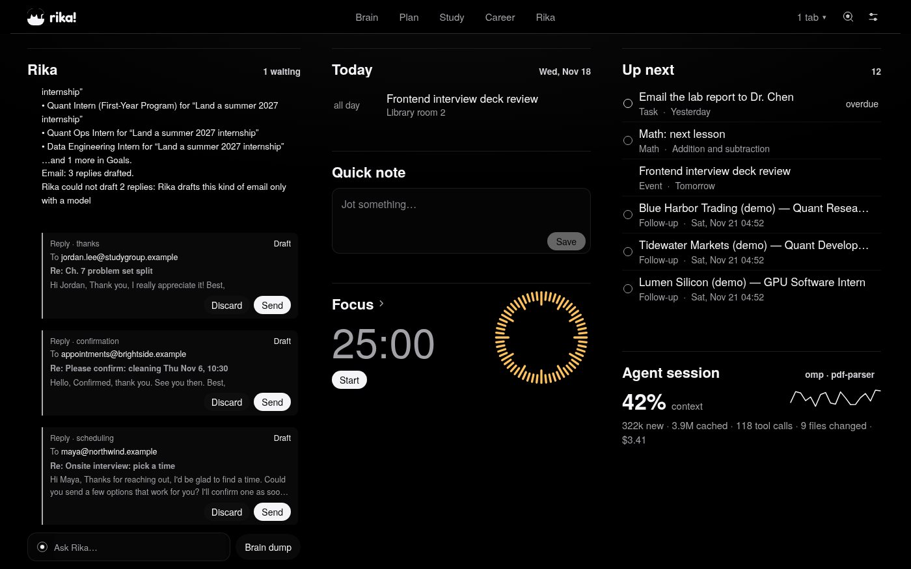
</p>
<p align="center"><sub>Home: today, what's next, and Rika on the right with your replies already drafted.</sub></p>

<br>

## At a glance

<table>
  <tr>
    <td width="33%" valign="top">
      <b>Write</b><br>
      <sub>Blocks, <code>[[wiki]]</code> links and <code>((block))</code> references. Documents, PDFs, canvases, mind maps and floating quick notes.</sub>
    </td>
    <td width="33%" valign="top">
      <b>Plan</b><br>
      <sub>A calendar, tasks and goals, with flashcards and study beside the material you're learning.</sub>
    </td>
    <td width="33%" valign="top">
      <b>See</b><br>
      <sub>The Brain: every record and every edit as a point on a 3D brain or a flat 2D map.</sub>
    </td>
  </tr>
  <tr>
    <td width="33%" valign="top">
      <b>Delegate</b><br>
      <sub>Rika reads what changed, drafts the replies and keeps an eye on your coding agents. You press Send.</sub>
    </td>
    <td width="33%" valign="top">
      <b>Shape</b><br>
      <sub>Rearrange any page, start home from eighteen templates, and pick Black or seventeen other themes.</sub>
    </td>
    <td width="33%" valign="top">
      <b>Grow</b><br>
      <sub>Switch modules on and off. Heavy parts download as signed packs only when you ask for them.</sub>
    </td>
  </tr>
</table>

<br>

## Your workspace

### Your mind isn't a filing cabinet.

A paragraph can belong to a project, a question and next Tuesday's study session.
rika! gives those connections somewhere to live: one SQLite database on your
machine, with an atlas instead of another pile of tabs.

### 01 &nbsp; Catch the thought

Write in blocks. Link a page with `[[wiki]]` links or refer to the exact passage
with `((block))` references. Follow backlinks, spread an idea across a canvas,
or turn it into a mind map.

Documents, PDFs and floating quick notes stay in the same workspace.
You don't have to know where an idea belongs before you write it down.

### 02 &nbsp; Give it somewhere to go

Keep flashcards and study beside the material you're learning. Put the next
step on your calendar or task list, set a goal and watch what moves it.
Open another tab, or use search to move without losing your place.

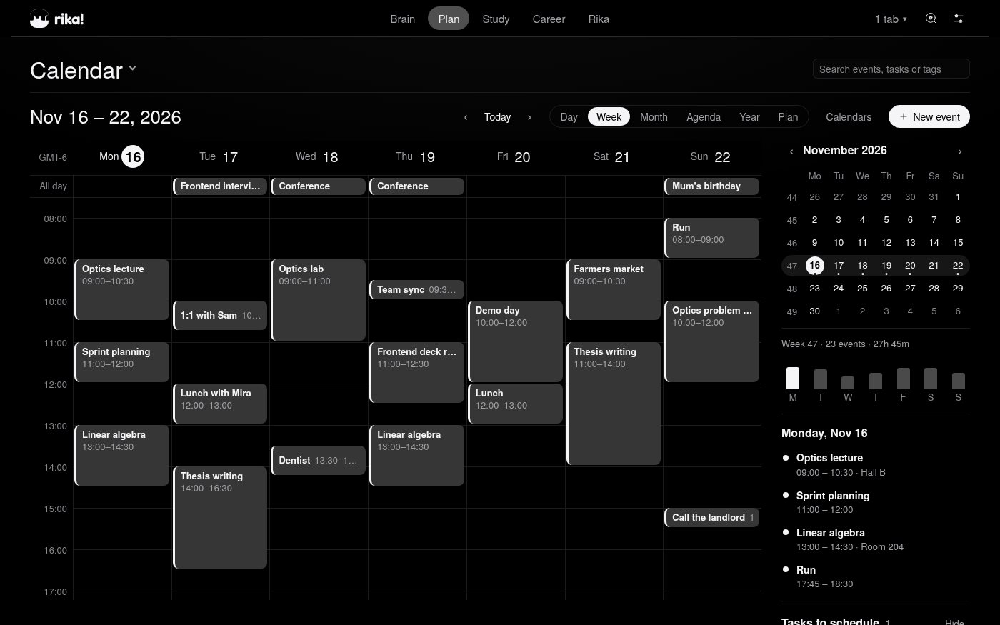
<p align="center"><sub>The calendar: one quiet row of controls, a line for now, and the day you picked beside it.</sub></p>

### 03 &nbsp; Follow the thread

Every record and every edit becomes a glowing point in the **Brain**: a
neural-network map of everything you've written, studied and planned. Prefer
flat ground? Switch to the **2D** map, where every point carries its name.
Same records, different ways to find your bearings.

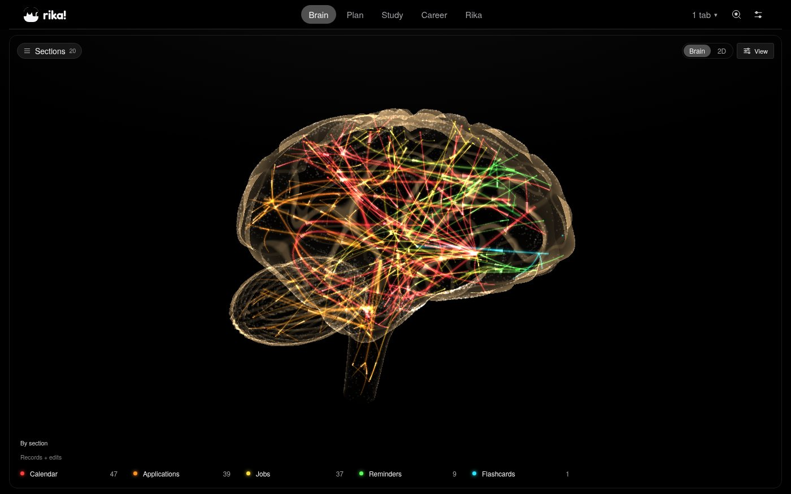
<p align="center"><sub>The Brain as its own view. Demo workspace, synthetic data.</sub></p>

<br>

## Rika

### Someone to hand the loose ends to.

Rika reads what changed overnight and tells you in a few lines. She drafts the
replies; **you** press Send. Ask her for something by typing, or by talking if
you turn Voice on. Press **Ctrl + R** and she docks beside whatever page you're on.

Rika thinks with a cloud model through [OpenRouter](https://openrouter.ai), on your
own key, so what you ask her and what she reads to answer goes there. It's optional:
without a key she still runs simple commands, and notes, plans and study don't need one.

She has a page of her own for everything else: the coding agents working for
you (what each is doing, how full its context is, what it has cost), the skills
you can drag onto one, what she remembers, and what all of it has used.

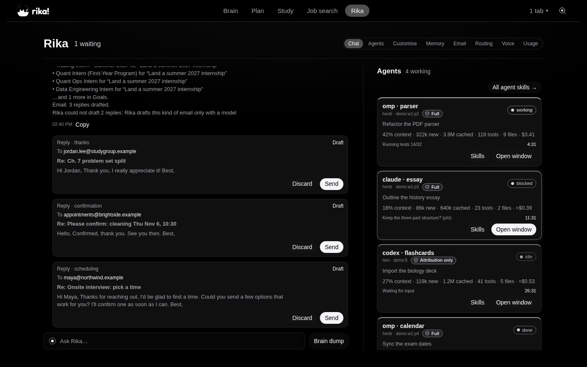
<p align="center"><sub>Rika's page: the conversation on the left, your agents on the right.</sub></p>

<br>

## Make it yours

### Your desk, not ours.

Press **Ctrl + Shift + Space** on any page. Drag a block where you want it, pull
an edge to resize it, and open **Widgets** to drag in a clock, a quick note or
your goals. Press Done and the page stays that way.

Home goes further: eighteen templates to start from, widgets in the order you
like, and six quiet tones to tell them apart.

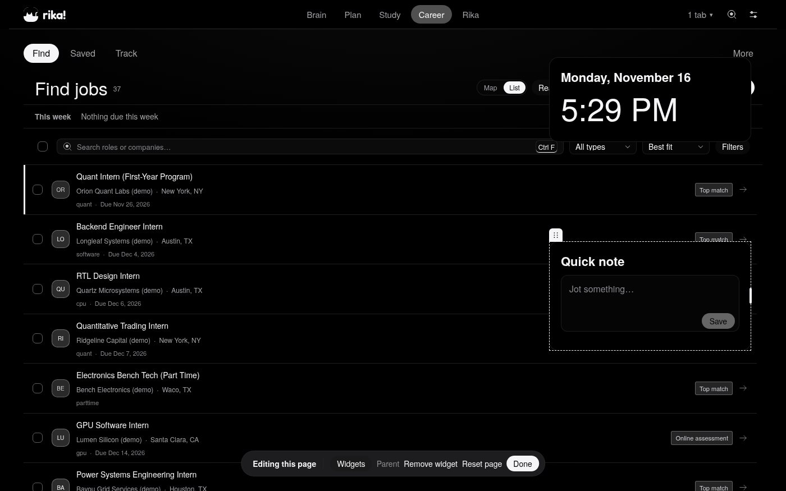
<p align="center"><sub>Edit any page: move it, size it, drag a widget in.</sub></p>

### Black by default. Loud when you want it.

rika! opens in **Black**: white type, hairlines, nothing glowing. Turn Themes on
for seventeen more, from Nord and Gruvbox to **Kitty**, a record sleeve from
about 1999 with a different film still behind it every time you open it.
Press **Ctrl + Y** to slide through them live; Enter keeps one, Esc puts yours back.

Turn **Animations** on and pages turn instead of blinking: they slide in the
order of the bar, grow out of what you pressed, and the marker of where you are
glides over. Everything stops if your system asks for less motion.

<p align="center">
  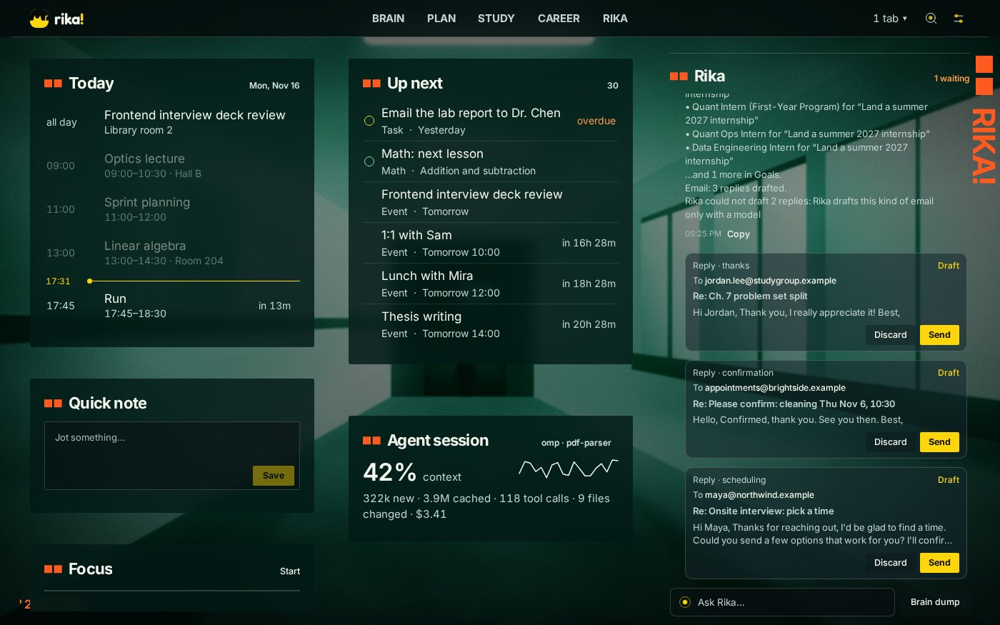
  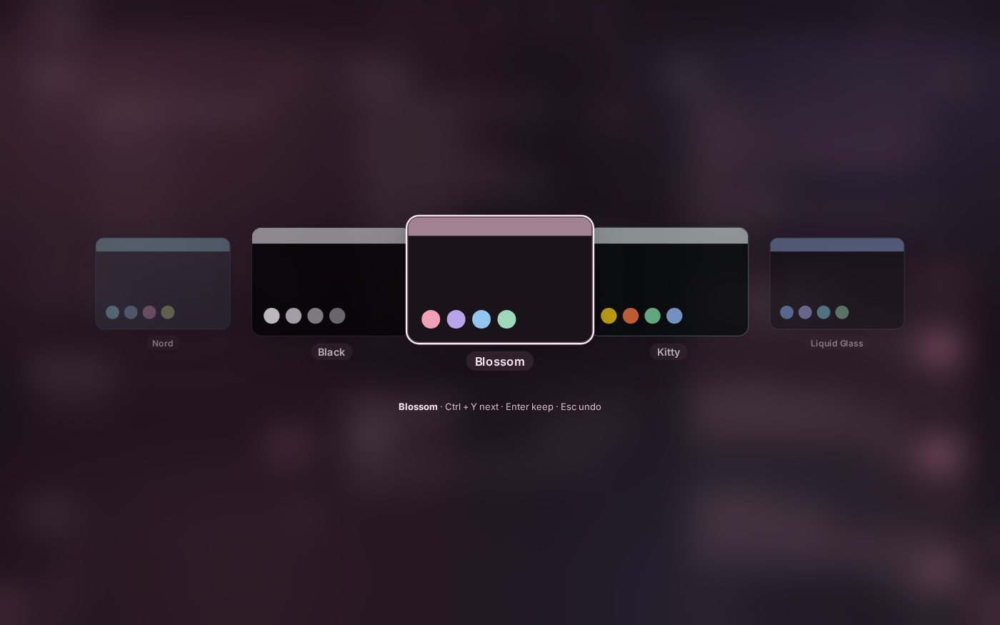
</p>
<p align="center"><sub>Left: the Kitty theme. Same home, different night. Right: Ctrl + Y, previewing Blossom.</sub></p>

### Keys worth knowing

| Keys | What they do |
| --- | --- |
| <kbd>Ctrl</kbd> <kbd>Space</kbd> or <kbd>Ctrl</kbd> <kbd>K</kbd> | Search commands, sections and jobs |
| <kbd>Ctrl</kbd> <kbd>Shift</kbd> <kbd>Space</kbd> | Edit the page you're on |
| <kbd>Ctrl</kbd> <kbd>R</kbd> | Rika beside the page; again or Esc to close |
| <kbd>Ctrl</kbd> <kbd>J</kbd> | Ask Rika from anywhere but a terminal |
| <kbd>Ctrl</kbd> <kbd>O</kbd> | Every open tab as a card: arrows or 1–9, Enter to open |
| <kbd>Ctrl</kbd> <kbd>Tab</kbd> · <kbd>Ctrl</kbd> <kbd>T</kbd> · <kbd>Ctrl</kbd> <kbd>W</kbd> | Next tab · new tab · close tab |
| <kbd>Ctrl</kbd> <kbd>Y</kbd> | Slide through your themes live |
| <kbd>Ctrl</kbd> <kbd>Shift</kbd> <kbd>F</kbd> | Fill the window with the focused panel |
| <kbd>?</kbd> | Every shortcut for the screen you're on |

<br>

## Modules

### A workspace, not a fixed collection of tools.

Keep the parts you use. Turn off the parts you don't.
Add a terminal when you're building, enable ApplyAI when you're looking for work,
or download the Brain when you want to see it all at once.

<p align="center">
  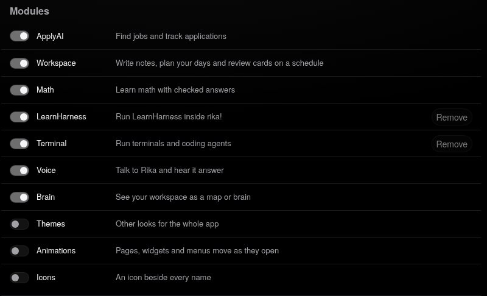
</p>

| Module | What it brings |
| --- | --- |
| **Core** · always on | Home, Rika, tabs, search, settings and module selection. |
| **Workspace** | Notes and block references, documents and PDFs, canvas, mind maps, flashcards, study, calendar, tasks, goals and floating quick notes. |
| **Terminal** · download | Your own [herdr](https://github.com/herdrdev/herdr) session in a tab. Open omp, Claude or Codex in labelled agent tabs with live activity. |
| **ApplyAI** · optional | Career: Find, Saved and Track in one bar. It fills forms but **never submits an application** and never invents facts about the applicant. |
| **Math**, **LearnHarness**, **Voice** · download | Checked math practice, the LearnHarness app inside Study, and talking to Rika. Each fetches what it needs when you turn it on. |
| **Brain** · download | Your workspace as a 3D brain or a 2D map, as its own view. |
| **Themes**, **Animations** · download | Seventeen more looks, and motion for pages, widgets and menus. Off until you ask. |
| **Icons** | An icon beside every name, if you like them there. |

### Small to install. Yours to grow.

The installer carries the window, Rika and the core. Everything heavier is a
**pack**: downloaded from the release when you switch its module on, checked
against a signed list, and removed again when you switch it off and say so.

### From a thought to a terminal

The Terminal module streams herdr into the window over a same-origin WebSocket.
Open the full herdr view in a tab, with coding agents in their own tabs.

If you separately install [Stencil Tern](https://stencil.so/tern), rika! can
also drive its own Tern session: list live and exited panes, run a command,
focus a pane, or capture one to a quick note.

### Looking for work? Three tabs, one bar.

**Career** keeps the search in one place: **Find** what's open, keep what you
like in **Saved**, and follow what you sent in **Track**, with Rika in a column
beside it. **Ready to apply** narrows Find to the jobs you can fill in now.

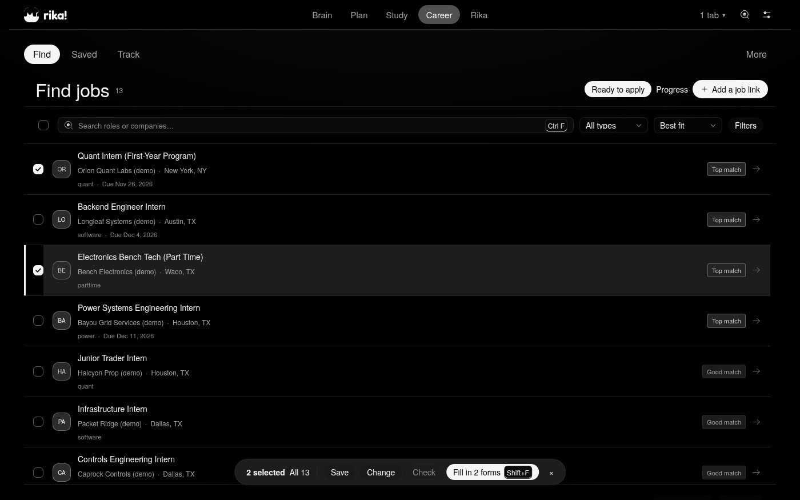
<p align="center"><sub>Tick the jobs, press Fill. rika! stops before Submit, every time.</sub></p>

### Leave the clutter. Keep the data.

Disabled modules disappear from navigation, routes, workers and MCP tools;
**their data stays intact**. Install add-ons from a GitHub release in
**Settings → Modules**, checked against the release's SHA-256.
The [module guide](docs/MODULES.md) explains the format and how to publish one.

<br>

## Quick start

### The desktop app

1. **[Download the latest release.](https://github.com/ZacharySF/rika/releases/latest)**
2. Install the `.deb` with your software installer, or run the AppImage.
3. Open rika! from your application launcher and choose **Start locally**.

Updates are signed: use **Check for updates** inside the app. Your workspace
lives apart from the application and stays put across updates.

Linux x86_64 only for now (Ubuntu 22.04+, or glibc 2.35+ for the AppImage).
There is no Windows, macOS or ARM build.

[Settings → Backup](docs/GUIDE.md#backup-and-restore) saves the whole workspace to one
file and restores it into a new folder. [Device sync](docs/GUIDE.md#device-sync)
carries notes only, not attachments, calendar, study, jobs or settings, and
[GitHub backup](docs/GUIDE.md#github-backup) copies notes but has no restore.

<p align="center">
  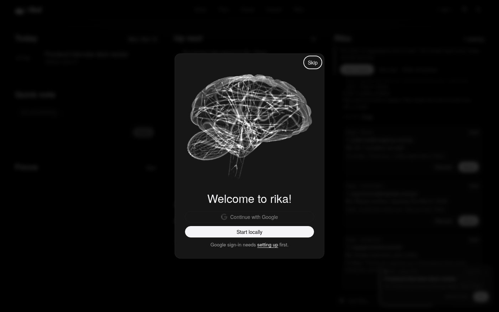
</p>
<p align="center"><sub>First launch: one button to start locally. No account needed.</sub></p>

### Run from source

Requirements: Git, Python 3.12 with [uv](https://docs.astral.sh/uv/), Node 22+ and Rust (cargo).

```bash
git clone https://github.com/ZacharySF/kitty.git
cd kitty
uv sync
npm --prefix web ci
npm --prefix web run build
cargo build --release --manifest-path server/Cargo.toml   # rika-server, the local front
uv run kitty-web --demo
```

The demo uses a **disposable workspace with synthetic data**. Open the printed
`http://127.0.0.1:…` address, not `localhost`: the server checks the exact Host.

For a real workspace:

```bash
uv run kitty init
uv run kitty-web
```

The [full guide](docs/GUIDE.md) covers modules, the desktop build, configuration
and every command. The repository and CLI still use the `kitty` name.

<br>

## Under the hood

### Architecture

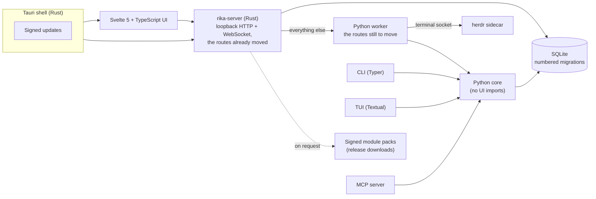

Two rules hold the layout together. Nothing under `src/kitty/core/` imports a UI
framework, so the website, desktop app, CLI, TUI and MCP server all call the
same functions against the same database. And the core is moving to Rust one
route at a time: a route moves only with a test that it answers exactly as the
Python it replaces ([how, and what stays in Python](docs/rust-core-design.md)).

### Engineering notes

**Your data**

- **Edits are never silently lost.** Pages, folders and block outlines carry a revision;
  a save against a stale revision is rejected, and a second window editing the
  same note offers *Load latest* or *Keep mine* instead of overwriting.
- **References point at rows, not copies.** Block references resolve the
  authoritative block at read time, with parent-cycle checks and bounded
  expansion.
- **History is append-only where it matters.** Application status changes are
  events; undo appends a reverting event instead of rewriting history.

**Security and shipping**

- **The local server is not an open door.** It binds to loopback, checks the
  exact Host and Origin, requires a custom header on every mutation, and requires
  a per-launch secret only rika!'s own windows hold on every API call and
  WebSocket, so a local program that forges the headers still gets nothing.
- **Downloads are checked twice.** A pack is fetched only from the release of the
  running version, against a list signed with the updater key, then against its
  size and SHA-256; a failed download changes nothing.
- **It ships.** Tauri builds signed Linux installers in CI and the app updates
  itself, including through an `appimage-run` launcher on NixOS.

**Rust and Python**

- **Rust where it pays.** Calendar, search, goals, study, flashcards, mind maps,
  backlinks, opportunities and settings are answered by rika-server; the
  flashcard scheduler is an exact port, checked against the Python one card by
  card. What leans on Python's own libraries (math checking, job scraping, form
  filling) stays there.
- **Browser automation without a framework.** ApplyAI drives Firefox through its
  own WebDriver BiDi client and stops at every human boundary: sign-in
  challenges, consent, unknown answers and the final submit.

### Develop

```bash
uv run pytest -n auto                           # Python core, web adapter, TUI
cargo test --manifest-path server/Cargo.toml    # rika-server
cargo test --manifest-path desktop/Cargo.toml   # the desktop shell
npm --prefix web run check                      # svelte-check / TypeScript
```

The browser tests in `web/tests/*.browser.test.mjs` drive a real Chromium against
the demo; run them one file at a time. CI runs the Python tests, the frontend
check and the web unit tests on every pull request. The README's screenshots come
from the demo through [`scripts/screens/`](scripts/screens/README.md).

<br>

## Reference

| Looking for… | Start here |
| --- | --- |
| Setup, configuration and everyday use | [Full guide](docs/GUIDE.md) |
| Exact behaviour and contracts | [Behaviour spec](docs/SPEC.md) |
| Building and publishing an add-on | [Module guide](docs/MODULES.md) |
| The move to Rust: rules, what is built, what stays | [Rust core design](docs/rust-core-design.md) |
| Rika: how she is put together | [Rika design](docs/rika-design.md) |
| Why the interface looks the way it does | [Design decisions](docs/design-decisions.md) |
| Linux installers and release notes | [Desktop releases](https://github.com/ZacharySF/rika/releases/latest) |

## Built on

rika! integrates these projects rather than reimplementing them; credit for
their features belongs to their authors.

| Project | Licence | What it does here |
| --- | --- | --- |
| [herdr](https://github.com/herdrdev/herdr) | Apache-2.0 | The terminal multiplexer behind the Terminal module, downloaded as a pack at a pinned version. |
| [LearnHarness](https://github.com/amosblomqvist/learnharness) | AGPL-3.0 | The upstream learning app opened from Study, run as a separate local server in a cross-origin frame. Its licence and corresponding source ship in its pack. |
| [Grinstead and Snell's *Introduction to Probability*](https://math.dartmouth.edu/~doyle/docs/prob/) | GNU FDL | Its exercises, used as a textbook source in Math, ship with their licence and source note in `third_party/grinstead-snell/`. |
| [Tauri](https://tauri.app), [Svelte](https://svelte.dev), [Textual](https://textual.textualize.io), [3d-force-graph](https://github.com/vasturiano/3d-force-graph) | MIT (Tauri: MIT or Apache-2.0) | The desktop shell, the interface, the TUI and the 3D graph views. |

The README wordmark uses [Fraunces](https://fraunces.undercase.xyz), by Undercase
Type, with a subset embedded under the [SIL Open Font License](docs/assets/OFL-Fraunces.txt).

## License

[MIT](LICENSE). Bundled third-party components keep their own licences.
