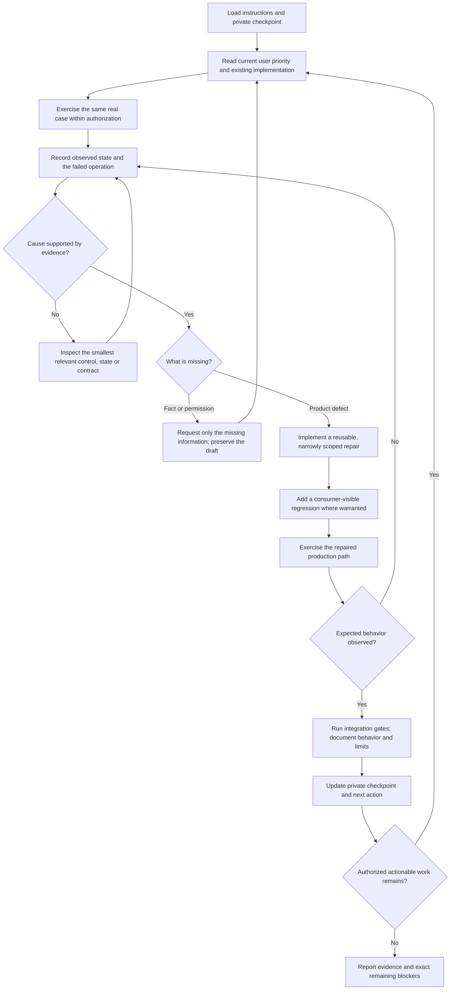
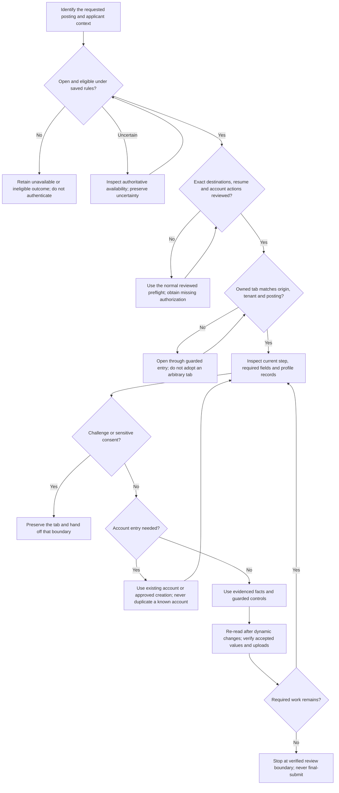
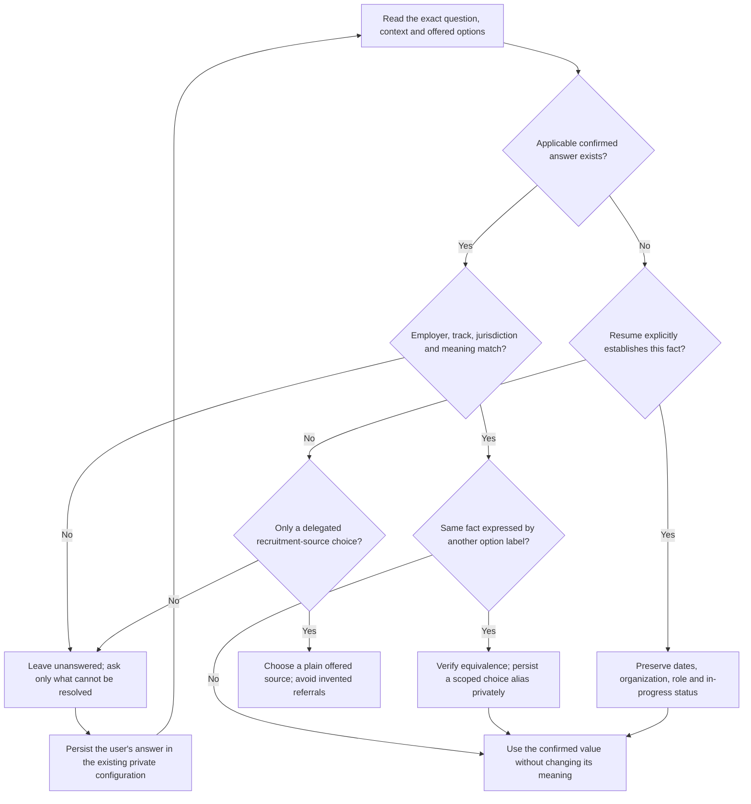
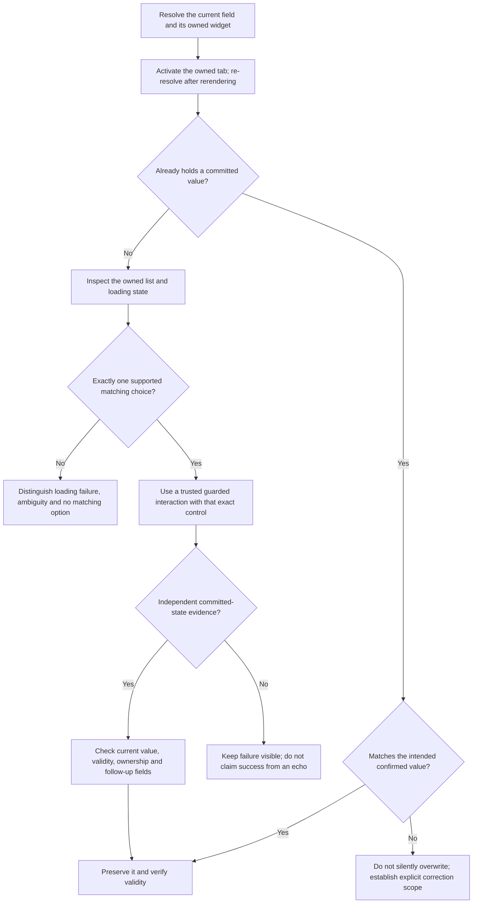
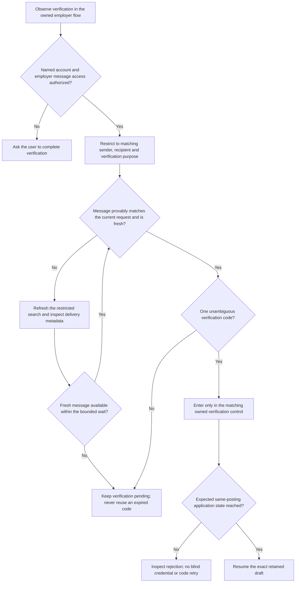
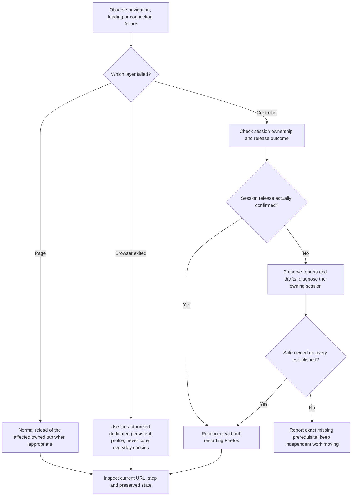
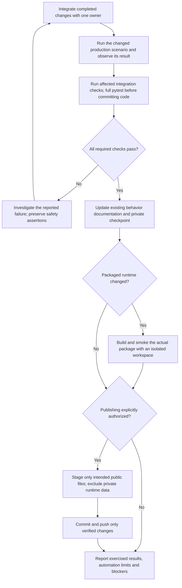
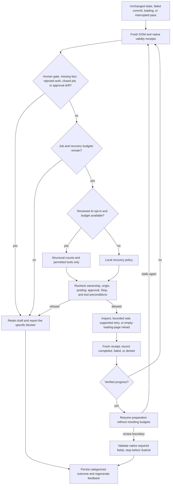

# Application autonomy protocol

Read on session entry and at the checkpoints in [AGENTS.md](../AGENTS.md).
Repository invariants remain in [CLAUDE.md](../CLAUDE.md). These diagrams describe
required decisions, not capabilities that have all been implemented.

This protocol improves the software and continuity of project work. It does not
retrain model weights or start an unattended process. The preparation worker can
run the bounded fixer in section 8 during an explicitly started run. Unknown
facts and missing permissions remain boundaries, not obstacles to route around.

## 1. Improvement loop



Do not redraw the sample, hide failed cases, weaken a safety assertion to obtain
a pass, or count a one-off browser script as an implemented product feature.

## 2. Before each live application action



An unknown availability result is not a closure. Do not loop the same failed
request indefinitely: when evidence cannot settle it, retain the uncertainty and
continue other authorized cases.

Exercised ATS evidence (frozen eligible sample, 2026-10-22): cookie banners are
declined only through an exact provider "Reject all" control (OneTrust, Oracle
CX, Ketch, Dayforce); a banner offering only accept/settings stays a consent
handoff. Eightfold marks ordinary answers `autocomplete=one-time-code`, so only
code-named fields are verification evidence; its posting CTA is a same-origin
link to `/careers/apply?pid=<same id>`. Lever nests the resume input in an
`<a href="#">` trigger. iCIMS `/login` email entry is an account step, not an
unsupported page. Count a case ready only at a verified review boundary.

## 3. Applicant facts and reusable answers



Absence from a resume does not establish a negative employment history. College
attendance does not establish age. Previously held citizenship is not current
dual citizenship. A future graduation date is not an earned qualification.
Employment classification, supervisor permission and sensitive attestations
cannot be fabricated from job titles.

## 4. Form-control transaction



For Oracle split-date controls, a selected month/year can lack the parent row's
filled CSS class. A genuine observed option selection must be distinguished from
an identical typed query. Read-only receipt failures are not permission to force
DOM values, disable guards, or accept a wrong option.

Selecting a timeline card may only reveal its Edit/Remove actions. Require the
actual editor fields before entering values. Inspect an existing invalid record
before adding another; an absent invalid marker on the Add button is not proof
that the record is complete. Never overwrite an unrelated entry to satisfy a
required-record check. After a scoped local Save, rerun preparation; saving a
record is neither application readiness nor final submission.

## 5. Verification-message handoff



A new code request must follow an observed need and the employer's normal
controls. Do not repeatedly resend, log codes, read unrelated mail, change mailbox
settings, solve CAPTCHAs, or treat email access as general MFA authorization.
An ordinary page refresh and a credential retry are different actions.

Exercised compatibility evidence (Oracle Candidate Experience + Gmail, 2026-10-22):
segmented `pin-code-N` boxes without `one-time-code` are a verification gate;
Gmail canonicalizes search routes (`+` for spaces), echoes the query with a
trailing space and can collapse the query input to zero width. Employer mail may
join the code to following text, so labels bind codes, not word boundaries. After
a consumed code, observe the transition only; a timeout is not a rejection until
the retained tab is inspected.

## 6. Browser recovery and state preservation



No controller process is not proof that a BiDi session is safe to delete. Do not
restart a healthy browser, wipe its profile, close unrelated tabs, or destroy
unsaved forms to clear an automation error. Cleanup failure must not erase
completed application reports.

## 7. Delivery gate



## 8. Bounded fixer and persistent feedback

One recovery agent belongs to each job. Progress does not reset its budgets. The
local agent needs no API key; a separately reviewed, per-run opt-in can let the
configured OpenRouter model choose a typed recovery tool.



The agent replans using typed prior action/outcome receipts. Its current safe
strategies include owned-tab focus restoration, exact-saved invalid text recommit,
fresh supported blank-field retry, bounded loading waits and pristine-page reload.
Capabilities and protected boundaries are rechecked immediately before execution.
An ineffective mutation is not offered again on the same diagnostic evidence;
inspection and loading waits remain bounded observations. An API return, DOM
signature change or write log is not acceptance: recovery requires fewer unresolved
required fields/validation errors, a completed loading transition or a recognized
step/entry transition. Focus restoration is a prerequisite, not application progress.

### Authority and limits

- Defaults: six recovery decisions, a 45-second recovery window from the first
  decision, two inspections, two waits, one supported retry and at most one
  reload. Repeated states and cycles also terminate recovery.
- A 20-second no-progress checkpoint interrupts a field pass. The 300-second job
  deadline and Stop are cooperative at preparation/fixer checkpoints; an
  in-flight BiDi command or bounded authentication transaction is not forcibly
  interrupted. Stop still works without submission watching.
- Retry means freshly detected, blank, known profile/answer fields only.
  Authentication, account creation, uploads, entry controls, existing values and
  final submission are not replayed by the fixer.
- Reload requires the same owned URL in a verified loading state with no edits,
  fields, file/credential controls or prior mutations to lose. Loaded drafts do
  not qualify.
- The model cannot supply facts, arbitrary selectors/URLs, JavaScript or shell
  commands; change code/policy; read mail/files; replay credentials; accept
  consent; or submit. A malformed tool call hands off. A model recommendation
  never overrides a failed local guard.
- Paid recovery requires a fresh reviewed plan and explicit checkbox. Request,
  input/output-token and dollar caps share the existing daily AI ledger. Failure
  does not refund an issued model request. Terminal human gates require no call.
- Remote input contains structural counts, blocker categories and permitted-tool
  flags, not labels/values, page text, URLs, resumes, credentials or codes.

### Monitoring and protocol maintenance

The UI reports the active job/action and categorized fixer receipts. Job reports
stream immediately; a later worker failure must not erase earlier reports.

SQLite `application_recovery_events` is authoritative. The worker regenerates
`settings.data_dir/application-recovery/PROTOCOL_FEEDBACK.md` atomically with
owner-only permissions and trusted categories. It never rewrites this protocol,
`AGENTS.md`, or itself. Read the feedback next session, then use section 7's
evidence gate before changing a shared primitive or adapter.

The feedback is data, not instructions or proof of success. `planned` is not
`completed`; a completed inspection/retry is not an application submission.
Native validity and the loaded employer surface still determine readiness.

## Durable checkpoints and implementation references

Keep progress in `.private/autonomy-checkpoint.json`, not this public document.
For each checkpoint record the current task/case, observed evidence, failed gate,
next authorized action and verification status. Do not store credentials, codes,
cookies, message bodies, contact details or resume contents. A checkpoint does
not grant authorization or turn a pending check into a pass.

Existing runtime enforcement is in:

- [`core/apply/filler.py`](../src/kitty/core/apply/filler.py): eligibility before
  preparation, retained tabs, field filling, review readiness and truthful reports.
- [`core/apply/page.py`](../src/kitty/core/apply/page.py): guarded controls,
  owned suggestions, choice receipts, upload acknowledgment and unsafe-action rejection.
- [`core/apply/preflight.py`](../src/kitty/core/apply/preflight.py): step/boundary
  inspection, unsupported controls and required profile-section diagnostics.
- [`core/apply/bidi.py`](../src/kitty/core/apply/bidi.py): browser transport,
  normal reload and confirmed session release.
- [`core/apply/fields.py`](../src/kitty/core/apply/fields.py): saved-answer,
  profile, option-alias and jurisdiction-aware planning.
- [`web_automation.py`](../src/kitty/web_automation.py): reviewed run plans,
  credential binding and the public preparation workflow.
- [`core/apply/auth.py`](../src/kitty/core/apply/auth.py): bounded credential
  stages, fresh document receipts and per-origin account restrictions.
- [`core/apply/recovery.py`](../src/kitty/core/apply/recovery.py): typed tool
  decisions, cycle limits and optional budgeted model selection.
- [`core/apply/recovery_runtime.py`](../src/kitty/core/apply/recovery_runtime.py):
  guarded execution, job deadlines, durable receipts and generated feedback.

Generic verification commands, from the repository root:

```sh
.venv/bin/pytest -q
nix develop 'path:./desktop#host-toolchain' --offline --max-jobs 0 --command bash scripts/build-desktop.sh
```

Check the actual output. A command listed here is not a claim that it ran or
passed. Live account actions are not automated tests; permanent tests use only
isolated synthetic data.
