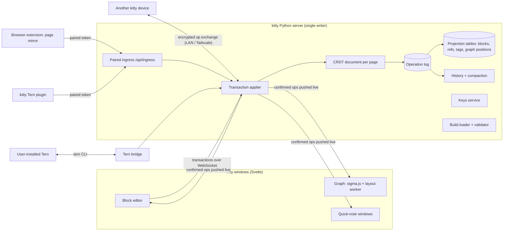
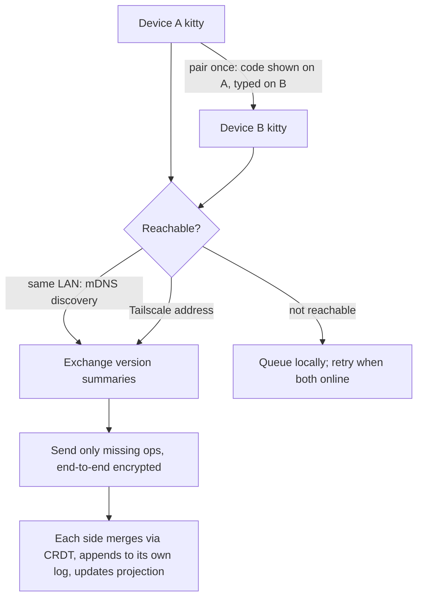

# kitty! platform design: block backend, sync, Tern, builds, keys, web mirror, tags

This document records the outcome of a design interview held on 2026-10-31. kitty! keeps its
current stack (Svelte 5 + TypeScript, Tauri, a Python server, SQLite). It adopts the parts of
Notion's architecture that make a local-first app better:
- one universal block model;
- server-applied transactions;
- an append-only operation log with version history;
- live push to every window.

It adds peer-to-peer CRDT sync across one person's devices. It rejects the parts that solve
multi-tenant cloud problems kitty does not have: Postgres sharding, Redis, S3, a Node service,
and a React rewrite. The Tern bridge is built and merged (pull requests #21 and #33 into
`feat/desktop-releases`). Everything else is designed but not started. Build order is in
[Build order](#build-order). Edits from different devices are merged with Loro (Q5).

## Terms

- **block**: the one record type for content: id, type, properties, parent, order key. A page is a block whose children are blocks, as in Notion's data model. *Avoid:* node, element, row.
- **page**: a block of type `page`; opening it shows its child blocks. *Avoid:* document, note.
- **operation**: one atomic change to one block (set a property, move, insert text). The operations made by one user action form a **transaction**. *Avoid:* event, mutation, patch.
- **operation log**: the append-only list of every transaction, stored in SQLite and never rewritten. It powers version history, point-in-time restore and sync. *Avoid:* event store, journal, history table.
- **projection**: ordinary SQLite tables (blocks, refs, tags, graph positions) rebuilt from the operation log, so search, backlinks and the graph stay fast to read. *Avoid:* cache, view, materialization.
- **build**: a shareable, versioned file describing one person's kitty: modules, settings, theme, layout, dock and graph preferences, and custom CSS. It never contains notes or keys. *Avoid:* config, profile, preset, dotfile.
- **Tern bridge**: kitty driving a user-installed Stencil Tern through Tern's own command line. kitty never ships Tern. *Avoid:* Tern backend, Tern embed.
- **kitty Tern plugin**: a Luau plugin installed into Tern that shows kitty notes and tasks inside Tern and sends captures back to kitty. *Avoid:* Tern extension, Tern add-on.

## Why

The user, in their own words: kitty should be "something that really impresses notion senior
engineers". Concretely, that means:
- Adapt Notion's atomic block backend ("everything is atomic and you can upgrade from there").
- Add Stencil's Tern.
- Let people share their exact kitty build "like nixos".
- Let people live-edit their kitty and see it change.
- Store keys for apply-ai and any AI use.
- Mirror the website they are on into kitty to take notes on it.
- Later, add a browser pop-up for notes.
- Auto-attach tags when a keyword appears.

Hard rule from the user: "dont adapt any of these if it makes kitty worse". Explicit decision:
**do not rewrite kitty in React; keep Svelte.**

### What kitty is today (verified in the code)

- **Server and push:** the Python standard-library HTTP server on `127.0.0.1` is the only process that writes to SQLite (WAL mode, one global mutation lock). The terminal WebSocket is the only push channel; every other view polls.
- **Notes are stored four ways:**
  - `note_blocks`: UUID, `parent_id`, an integer `ordering` renumbered on every edit, and no type;
  - a canvas JSON blob in `note_pages.document`;
  - Markdown `documents`;
  - `quick_notes`.
- **Saving an outline** deletes and re-inserts every block on the page (`src/kitty/core/note_blocks.py:66-97`). There is no note history.
- **Settings were spread across** (before builds, Q8):
  - `config/modules.yaml` (restart required);
  - browser `localStorage` (theme, dock, graph);
  - SQLite rows (AI, notes, study);
  - hard-coded themes (`web/src/lib/themes.ts`).
- **Keys:**
  - OpenRouter comes from an owner-only `.private/openrouter-key` file or an environment variable.
  - Anthropic, USAJOBS and Brave come only from environment variables.
  - There is no keyring.
- **Graph:** Canvas 2D with d3-force on the main thread, plus optional 3D through `3d-force-graph`. Capped at 180 atlas nodes per section and 300 nodes per mind map.
- **Request guard:** checks exact Host and Origin plus an `X-Kitty-Request` header. This stops web pages but not local programs. (Since closed for `/api`: see [UI secret: what was built](#ui-secret-what-was-built).)

### Notion facts that shaped the design (primary sources)

- **Data model:** one block record with `type`, `properties`, `content` (child ids) and `parent`. "Turn into" changes only `type`. ([data model](https://www.notion.com/blog/data-model-behind-notion))
- **Write path:** the client turns a user action into operations grouped as a transaction, applies it locally, queues it, and sends it to `/saveTransactions`. The server checks and commits it, then pushes new versions over a WebSocket.
- **Single writer:** "only a single parent process ever writes to SQLite" on desktop. ([WASM SQLite](https://www.notion.com/blog/how-we-sped-up-notion-in-the-browser-with-wasm-sqlite))
- **Conflict handling:** last-write-wins per block until July 2025. Since then, an in-house CRDT (RGA plus Peritext) handles text only. ([CRDT post](https://www.notion.com/blog/how-notion-handles-concurrent-editing-with-crdts))
- **History:** Notion keeps scheduled version snapshots, not a replayable log of every edit. Linear is the example of an append-only sync log.
- **Infrastructure kitty does not need:** Postgres sharding by workspace, Redis (used as a task queue), and the S3 data lake. All of them solve multi-tenant scale.

## Architecture overview



### Write path for one edit

```mermaid
sequenceDiagram
  participant W as Window (editor)
  participant S as kitty server
  participant D as SQLite
  participant O as Other windows
  W->>W: echo keystroke locally (pending)
  W->>S: transaction {ops, base version} over WebSocket
  S->>S: apply to page CRDT, check cycles/limits
  S->>D: BEGIN; append op log row; update projection; COMMIT
  S-->>W: ack (seq) — pending cleared
  S-->>O: push ops (seq)
  Note over S,D: later: peer sync sends ops after the peer's last seq
```

### Sync between devices



## Locked decisions

### Q1: Adding Tern means the Tern bridge plus a kitty Tern plugin

| Option | UX | Correct | Risk | Cost |
|---|---|---|---|---|
| A. Tern bridge only | mixed | good | good | good |
| **B. Tern bridge plus kitty Tern plugin** | **good** | **good** | **mixed** | **good** |
| C. Tern replaces herdr when installed | mixed | mixed | poor | good |
| D. Embed Tern's web client in an iframe | poor | poor | poor | poor |

**Decision: B.** The two parts work in opposite directions:
- **Bridge (kitty → Tern):** kitty detects a user-installed `tern` (`$KITTY_TERN` or PATH) and drives a dedicated Tern session named `kitty` through Tern's command line.
- **Plugin (Tern → kitty):** the plugin, kept in kitty's repo under `integrations/tern/` and installed with `tern plugin link`, adds a kitty Inbox block and palette commands such as "Capture pane or browser selection to a kitty note".

herdr stays the bundled in-window terminal. Risk: Tern is a beta, so every Tern feature must disappear cleanly when `tern` is absent or misbehaves.

Why the alternatives lost:
- **A:** one-way only.
- **C:** takes the in-window terminal away from anyone who has Tern installed.
- **D:** cannot run at all. Tern's web client requires WebGPU, and `navigator.gpu` was missing in kitty's WebKitGTK 2.54.1 window even with the flag forced. It also downloads a 68 MB wasm from build.stencil.so.
- **Bundling Tern in any form:** Tern is proprietary and its terms forbid providing it to third parties.

**Status: built.** The bridge is merged (#21, #33; see [Verified facts](#verified-facts)), pairing (Q7) is built (see [Pairing (Q7): what was built](#pairing-q7-what-was-built)) and so is the plugin (see [Tern plugin (Q1): what was built](#tern-plugin-q1-what-was-built)).

### Q2: Sync is offline-first and peer-to-peer between one person's devices

| Option | UX | Correct | Risk | Cost |
|---|---|---|---|---|
| **A. Peer-to-peer, offline-first** | **good** | **good** | **mixed** | **good** |
| B. One home kitty orders every change | mixed | good | good | good |
| C. Several people, hosted server | good | mixed | poor | poor |
| D. No sync yet | poor | good | good | good |

**Decision: A.** Any kitty syncs with any other kitty, and offline edits on both sides merge
deterministically. There is no kitty-hosted cloud. Risk: a CRDT library and a second
representation of each page. The mitigation is that the operation log is append-only and every
page can be restored.

Why the alternatives lost:
- **B:** makes one machine special.
- **C:** needs accounts, permissions and hosting. It remains reachable later on the same design.
- **D:** delays the hard problem the user cares about most.

### Q3: Everything is a block, including every canvas element

| Option | UX | Correct | Risk | Cost |
|---|---|---|---|---|
| **A. Everything, including canvas elements** | **good** | **mixed** | **poor** | **mixed** |
| B. Text content only; a canvas is one block | good | good | mixed | good |
| C. Keep separate tables; add a type column | mixed | mixed | good | good |

**Decision: A** (chosen against the recommendation of B). Pages, outline items, documents,
quick notes and every canvas element (sticky, shape, text box, image, ink) become rows of one
typed block table with a fractional order key. Canvas elements carry `x`, `y`, `w`, `h`,
`rotation` and `z` as properties.

What it costs, and the required mitigations:
- **Migration:** it is a one-way migration of every note. It ships with a reversible JSON export and a migration test on synthetic data.
- **Ink volume:** dense ink adds row volume. Q18 bounds it by grouping strokes.
- **Graph noise:** the graph filters canvas geometry out by default.

Why the alternatives lost: B kept freeform geometry out of the tree, but the user wants one
uniform model. C leaves the content silos in place.

### Q4: Keep Svelte; no React rewrite

| Option | UX | Correct | Risk | Cost |
|---|---|---|---|---|
| **A. Keep Svelte 5 + TypeScript + Tauri** | **good** | **good** | **good** | **good** |
| B. Rewrite in React | mixed | mixed | poor | mixed |

**Decision: A**, stated directly by the user. Nothing in Notion's block model, sync or offline
design depends on React.

### Q5: Loro merges the blocks

| Option | UX | Correct | Risk | Cost |
|---|---|---|---|---|
| **A. Loro: one document per page; LoroTree for structure, maps for properties, rich text** | **good** | **good** | **mixed** | **good** |
| B. Yjs (pycrdt) with hand-written parent/order and cycle check | good | mixed | mixed | good |
| C. Automerge 3 | good | mixed | poor | mixed |
| D. kitty's own CRDT | good | mixed | poor | good |

**Decision: A** (user, after Finish). Loro is the only option with a proven tree move
(Kleppmann's move operation, cycles refused) and fractional sibling order built in, plus
history and checkout that back version history and point-in-time restore. Its Python package
(`loro` 1.17) runs inside kitty's server next to SQLite. Risk: kitty's on-disk sync format
follows Loro's. Mitigation: the SQLite projection and the JSON export stay readable without
Loro, and the server wraps Loro behind a small `PageDoc` interface.

Why the alternatives lost: B makes kitty re-implement tree moves; C's Python package is
pre-release (stable PyPI 0.1.2); D is months of correctness work Loro already proves.

### Q6: The local kitty server applies every edit

| Option | UX | Correct | Risk | Cost |
|---|---|---|---|---|
| **A. Server applies; windows send transactions over WebSocket** | **good** | **good** | **good** | **good** |
| B. Each window runs the CRDT in WebAssembly | good | mixed | mixed | mixed |
| C. Both | good | mixed | mixed | poor |

**Decision: A.** This keeps a single writer, as Notion does on desktop. On loopback a round trip
is about 1 ms, and the editor echoes keystrokes locally until the server acknowledges them. It
also replaces kitty's polling with live push to every window, quick notes included. Weakest
point: a window cannot edit while its server is down, which cannot happen in the desktop app.

Why the alternatives lost: B and C add a WebAssembly CRDT of about 1 MB to every window and
bring back multiple writers.

### Q7: Outside programs reach kitty by pairing

| Option | UX | Correct | Risk | Cost |
|---|---|---|---|---|
| **A. Pairing with revocable, scoped tokens** | **good** | **good** | **good** | **good** |
| B. Fixed port and one shared secret | good | mixed | poor | good |
| C. No network ingress (CLI and native messaging) | mixed | good | good | mixed |

**Decision: A.**
- kitty writes its current address to an owner-only `.private/endpoint.json`.
- A client requests pairing and the user approves it in kitty.
- The client receives a revocable token limited to scopes such as `capture` and `read`.
- Settings lists paired clients and can revoke each one.
- The ingress lives under its own route prefix (`/api/ingress/*`), separate from the browser-only guard.
- Extensions call it only from background or side-panel pages, never from content scripts (Chrome Local Network Access rules).

The same mechanism pairs devices for sync (Q16).

**Status: client pairing is built** (see [Pairing (Q7): what was built](#pairing-q7-what-was-built)); device pairing is built with peer sync (see [Build step 3: what was built](#build-step-3-what-was-built)).

Why the alternatives lost:
- **B:** any local program could impersonate any client.
- **C:** native messaging needs Home Manager packaging per browser on NixOS.

### Q8: A build is one file, shared as a file or link, with diff and rollback

| Option | UX | Correct | Risk | Cost |
|---|---|---|---|---|
| **A. One schema-versioned build file** | **good** | **good** | **good** | **good** |
| B. A Nix flake per build | poor | good | mixed | good |
| C. Hosted gallery with accounts | good | mixed | poor | poor |

**Decision: A.** `kitty-build.json` holds:
- the schema version and the kitty version it was made with;
- enabled modules;
- every setting, including history retention (Q20) and the tag mode (Q13);
- theme tokens;
- dock and graph preferences;
- Tern plugin on or off;
- custom CSS (Q9).

It never contains notes, keys, tokens or personal data. Installing:
- fetches a local file or an `https` link (a gist or repo raw URL);
- validates it against the schema;
- shows a diff of what changes;
- applies it in one step;
- keeps the previous build for one-click rollback.

Settings now in `localStorage` and scattered SQLite rows move into the build, so they survive a
browser profile and become shareable.

Why the alternatives lost: B shuts out non-Nix users. C means operating a service. A static
gallery page that lists build links can be added later.

**Status: built** (see [Builds (Q8/Q9): what was built](#builds-q8q9-what-was-built)).

### Q9: Live configuration: the build file is live, including custom CSS and theme tokens

| Option | UX | Correct | Risk | Cost |
|---|---|---|---|---|
| A. The build file is live | good | good | good | good |
| **B. A plus live custom CSS and theme tokens** | **good** | **good** | **mixed** | **good** |
| C. B plus user scripts | good | mixed | poor | good |

**Decision: B.**
- The user can edit the build file in a split pane inside kitty, or in any editor; kitty watches the file.
- Every save is validated and pushed over the WebSocket to all windows.
- An error shows inline with its line number, and kitty keeps the last good build.
- The Settings screens edit the same file.
- Custom CSS and theme tokens restyle kitty as the user types.
- A safe-mode shortcut and launch flag load kitty without custom CSS.
- Module changes still require a restart, and the live view says so.

Why C lost: a shared build that runs scripts could steal notes and keys. Scripts need a sandbox
and a permission model before they are safe.

**Status: built** (see [Builds (Q8/Q9): what was built](#builds-q8q9-what-was-built)).

### Q10: Keys live in one kitty Keys service

| Option | UX | Correct | Risk | Cost |
|---|---|---|---|---|
| **A. kitty Keys service: OS keyring, then owner-only file; inject per command** | **good** | **good** | **good** | **good** |
| B. automic-vault only | poor | mixed | poor | good |
| C. kitty's own encrypted vault with a passphrase | mixed | mixed | mixed | good |

**Decision: A.** `src/kitty/core/keys.py` holds named secrets (openrouter, anthropic,
usajobs, brave, and user-defined ones).
- **Storage, in order of preference:**
  1. the OS keyring through Secret Service (KeePassXC or gnome-keyring), via Python `keyring`;
  2. the existing owner-only `.private/` file;
  3. environment variables.
- **Consumers:** every current consumer (`web_ai._key`, `triage/openrouter._key`, the Anthropic client) reads through it. apply-ai and any AI feature use it.
- **Keys screen:** shows only whether each key is set and where it is stored, never the value.
- **Other programs:** `kitty keys run +OPENROUTER -- command` injects the key into that one command's environment, following automic-vault's model.
- **macOS:** automic-vault never returns a secret to an app, so it is not a storage backend; it is documented as a launch wrapper whose injected variables reach kitty as environment variables (storage 3). macOS is not implemented or tested.

Verified fact: automic-vault is macOS-only (Keychain, Touch ID, code signing) and deliberately
never returns a secret to an app.

Why the alternatives lost: B breaks kitty on Linux. C makes kitty own its cryptography and a
passphrase prompt.

Built (Keys step):
- `kitty.core.keys` resolves keyring → file → environment. The keyring is the `keyring` package's Secret Service backend, used directly rather than through `keyring`'s backend auto-selection (MIT; its dependencies SecretStorage, jeepney and jaraco.* are BSD/MIT, and `cryptography` was already locked). Entries are filed under the Secret Service attribute `service=kitty`; only those are ever searched. No `secret-tool` binary is needed. `KITTY_KEYRING=none` turns the keyring off (tests always do).
- Files: OpenRouter keeps `.private/openrouter-key`; other keys use `.private/keys/<NAME>`. Owner-only (600/700), `O_NOFOLLOW`, symbolic links refused. Setting a key in the keyring removes a stale file copy; **Move to keyring** verifies the keyring copy before deleting the file.
- Consumers: `web_ai`, `triage/openrouter`, `triage/run.make_client` (Anthropic now gets `api_key` explicitly; `Settings.anthropic_key_set` is gone), the USAJOBS and Brave adapters and `kitty doctor` (`key/<NAME>` checks). USAJOBS and Brave error text is redacted with the key value. `USAJOBS_EMAIL` stays an environment setting: it is an identifier sent as the User-Agent, not a secret. `.private/application-credentials.env` is unchanged.
- Settings → Keys (`web_keys.py`: `GET /api/keys`, `POST /api/keys/set|remove|move`) and `kitty keys list|set|remove|move|run`. `run` replaces itself with the command (`execvpe`), with the named keys added and kitty's other known keys removed from the command's environment. Demo mode uses only its throwaway files.

### Q11: The website you're on appears in kitty as a live page mirror from your everyday browser

| Option | UX | Correct | Risk | Cost |
|---|---|---|---|---|
| **A. Extension streams the current tab to kitty** | **good** | **good** | **mixed** | **good** |
| B. kitty opens the site in its remote-controlled Firefox | mixed | good | mixed | good |
| C. Real video through the Wayland screencast portal | mixed | mixed | mixed | poor |

**Decision: A.** The feature is feasible as a mirror rather than video. A kitty extension sends
the current tab to kitty over the paired ingress (Q7):
- URL and title;
- readable text (Defuddle or Readability);
- the current selection;
- a JPEG from `tabs.captureVisibleTab` every few seconds and on scroll (Chrome caps it at 2 per second).

kitty shows the mirror in a pane beside a note. Clicking a passage quotes it into the note as a
block that links back to the URL.

Privacy rules:
- Mirroring is off until the user turns it on for a tab.
- Banking and password pages are never sent by default (a deny list plus password-field detection).
- Screenshots are kept only when quoted or pinned. As built, a screenshot is never kept: frames live in kitty!'s memory and only quoted text becomes a block (see [Browser mirror (Q11/Q12): what was built](#browser-mirror-q11q12-what-was-built)).

**Status: built** (with Q12), see [Browser mirror (Q11/Q12): what was built](#browser-mirror-q11q12-what-was-built).

Why the alternatives lost:
- **B:** kitty's apply-ai Firefox is isolated for job sites by repo rule.
- **C:** gives pixels with no URL or text. WebKitGTK cannot capture the screen, and a Rust PipeWire pipeline is costly.

### Q13: Tag keywords: suggest, or always attach, chosen in a setting

| Option | UX | Correct | Risk | Cost |
|---|---|---|---|---|
| **A. Suggest, with opt-in auto-attach** | **good** | **good** | **good** | **good** |
| B. Always attach automatically | mixed | poor | mixed | good |
| C. Only after the fact, on the tag page | mixed | good | good | good |

**Decision: A, extended at the user's request.** A global Tags setting has two modes:
- **Suggest** (the default for new installs): matching keywords get a faint underline, and Tab or a click attaches the tag.
- **Always attach:** every keyword match attaches immediately.

Each tag can override the global mode in either direction.

How tags are stored and matched:
- A tag is a block of type `tag` holding its keywords and aliases. A tagged block shows on the tag page as a backlink.
- Matching uses one Aho-Corasick pass on casefolded whole words. It skips code, URLs and existing `#tag`/`[[link]]` tokens, and by default ignores keywords shorter than 3 characters. It runs debounced on the server when a transaction is applied.
- Automatic attachments are marked `auto`. Removing one is remembered per block and tag, so it never re-attaches.
- Each tag page lists the remaining unlinked mentions, with "Link all".

Why the alternatives lost: B with no per-tag escape hatch floods the graph with false links. C
misses the moment of writing.

Built (auto-tags step):
- **Records** (`src/kitty/core/blocks/tags.py`, routes in `web_tags.py` under `/api/tags`): a tag is a root block of type `tag` whose text is its name, with `keywords`, `aliases`, `mode` (`suggest`/`always`, absent to follow the setting) and `short` (match terms under 3 characters) as properties. Names and aliases are unique (casefolded) and match like keywords; `#alias` tags like `#name`. Create, update, delete (to Trash), attach, remove and Link all are block transactions.
- **Attachments are block properties:** a block's state for one tag is `tag_<tag id without dashes>` = `manual`, `auto`, `accepted` or `rejected`, set with ordinary `set` operations, so they are in the op log, History and live push with no new operation kinds. Tag states, like view state, are not edits: they move neither the page `revision` nor `updated_at`, so a tag attached while someone types never causes a 409. Whole-page saves (`convert.sync_tree`) keep them.
- **Projection** (migration `039_block_tags.sql`): `block_tags` (block, tag, `source` manual/auto/accepted, `created_at`) and `tag_rejections` are rewritten by `store.transact` for the changed blocks, from their `tag_*` properties plus `#name` tokens (counted as `manual`; `block_topics` is unchanged). When a tag record is created, renamed, re-aliased or trashed, its `#name` attachments are re-derived. The global mode (default `suggest`) is the build's `settings.tags.mode` (Q8); `tag_settings` holds its projection and a `vocabulary` counter every tag change moves. A `-- python after:` migration directive (new in the runner) runs the backfill after the tables exist: every existing `#name` became a tag record, spelled as first written, in one transaction.
- **Matching** (`autotag.py`, pure Python, no new dependency): one Aho-Corasick automaton over every live tag's terms, cached per database until the `vocabulary` counter moves. Text is casefolded once (with an index map when folding changes length, e.g. `ß`); a hit counts only on word boundaries and outside skipped spans: backtick and fenced code, inline-code marks (UTF-16 ranges converted to code points), `code` blocks, URLs, e-mail addresses, and `#tag`, `[[page]]`, `((ref))`, `{{embed:ref}}` tokens. Only text-flow blocks of note pages are tagged (not page roots, documents, quick notes, canvas elements or a tag's own page).
- **On the transaction path** (`tagging.py`): after a transaction's operations are applied, each changed block is scanned; *always* tags it does not carry (and never rejected) are attached as `auto` inside the same transaction, and `auto` tags whose words are gone are dropped (no rejection). The editor's socket transactions also return `suggestions` (`{block: {text, items: [{tag, name, start, end}]}}`, UTF-16 offsets) for *suggest* tags; `GET /api/blocks/page` includes them for the whole page. The editor's own 250 ms typing debounce is the debounce: a transaction goes out when typing pauses.
- **Editor** (`BlockEditor.svelte`, logic in `blockTags.ts`): suggestions are underlined with the CSS Custom Highlight API (the contenteditable DOM is untouched) only while the block's text is the text they were computed for. With the caret on one, a pop-up offers **Tag #name** / **Ignore**; `Tab` attaches (`accepted`) and `Esc` ignores (`rejected`) via `blockKeymap.ts`. Attached tags show as chips (automatic ones dashed); `×` records `rejected`. `blockSync.ts` applies the server's `tagged` operations from the ack, since a window ignores the echo of its own transaction.
- **Tag pages** (`TagPage.svelte` in the Notes side panel; chips and `#name` clicks open it): tagged blocks (backlinks) with how they were attached, unlinked mentions (blocks whose words match but that neither carry nor rejected the tag) and **Link all** (`accepted`, in transactions of up to 2,000 blocks). **Settings → Tags** (`TagSettings.svelte`) holds the mode and every tag's keywords, aliases and override.
- **Cost** (measured by `tests/test_block_tags.py::test_perf_…`, 2,000-block page, 1,000-tag vocabulary with 3,000 keywords, this machine): a typing transaction takes 8.2 ms median (p95 9.6 ms) against 7.8 ms with tagging bypassed, so about 0.5 ms is tagging; one block scan is 28 µs; rebuilding the automaton after a tag change takes 15 ms; suggestions for the whole page (page load) take 73 ms on top of the 12 ms load.
- **Not done:** adding a keyword does not rescan existing blocks (their mentions wait on the tag page for Link all); suggestions refresh on this window's own transactions and page loads, not on other windows' pushes; typing a new `#name` does not create a tag record (it stays a topic, as before, until one is made, e.g. with **Make #name a tag**, which then picks up every `#name` already written).

### Q14: The graph reaches 10,000+ blocks at 60 fps with sigma.js and a layout worker

| Option | UX | Correct | Risk | Cost |
|---|---|---|---|---|
| **A. sigma.js (WebGL) plus ForceAtlas2 in a Web Worker, positions saved** | **good** | **good** | **good** | **good** |
| B. cosmos.gl (layout and drawing on the GPU) | good | mixed | mixed | good |
| C. kitty's own WebGL renderer | good | mixed | mixed | good |

**Decision: A.**
- Layout runs off the main thread.
- Settled positions are stored in a projection table, so reopening is instant and only changed blocks re-settle.
- WebGL draws the graph; WebGL2 is confirmed in kitty's window.
- 3D stays for small graphs.
- kitty ships a benchmark page with synthetic graphs of 1k, 10k and 50k nodes that reports frame times. No independent 10k-node, 60 fps benchmark exists, so kitty measures its own.
- The server caps of 180 and 300 nodes are lifted for this renderer.

Weakest point: CPU layout slows past about 100k nodes, where B would win.

Why the alternatives lost: B relies on float render targets untested on WebKitGTK and has
thinner labels and picking. C re-solves label rendering and picking.

### Q15: Version history keeps every transaction, then compacts

| Option | UX | Correct | Risk | Cost |
|---|---|---|---|---|
| A. Keep every transaction forever | good | good | good | good |
| B. Snapshots every few minutes | mixed | good | good | good |
| **C. Every transaction within a retention window, then daily snapshots** | **mixed** | **good** | **mixed** | **good** |

**Decision: C** (chosen over the recommended A). Within the window (30 days, Q20), every
transaction is kept for exact point-in-time restore. Older history is folded into one snapshot
per page per day.

The history panel:
- groups transactions into editing sessions per device;
- has a slider that previews the page at any moment;
- restores by appending a new transaction and never rewrites the past.

Deleted blocks and pages go to Trash, which follows the same window.

Compaction must not break sync. A peer whose last-seen sequence number is older than the
compaction horizon gets a full snapshot of the affected pages instead of individual operations.

Why the alternatives lost: A keeps unbounded data. B loses fine-grained restore for recent
work.

### Q16: Devices find each other directly after pairing

| Option | UX | Correct | Risk | Cost |
|---|---|---|---|---|
| **A. Direct and paired: LAN discovery or Tailscale, end-to-end encrypted** | **good** | **good** | **good** | **good** |
| B. A plus an optional self-hostable relay | good | good | mixed | mixed |
| C. Through a synced folder | mixed | good | mixed | good |

**Decision: A.**
- **Pairing:** two kittys pair once (a code shown on one is typed on the other) and exchange keys.
- **Discovery:** mDNS on the LAN, or a stored Tailscale address.
- **Exchange:** peers swap version summaries and send only the missing operations, encrypted end to end.

Weakest point: two devices that are never online at the same time. B's relay can be added later
without changing the protocol.

**Status: built** (see [Build step 3: what was built](#build-step-3-what-was-built)).

Why the alternatives lost: B needs a service to run. C hands trust and timing to the folder tool.

### Q17: The block editor is kitty's own Svelte block editor

| Option | UX | Correct | Risk | Cost |
|---|---|---|---|---|
| **A. kitty's own: one contenteditable per block** | **good** | **good** | **mixed** | **good** |
| B. ProseMirror/Tiptap, one document per page | good | mixed | mixed | mixed |
| C. Keep the textarea outline and add features | mixed | mixed | good | good |

**Decision: A.** Each block on screen is one block in the database, rendered as one small
contenteditable. Features:
- a shared selection and keyboard model across blocks;
- a drag handle on hover;
- drag and drop between any blocks and pages;
- a `/` menu, and "turn into" that changes only `type`;
- Markdown shortcuts as you type (`# `, `- `, `[] `, `---`);
- Esc to select blocks and Ctrl+Shift+arrows to move them;
- text batches sent as text operations.

Required browser tests: cross-block selection, IME composition, and copy/paste across blocks.

Why the alternatives lost: B fights the block model; ProseMirror treats a block split as
delete-plus-insert. C cannot show inline formatting.

### Q21: Build order: block backend first

| Option | UX | Correct | Risk | Cost |
|---|---|---|---|---|
| **A. Block backend, then editor, then peer sync, then graph; others slot between** | **mixed** | **good** | **good** | **good** |
| B. Pairing and website mirror first | good | good | good | good |
| C. Four parallel worktrees | good | mixed | mixed | good |

**Decision: A** (chosen over the recommended C). This avoids building the mirror and tags on the
old notes API and then moving them. See [Build order](#build-order).

## Routine choices

- **Q12, extension browsers:** Firefox (sidebar) and Chrome-family browsers (side panel), from one codebase using `webextension-polyfill`. The UI branches between `sidebar_action` and `chrome.sidePanel`. Firefox builds are signed as an unlisted add-on through Mozilla. Safari waits for a macOS kitty build. **Built** in `integrations/browser/` (signing is left to the owner; nothing is submitted).
- **Q18, ink:** strokes drawn together within a short burst (a few seconds) form one `ink` block, with points stored compactly as one property, written once when the burst ends.
- **Q19, publishing:** the repo stays private. Only the engineering blog post is published. It covers local persistence, the operation log, sync, and graph performance with real measured numbers.
- **Q20, retention window:** every transaction is kept for **30 days**, then compacted into daily snapshots. The value is a setting in the build file.

## Data model sketch

```sql
-- One table for all content (projection; rebuilt from the op log)
CREATE TABLE blocks (
  id TEXT PRIMARY KEY,               -- UUID v4
  type TEXT NOT NULL,                -- page, text, heading, todo, toggle, quote, code, image,
                                     -- document, quick_note, canvas, sticky, shape, ink, tag, ...
  parent_id TEXT REFERENCES blocks(id),
  order_key TEXT NOT NULL,           -- fractional index (rocicorp/fractional-indexing, Python port)
  properties TEXT NOT NULL,          -- JSON: title, checked, x/y/w/h, keywords, points, ...
  text TEXT NOT NULL DEFAULT '',     -- plain text for search/backlinks
  created_at TEXT, updated_at TEXT,
  deleted_at TEXT                    -- Trash
);
CREATE INDEX blocks_children ON blocks(parent_id, order_key);

CREATE TABLE op_log (                -- append-only
  seq INTEGER PRIMARY KEY AUTOINCREMENT,
  device_id TEXT NOT NULL,
  txn_id TEXT NOT NULL,
  page_id TEXT NOT NULL,
  at TEXT NOT NULL,
  ops BLOB NOT NULL                  -- CRDT update bytes + readable op summary
);
CREATE TABLE page_snapshots (page_id TEXT, day TEXT, state BLOB, PRIMARY KEY(page_id, day));
CREATE TABLE block_refs (source_id TEXT, target_id TEXT, kind TEXT, PRIMARY KEY(source_id, target_id, kind));
CREATE TABLE block_tags (block_id TEXT, tag_id TEXT, origin TEXT CHECK(origin IN ('manual','auto')),
                         PRIMARY KEY(block_id, tag_id));
CREATE TABLE tag_rejections (block_id TEXT, tag_id TEXT, PRIMARY KEY(block_id, tag_id));
CREATE TABLE graph_positions (block_id TEXT PRIMARY KEY, x REAL, y REAL, layout_version INTEGER);
CREATE TABLE peers (device_id TEXT PRIMARY KEY, name TEXT, public_key BLOB, last_seq INTEGER, address TEXT);
CREATE TABLE clients (id TEXT PRIMARY KEY, name TEXT, token_hash TEXT, scopes TEXT, created_at TEXT, revoked_at TEXT);
```

Migration: a new numbered migration creates these tables, and a one-time Python step converts
the existing content:

| Existing content | Becomes |
|---|---|
| `note_pages` | `page` blocks |
| `note_blocks` | typed child blocks, with dense `ordering` converted to `order_key` |
| canvas JSON elements | child blocks with geometry properties; ink grouped per Q18 |
| `documents` | `document` page blocks whose Markdown is split into blocks |
| `quick_notes` | `quick_note` blocks |

Old tables stay read-only for one release. A full JSON export is written before the migration
runs.

## Build order

1. **Block backend:** the tables above and the migration; server-applied transactions over a WebSocket with acknowledgements; the operation log; projection updates; live push to every window; history with 30-day compaction and Trash.
2. **Block editor** (Q17) on top of it.
3. **Peer sync** (Q16) using Loro (Q5).
4. **Graph** (Q14) with its benchmark page.
5. **Slotted in between, each a separate pull request:**
   - pairing and ingress (Q7), which unblocks the kitty Tern plugin (Q1) and the web mirror extension (Q11/Q12);
   - builds with live config (Q8/Q9);
   - Keys (Q10);
   - auto-tags (Q13).

The Tern bridge (Q1, first half) is already done.

## Build step 1: what was built

The block backend lives in `src/kitty/core/blocks/` (no web imports).

- **Tables** (migration `032_blocks.sql`): `blocks`, `op_log`, `page_snapshots`, `block_refs`, `block_topics` and the one-row `block_history` (device ID, compaction horizon), as in the [data model sketch](#data-model-sketch). Two additions:
  - `blocks.page_id` names each block's root (the page, document or quick note it belongs to), so a page loads with one indexed query.
  - Root blocks keep the integer `number` the existing Notes API uses; `note_page_index` and `note_outline` are SQL views over the projection for existing readers (atlas, schema maps, backlinks).
  - `block_tags`, `tag_rejections`, `graph_positions`, `peers` and `clients` are not created yet; the step that uses each one adds it.
- **Operations** (`pagedoc.py`): `insert`, `set`, `text` (replace or splice), `move`, `delete` (to Trash), `restore`, `purge`, and `release`/`adopt` for a move between pages. A move that would create a cycle is refused.
- **Transactions** (`store.transact`): inside one SQLite transaction the server loads each touched page, applies every operation, refuses stale `base` revisions (409), appends one `op_log` row per touched page and rewrites only the changed projection rows, refs and topics. Content edits bump the page's `revision`; view state (`viewport`, `favorite`, `last_opened`, `position`) does not. Triggers keep `op_log` append-only: rows are never updated, and are deleted only below the compaction horizon.
- **CRDT (Q5):** step 1 keeps Loro behind the `PageDoc` interface and does not ship it yet. With a single writer (Q6) every transaction already has a total order, so a CRDT merges nothing until a second device exists. Step 3 adds a Loro `PageDoc`, seeds each page from its projection, and adds Loro update bytes to new `op_log` rows. Rows written before then stay replayable without Loro.
- **Migration** (`033_notes_to_blocks.sql` runs `blocks.legacy.migrate_notes`): it first writes `data/exports/notes-before-blocks-<time>.json` (owner-only, every row of every notes table). Then each note page, document and quick note becomes one root block, written by one transaction:
  - outline items become `text` blocks;
  - the canvas becomes a `canvas` block whose children are the elements in paint order. Each keeps its `x`, `y`, `w` and `h` as properties; z order is the order key. Runs of adjacent strokes become one `ink` block (Q18).
  - documents are split into paragraph-level blocks that keep their exact separators.

  The legacy tables stay readable and refuse writes (triggers) for one release. A runner directive (`-- python: module:function`) lets a numbered migration call a Python conversion in the same transaction.
- **Existing UI:** every Notes, Documents and Quick notes endpoint keeps its request and response shape. They now read the projection and write through transactions; a whole-page save becomes the smallest diff (`convert.sync_tree`). Deleting a page or quick note moves it to Trash.
- **WebSocket transactions and live push** (`src/kitty/web_live.py` since builds, which made the channel part of the always-on core; `web/src/lib/live.ts`):
  - A window gets a single-use token from `POST /api/live/session`, then opens `/api/live/socket` (`/api/blocks/session` and `/api/blocks/socket` before builds). The socket has the same exact Host and Origin guard as the terminal; the RFC 6455 code is now shared in `web_socket.py`.
  - `{"type":"txn","ops","base"}` is applied by the server and answered with `ack` (sequence numbers and revisions) or `reject` (status and error) to the sender only.
  - Every committed `op_log` row is pushed to every window as a `change`. This includes rows written by the HTTP adapters, background imports and other processes: one thread follows the log and starts with the first window.
  - A reconnecting window sends `resume` with its last sequence and receives what it missed, or `reset` if that history was compacted.
  - Notes, Documents, Quick notes and pop-out quick-note windows refresh on a push; the 4-second Notes poll is gone. Unsaved local edits are never overwritten.
- **History, compaction and Trash** (`src/kitty/core/blocks/history.py`; routes in `web_blocks.py`):
  - `GET /api/blocks/history` lists a page's editing sessions (per device, split by 10-minute pauses) and its daily snapshots. A page is named by `page=<block id>` or by `type` and `number`.
  - `GET /api/blocks/history/preview?seq=` rebuilds the page as it was after any transaction still in the window, or from the daily snapshot for older moments (410 when no snapshot covers it).
  - `POST /api/blocks/history/restore` appends one transaction that turns the current page into that version; the past is never rewritten.
  - `GET /api/blocks/trash` lists the top-most deleted blocks with their page, newest first; `POST /api/blocks/trash/restore` brings one back.
  - `compact` runs a minute after start and every six hours:
    - it purges Trash older than 30 days;
    - it folds `op_log` rows older than 30 days into one `page_snapshots` row per page per UTC day;
    - it advances the `block_history` horizon, below which the trigger lets those rows be deleted;
    - a purged page's snapshots go with it.

    The window is the build's `settings.history.retention_days` (Q8; `history.retention_days(conn)` reads its projection). A socket that resumes from before the horizon gets `reset`; step 3's peers use the same horizon to fall back to a snapshot transfer.

**Extending it for step 2 (block editor):**

- The editor adds a `transact()` beside `onBlockChange` in `live.ts` and sends `txn` messages over the same socket, using the IDs, order keys and `base` revisions it already holds.
- It echoes keystrokes locally until the `ack` arrives and renders other windows' `change` messages.
- History and Trash need only screens: the APIs above are complete.
- The legacy adapters in `notes.py`, `note_blocks.py`, `documents.py` and `quick_notes.py` can then be removed screen by screen.
- New block types need no schema change: a type is a name plus properties.

## Build step 2: what was built

- **Editor** (`web/src/lib/BlockEditor.svelte`): one contenteditable per text-flow block (`text`, `heading_1`–`heading_3`, `to_do`, `bulleted_list`, `numbered_list`, `toggle`, `quote`, `callout`, `code`, `divider`, `page_link`). Block types may now carry digits. Pure logic lives in node-tested modules:
  - `blockKeys.ts`: a port of `order.py`, so the editor makes the same order keys as the server;
  - `blockDoc.ts`: the page document and the operation vocabulary, applied strictly to local edits and leniently to pushed changes (canvas elements are left to the canvas UI);
  - `blockEdits.ts`: split, merge, nest/un-nest, move, drop, turn into (type only), delete to Trash, paste;
  - `blockText.ts`: inline marks (bold, italic, code, link) kept in a `marks` property beside plain `text`, Markdown shortcuts, Markdown paste and copy;
  - `blockKeymap.ts`: one keyboard model for typing and for block selection (Esc, Shift+arrows, Ctrl/Cmd+Shift+arrows, Tab);
  - `blockSync.ts`: edits echo at once, go out one `txn` at a time with the page's `base` revision (typing as code-point splices), and re-sync on `reject`. Other windows' changes render under unconfirmed local edits. A Notes HTTP save runs `exclusive`ly so the two writers never race.
- **Server additions:** `GET /api/blocks/page` (what the editor loads, with the `seq` it reflects); history sessions list every transaction as a `moment`; outline readers (citations, topics, mentions, search, `note_outline` via migration 037) treat every text-flow type as page text. The whole-outline `POST /api/notes/pages/:id/blocks` is gone; imports and portable copies still use `note_blocks.save_blocks`, which now keeps types and properties.
- **Notes:** `NoteOutline.svelte` (editor plus citations, topics and unlinked mentions) replaces the textarea outline. Blocks drag onto a page in the sidebar or a page tab to move there. History (`BlockHistory.svelte`: sessions, a slider over every moment, read-only preview, Restore) and Trash (`BlockTrash.svelte`) open from the page's More menu.
- **Not moved:** Documents keep their Markdown editor. A document is stored as exact-byte Markdown chunks (`convert.split_document`) for lossless export; moving it onto typed blocks needs a conversion of that format first. Quick notes keep their own editor.

## Pairing (Q7): what was built

- **Endpoint file** (`src/kitty/core/endpoint.py`): the desktop sidecar (`desktop/backend.py`) and `kitty-web` write `{"origin", "pairing": "/api/ingress/pair"}` to `.private/endpoint.json` before announcing readiness, and remove it when serving stops (`kitty-web` now stops on SIGTERM as on Ctrl+C). The file is written through a temporary name and renamed, with every step relative to the `.private` descriptor: 0600 file, 0700 directory, a symlinked `.private` is refused and a symlinked file is replaced, never followed. Shutdown leaves a file another server has rewritten since.
- **Pairing** (`src/kitty/core/clients.py`): requests live in memory for 5 minutes; at most 3 wait at once and 10 are accepted per 10 minutes (429 with `Retry-After`). Each has a public ID (kitty's UI), a 256-bit poll secret (the client's) and a 6-character code both sides show. On approval the client's next poll creates the client row and returns a `kitty_`-prefixed 256-bit token once; only its SHA-256 is stored (migration `038_clients.sql`: `clients` with `kind`, `scopes`, `origin`, `created_at`, `last_used_at`, `revoked_at`) and compared with `hmac.compare_digest`. `last_used_at` is written at most once a minute.
- **Ingress** (`src/kitty/web_clients.py`, captures in `src/kitty/core/ingress.py`): `/api/ingress/*` skips the page guard but requires the exact loopback Host; an `Origin`, when present, must be an extension origin. Every route except pairing needs `Authorization: Bearer`, and each route needs one scope (`capture`: notes, inbox, mirror; `read`: recent titles). Every other API route refuses any `Authorization` header, so a token reaches nothing else. Captures run as one `blocks.transact` each and wake the live push. The Inbox is a note page flagged `inbox` in an "Inbox" notebook; a page mirror snapshot is a callout linked to the URL (`source_url`, `captured_at`), the selection as a quote and the readable text as a collapsed "Page text" toggle. Live mirror frames with screenshots (Q11) go to `/api/ingress/mirror/frame` and stay in memory (see [Browser mirror (Q11/Q12): what was built](#browser-mirror-q11q12-what-was-built)).
- **CORS:** an extension pairs from its own `Origin`, which is recorded; its token is refused from any other origin (or none), and a non-extension client's token is refused from any origin. Preflight answers pairing for any extension origin and the token routes only for origins of live paired extensions (also `Access-Control-Allow-Private-Network`). Web page origins never pass. Extensions call from extension pages or the background, not content scripts.
- **UI:** Settings → Connected apps (`ConnectedApps.svelte`) lists waiting requests with their codes (Approve/Deny) and paired clients (kind, scopes, origin, connected, last used, Revoke). `PairingPrompt.svelte` shows a waiting request as a non-blocking bar above every other view. Both poll `GET /api/clients` every 4 seconds while visible.
- **Limits:** pending requests do not survive a restart. A crash (SIGKILL) leaves a stale endpoint file until the next start rewrites it; a client that finds no server there should treat the file as stale. Clients cannot yet verify that the server at the published origin is kitty!.

## UI secret: what was built

The paper's §13 step 3 ("the UI gets a per-launch secret through the Tauri initialisation-script path"). Code: `src/kitty/web_auth.py`, `RequestHandler._authorize`/`_session`/`_upgrade` in `src/kitty/web_server.py`, `desktop/backend.py`, `desktop/src/owner.rs` (`readiness`, `window_script`), `desktop/src/main.rs`, `web/src/lib/api.ts`.

- **Secret:** `secrets.token_hex(32)` per server start, held only in memory (`LocalHTTPServer.ui_auth`). Never logged, never in a URL, never in `.private/endpoint.json`; `repr` hides it.
- **Check:** every `/api` request except `/api/ingress/*` (bearer tokens, unchanged) needs exactly one `X-Kitty-Secret` header equal to it (`hmac.compare_digest`), after the existing Host/Origin/`Sec-Fetch-Site`/`X-Kitty-Request`/JSON checks and before module gating. Any failure is the same 401 (`WWW-Authenticate: Kitty`, one generic message). WebSocket upgrades (live channel, terminal) carry it as the subprotocol `kitty-secret.<secret>` next to `kitty`, which the 101 selects; the single-use socket tokens are still required and can only be minted with the secret.
- **Desktop:** the sidecar's one readiness line on the private owner pipe is now `{"origin", "secret"}` (exactly those keys, 64 lowercase hex). The shell injects `Object.defineProperty(window, "__KITTY_UI_SECRET__", …)` with `initialization_script`, which Tauri runs on the main frame only, guarded by `location.origin ===` the server's origin, into the main window and every quick-note window. The LearnHarness frame (another origin) never gets it.
- **Browser mode (`kitty-web`, also `--demo`):** prints `rika! website: <origin>/?code=<code>`. The page POSTs the code to `/api/session` (page-guarded, no secret needed) and gets the secret, keeps it in the tab's `sessionStorage` and removes the code from the address bar. One code is outstanding at a time, 128-bit, single use, 10 minutes; kitty-web prints a new link when one is used or expires.
- **Navigations that cannot carry a header:** downloads and PDFs opened in a new window (on the desktop these open in the system browser) go through `POST /api/session/link {path}`, which returns the path with a 256-bit `ticket`: single use, 60 s, bound to the exact path and query, GET only, at most 64 outstanding. Images (canvas references, mirror screenshots) are fetched with the header and shown as object URLs.
- **Why a header and not a cookie:** cookies ignore ports, so an HttpOnly, SameSite=Strict cookie set by `127.0.0.1:<port>` is also sent to `127.0.0.1:3210` (the LearnHarness frame) and to any other local server the browser opens. `web/tests/uiSecret.browser.test.mjs` shows it in Chromium and WebKit, for a subframe and a top-level page.
- **Tests:** `tests/test_ui_secret.py` (every route family and HEAD/GET/POST with perfect forged headers gets 401; wrong, repeated or reshaped secrets; upgrades; terminal token minting; code and ticket lifetimes; ingress unaffected; kitty-web's reprinted link), the desktop sidecar (`tests/test_desktop_runtime.py`), Rust `owner::tests` (readiness parsing, the escaped, origin-guarded script), and web harness fixtures that hand pages the secret the desktop way (`tests/kittyServer.js` `authorize`).
- **Limits (honest):** local programs no longer get `/api`, but trust remains elsewhere. The CLI, TUI and MCP server still open the SQLite database directly (the later "mediation" item); any same-user program can read workspace files, and with ptrace allowed can read the secret from rika!'s or the webview's memory. In browser mode the secret sits in `sessionStorage`, which browsers may write to disk for session restore, and a new tab needs a new link. A crash leaves nothing to clean up: the next launch has a new secret.

## Build step 3: what was built

Peer sync (Q16) on Loro (Q5). Code: `src/kitty/core/blocks/crdt.py` (Loro page documents), `merge.py` (merging), `src/kitty/core/sync/` (`noise`, `channel`, `discovery`, `peers`, `protocol`, `service`), `src/kitty/web_devices.py`, `web/src/lib/Devices.svelte`. Migration `040_peer_sync.sql`. Dependencies added with uv: `loro` 1.17.1, `spake2` 0.9 (MIT, pure Python over `cryptography`), `zeroconf` 0.153 (LGPL-2.1, pure Python; imported, not modified).

- **One Loro document per page.** A `LoroTree` holds one node per block (Kleppmann's move, so A-into-B on one device and B-into-A on another never make a cycle). Each node's map holds `id`, `type`, `key`, `created`, `updated`, `deleted` (last-writer-wins), `props` (a map: per-property last-writer-wins) and `text` (a `LoroText`: concurrent typing interleaves). Sibling order stays kitty's own fractional key, stored per node, not Loro's fractional index: the editor makes keys before the server sees them (it echoes keystrokes locally), so the key space shared by `order.py` and `blockKeys.ts` stays the one in the log. Two devices inserting at the same spot make the same key; the projection sorts equal keys by block ID and gives the later one a key between its neighbours, and a merge writes that key into the document.
- **The server is still the single writer (Q6).** `LoroPageDoc` (a subclass of `OrderedPageDoc`) validates every operation against the projection exactly as before, then mirrors the result into the page's document; a text splice stays a splice. A page with no document yet is seeded from its projection on its first operation. Each `op_log` row now carries its transaction's Loro update bytes (`crdt`); rows written before this step have none and replay from their JSON as before. `page_crdt` keeps a snapshot, rewritten every 64 rows; a page loads as snapshot + tail, and recently written documents stay cached in the server process (checked against the stored version vector), so a keystroke costs about 1 ms more than before (median 9.7 ms against 8.6 ms on a 2,000-block page; most of it is still loading the projection). `blocks.node` records which tree node each projected block came from.
- **Per-device properties never sync:** `revision` (windows' stale-edit check), `number` (the Notes API address), `notebook_id`, `viewport`, `viewport_revision`, `last_opened`. A page carries its notebook's title instead; an arriving page is filed under this device's notebook of that title (created if missing) and given the next page number. Favourites and sidebar positions do sync.
- **Merging** (`merge.merge`): a batch of Loro updates from a paired device is imported into each page's document; `crdt.project` turns the document back into blocks; the difference becomes one ordinary transaction per batch (`put` for a changed block, a `text` splice before it, `purge` for a block that is gone) with one `op_log` row per page logged under the device that made the changes. So History (sessions show the paired device's name), live push (windows apply `put` in `blockDoc.ts`), refs, topics, tags and the projection all see merges like local edits. *Always* tags attach to merged text; the page revision moves only when content changed. Deterministic rules, all functions of the document: a block added under a block deleted elsewhere goes to Trash with it and comes back with it; a block re-created on two devices keeps the older node and the other becomes a copy with its own ID; a block moved to two different pages stays on both, the page with the smaller ID keeping the block ID. A block tagged before its tag record arrives is attached when the record does.
- **Pairing:** Settings → Devices → *Show a code* (6 characters, 5 minutes, three wrong tries retire it) on one device; *Enter a code* on the other, picking the device from the LAN list or typing its address (LAN IP, Tailscale name or IP; port 8770 by default). The code goes through SPAKE2 (as magic-wormhole does), so a passive listener learns nothing and an active one gets one guess per try; its key is the psk of a `Noise_XXpsk3_25519_ChaChaPoly_SHA256` handshake that exchanges and authenticates both long-term X25519 keys. Each device then lists the other in `peers` (its own trust list, separate from Q7's `clients`); the showing side records the other before confirming, so when the typing side reports success both already list each other. A try is spent when an attempt starts, so a wrong guess is counted before the other side sees the refusal. A device refuses to pair with its own device ID (a copied database). The private key lives in the Keys service as `SYNC_KEY_<device id prefix>` (keyring, else the owner-only file), never in SQLite.
- **Transport:** `Noise_IK_25519_ChaChaPoly_SHA256` on TCP (Noise implemented in `noise.py` over the `cryptography` package kitty! already locked, and checked against the cacophony and snow test vectors): mutual authentication with the paired keys, forward secrecy, an unknown key gets no reply at all. Why not libsodium/PyNaCl boxes: no forward secrecy and no handshake; Noise is the framework WireGuard uses and needs only primitives already in the lock.
- **Discovery:** mDNS/DNS-SD (`_kitty-sync._tcp`, python-zeroconf), not a home-made UDP beacon: no port of kitty's own to open, coexists with avahi, and inspectable with `avahi-browse -r _kitty-sync._tcp`. Announcements carry only the device ID, name, a key fingerprint and whether a code is shown; they are never trusted.
- **Protocol** (`protocol.py`): `hello` (each side says how much of the other's log it has applied), then each side in turn offers the pages its log changed since then, the other answers with its version vector per page, and only the Loro changes it lacks travel (whole documents for pages it lacks; a purged page travels as its document with the root gone), merged batch by batch, then acknowledged. When the other side is behind the compaction horizon (or ahead of the log, after a restore), every page is offered and the version vectors decide: the snapshot transfer.
- **Compaction (Q15):** `history.compact` never folds rows above the lowest `acked_seq` of any paired device and rewrites a page's Loro snapshot before folding its tail. A paired device that never syncs holds history back; Settings → Devices says so, and unpairing releases it.
- **Scheduler:** a device with unacknowledged changes syncs with each reachable paired device every 2 seconds (so edits arrive within seconds), otherwise every 30 seconds; *Sync now* is immediate; unreachable devices back off to 5 minutes. *Pause sync* stops both directions. `KITTY_SYNC=off` turns the service off, `KITTY_SYNC_PORT` picks the port and `KITTY_SYNC_DISCOVERY=off` stops announcing (tests use all three).
- **Settings → Devices** (`Devices.svelte`, `devices.ts`): this device's name, fingerprint and addresses, Pause, Show a code / Enter a code, paired devices with status, last sync, address (editable for Tailscale), unacknowledged changes, Sync now and Unpair.
- **Measured** (this machine; `tests/test_block_merge.py` scenarios, numbers from a script on the same code): a 2,000-block page sent whole is 581 KB; after 500 concurrent single-keystroke transactions on each of two devices, each side's update is 51.6 KB and merging it takes 175–198 ms; both pages then match exactly.
- **Tests:** `tests/test_block_merge.py` (named concurrent scenarios plus 40 randomized runs: 20 on two devices with 100 random steps, 12 on three devices with 120 steps, 8 on three devices with moves between pages; every run ends with identical projections, refs, topics, tags and rejections on every device, the log of every page replaying to its projection, distinct sibling keys and, outside cross-page moves, every block and every typed token present unless a device deleted it). `tests/test_sync_service.py` (pairing, wrong codes, copies, sync, pause, unpair, unknown keys, compaction gating, snapshot transfer, three devices), `tests/test_web_devices.py` (two real web servers paired over HTTP; a page written on one reaches a window open on the other as a live push), `tests/test_sync_noise.py`, `tests/test_sync_channel.py`, `tests/test_sync_discovery.py`, `web/tests/devices.test.mjs`, `web/tests/devices.browser.test.mjs`, `web/tests/blockMerge.test.mjs`.
- **Boundaries and known limits:** only block content syncs (pages, documents, quick notes, tags). Jobs, applications, calendar, study, notebooks and folders themselves, Settings and attachment files (images) stay on each device; an image block syncs but its file does not. An edit made on one device to a block another device moved to a different page while both were offline is kept in the source page's history, not on the moved block. A purge (Trash expiry) wins over a concurrent edit of the purged block. Two tag records with the same name made on two devices both stay (each attaches); delete one by hand. Documents keep their Markdown editor and sync as blocks. Pairing a device and syncing need both devices online at the same time (no relay, Q16 B).

## Builds (Q8/Q9): what was built

Code: `src/kitty/core/builds/` (`document`, `css`, `store`, `project`, `share` and the published
schema `kitty-build.schema.json`), migration `041_builds.sql`, `src/kitty/web_build.py`,
`src/kitty/web_live.py`, `web/src/lib/build.svelte.ts`, `buildCore.ts`, `BuildEditor.svelte`,
`BuildSettings.svelte`, `BuildStatus.svelte`. Dependency added with uv: `jsonschema` 4.26 (MIT;
already in the lock through `mcp`).

- **Where the active build lives: `config/build.json`.** It sits beside the YAML a person edits
  by hand, so `kitty-web --root`, the desktop workspace and the CLI find it where they find the
  rest of the configuration, any editor can open it, a demo workspace (a temporary root) never
  touches the real one, and it is ignored by Git like `config/*.yaml`. Not `.kitty/`: kitty! has
  no such directory, and `.private/` is for secrets, which a build never holds. History copies
  are runtime state and go to `data/build-history/` (the newest 10).
- **What a build holds** (every key optional; a missing key takes its default):
  `schema` (format 1), `kitty_version`, `name`, `author`, `description`; `modules`;
  `settings.ai` (model, routing, output limit, daily budget), `settings.notes` (allow AI,
  attachment retention days), `settings.history.retention_days` (Q15/Q20, default 30),
  `settings.tags.mode` (Q13), `settings.study` (focus and break lengths, sound, notifications),
  `settings.opportunities` (scheduled monitoring on/off and interval), `settings.tern.plugin`
  (the kitty Tern plugin may pair and send captures); `theme.base` (a built-in theme; default
  Kitty), `theme.tokens`, `theme.css`; `ui.dock` (mode, the docked height step `s`/`m`/`l`, or
  the floating card's `float`, `size` and `offset`), `ui.graph` (look, layout, physics),
  `ui.atlas.hidden`, `ui.notes.pen_only`, `ui.terminal.coding_agent`, and the preferences the
  redesign added (merged from main, 2026-11-02): `ui.appearance` (title font, density, motion,
  motif, background), `ui.home.look` (Brain or 2D), `ui.brain` (the Brain's View panel settings
  and picked colours), `ui.notifications.quiet` (quiet hours), `ui.flashcards.look` and
  `ui.study` (study guide and plans views).
- **What it never holds:** notes, pages, documents, quick notes, tags and any block content;
  keys and credentials (Q10 Keys service, `.private/`); paired clients (Q7) and paired devices
  (Q16); applicant data (`config/profile.yaml`, `answers.yaml`, resumes, watchlists, tracks,
  sources, the opportunity-monitoring profile: major, track, interests, locations); device
  state (the study timezone, open note tabs, schema drafts, notification permission and the
  notification ledger, recent ink colours, caches, and window layout: the home rail, the Brain's
  View panel, the notes floating outline, the canvas pill, drawers and split widths). The schema has no place for them, export writes only the normalized build
  (unknown and `x-` keys are dropped), and `tests/test_builds.py` checks a workspace seeded with
  synthetic secrets, credentials, a paired client, a profile and notes exports none of them.
- **Format and errors.** `document.check` parses JSON with a position for every value and key
  and reports every problem with its line and column: syntax, duplicate keys, `NaN`, schema
  violations, the CSS policy (a CSS list item maps to its own JSON line). Unknown keys, unknown
  groups under `ui`, unknown theme names and a newer kitty!'s keys are *warnings*: the build
  still loads, so builds made by a later kitty! (new themes, Brain view preferences) keep
  working. A newer format number is refused with "made by a newer kitty!".
- **Theme tokens:** the 16 roles, `graph1`–`graph6` and `shadow` take hex colours and override
  the base theme before Bracket derives its palette; any other name `n` sets `--n` on the page
  to a plain CSS value (checked: no `url()`, braces, semicolons, at-rules or `!important`).
- **Custom CSS policy** (`css.py`, on CSS tokens, so escapes like `u\72l(` are decoded first):
  `url()` only for an inline base64 `data:image` (PNG, JPEG, GIF, WebP, AVIF; not SVG); no
  `image()`, `image-set()`, `cross-fade()`, `element()`, `src()`, `paint()`, `expression()`;
  at-rules only `@media`, `@supports`, `@container` (no `@import`, `@font-face`, `@namespace`,
  `@scope`); no `behavior`/`-moz-binding`; balanced brackets, closed strings and comments, no
  `<!--`. The window injects it only as `@scope (#app) { ... }` through `textContent`, so it can
  restyle the app but not load anything, run anything or leave `#app`. The page CSP already
  forbids remote styles, images and fonts; the policy refuses them before they reach it.
- **Source of truth and projection.** The settings rows (`ai_settings`, `note_preferences`,
  `study_settings`, `opportunity_settings`, `tag_settings`, and `build_state` for history
  retention and the Tern plugin) are a projection of the active build, written only by
  `project.apply`, so their many readers (budget checks, cleanup, the timer, the scheduler, the
  tagger, compaction, the ingress) are unchanged and every process sees the same values. A row's
  `revision` moves only when its values change. Settings screens keep their routes and shapes;
  each writes through `project.editing`: under the build lock and one `BEGIN IMMEDIATE`, the
  document is changed, validated, the rows projected and the file renamed into place before the
  commit, so the file and the rows never disagree. A build file with an error refuses Settings
  writes (409 with the problems) rather than overwrite a half-finished edit.
- **Migration (one time, clean cutover).** The first open of a workspace without
  `config/build.json` writes it, moving `config/modules.yaml` into `modules` (the YAML is then
  removed; `modules.py` reads it only to migrate). The first projection takes the settings the
  file does not mention from the existing rows. Browser preferences (`kitty.theme`,
  `kitty.dock`, `kitty.graph.look`, `kitty.graph.default-layout`, `kitty.atlas.physics`,
  `kitty.atlas.hidden`, `kitty.notes.pen-only`, `kitty.coding-agent`, and main's
  `kitty.appearance`, `kitty.home.look`, `kitty.brain.view`, `kitty.brain.colors`,
  `kitty.notify.quiet`, `kitty.flashcards.deck-look`, `kitty.study.guide-view`,
  `kitty.study.plan-view`) move once per workspace
  through `POST /api/build/local`, which fills only keys the build does not set; every browser
  then deletes those keys. No localStorage fallback remains.
- **Live (Q9).** The live channel moved from the workspace module to the always-on core
  (`/api/live/session`, `/api/live/socket`; block transactions still need the workspace
  module). A watcher (a stat every 250 ms, acting once a file has stood still for one tick)
  projects each valid save and pushes `{"type": "build", ...}` to every window, whoever saved
  it: the build editor, a Settings screen, an install, another process or any text editor. An
  invalid save changes nothing: every window gets the problems, shows a notice with the line and
  keeps the last good build, which `build_state.applied_text` also keeps across a restart
  (`startup_modules` starts the server on it). A window whose `hello` names another active build
  reloads it. Module changes are flagged "restart required" everywhere.
- **Theme engine:** the build's look is applied by main's theme engine (`web/src/lib/themes/`:
  the catalog's tokens, the engine presets for surface, focus, selection, motion and backdrop,
  and the lazily loaded motif modules of Kitty, Scythe and Liquid Glass) with the build's role
  tokens over the base theme's roles, the other tokens as custom properties, the custom CSS
  scoped to `#app`, and safe mode on the base theme alone. Settings → Appearance (theme, presets,
  title font, density, motion, motif, background, home and section-graph looks) writes the
  build; a preset is one change.
- **Build editor** (Settings → Build → *Open build editor*, or *Edit build* in Ctrl+K): a pane
  docked at the right (the workbench narrows beside it), line numbers, marks at problem lines,
  a problems list that moves the caret, the checked look applied to that window while typing,
  autosave of valid text and Ctrl+S, and a *changed elsewhere* choice (Reload / Keep mine).
- **Sharing.** *Export build* downloads the normalized active build as `kitty-build.json`,
  stamped with this kitty! version. Import takes a file or an `https` link (fetched in the
  background: https only, public addresses only, at most 3 redirects and each must stay https,
  256 KB cap, 10 s timeout). The preview lists every change (path, before, after) with *restart*
  on modules and *privacy/cost* on turning on note AI, choosing an AI model, raising the AI
  budget and turning on scheduled monitoring; those apply only when *Also apply privacy and cost
  changes* is ticked, otherwise they are held and listed. Install is one step against the
  previewed revision (409 if the build changed since), and keeps the replaced build in history;
  *Roll back to previous build* (or any entry) restores one, keeping the rolled-back one too.
- **Safe mode:** `kitty-web --safe` (and the desktop app's `--safe`) for every window, `?safe`
  for one window, Ctrl+Alt+Shift+S to toggle (the URL follows). It applies the base theme only.
  Its control is mounted outside `#app`, in the top layer, with fixed inline styles, and shows
  whenever custom style or safe mode is on, so custom CSS cannot hide it (tested against
  `* { display: none !important }` plus a full-screen overlay).
- **Security summary:** a stranger's build can change modules (after a restart), settings
  within their ranges (privacy and cost ones only with consent), the theme and scoped CSS. It
  cannot run code, load remote resources or exfiltrate through CSS, change keys or credentials,
  add paired clients or devices, or touch notes or applicant data.
- **Tests:** `tests/test_builds.py` (schema and defaults, line/column problems, forward
  compatibility, token values, 11 allowed and 30 refused CSS cases, what an export never holds,
  the modules.yaml and settings-row migration, projection, invalid file keeping the last good
  build and starting on it, Settings writes through the file, symlinks refused, diff and holds,
  atomic install and rollback, a failed write changing nothing, history pruning, link fetching);
  `tests/test_web_build.py` (two live sockets: editor saves and external edits reach both, an
  invalid edit keeps the last good build and blocks Settings writes, preferences, the one-time
  local move, install/rollback, export, https-only links, the build without the workspace
  module, safe mode, the Tern plugin switch); `web/tests/builds.test.mjs` (pure client logic);
  `web/tests/builds.browser.test.mjs` (two real windows on a real server: a token edited in the
  editor and an external save restyle both, invalid saves marked at their line, import diff with
  restart flag, install, rollback, safe mode by shortcut and URL over hostile CSS).
- **Smoke (2026-11-02):** `kitty-web --demo` (temporary root, production `web/dist`) with two
  Chromium windows: the exported `kitty-build.json` held only the documented sections; a token
  edited in the build editor and a token plus CSS written to the file by an outside process
  restyled both windows and filled the open editor; a save with a duplicate key showed "Build
  file error · line 43" in both while the last good look stayed; importing a second build listed
  the diff (modules flagged *restart*, note AI flagged *privacy/cost* and held back), installed
  it in both windows and rolled back; Ctrl+Alt+Shift+S in one window and `?safe` in a third
  dropped the custom look while the other kept it. The smoke found three bugs, fixed with
  tests: the page answered 400 to `?safe`, Ctrl+Alt (Plan) fired on the way to the safe-mode
  chord, and a build without a dock height hid the dock.
- **Not done:** no gallery page (Q8 C); builds do not include Q10 keys by design; a build
  cannot ship a new theme, only tokens over a built-in base (new built-in themes slot into
  `theme.base` and the schema's `examples` list); the tag mode of individual tags stays on its
  tag record (block content, not a build setting); the CLI and TUI have no build commands or
  screens yet (they read and write the same file through `kitty modules` and the projection);
  the safe-mode control stays on screen (bottom left) whenever custom style is on and can cover
  page content there.

## Tern plugin (Q1): what was built

Code: `integrations/tern/` (the plugin, MIT, with its README: `plugin.toml`, `host.luau`, `window.luau`, `lib/core.luau`, `lib/client.luau`, `lib/inbox.luau`, Luau tests in `tests/`), `src/kitty/core/tern_plugin.py`, routes in `src/kitty/web_tern.py`, the panel in `web/src/lib/TernView.svelte`, `#notes/<number>` links in `App.svelte` (`notePageLink` in `workspace.ts`), `desktop/package_backend.py` (bundled as `tern-plugin`).

- **Installing:** Tern view → *kitty! plugin for Tern* → *Install kitty! plugin into Tern* (offered while Tern is installed and `settings.tern.plugin` is on; 409 otherwise). kitty! copies the shipped package to `<workspace>/.private/tern/plugin` and runs `tern plugin link` on the copy, aimed at kitty!'s own socket like every `tern` it runs; Tern's daemons and windows watch their plugins folder and load it themselves (verified on 0.9.8). Deviation from "link the shipped directory": the desktop sidecar is a PyInstaller one-file build whose bundled files live in a temporary folder deleted at exit, and the copy beside `.private/endpoint.json` is how the plugin finds this workspace without a setting. The panel shows *Update* when the copy differs from what this kitty! ships (a hash of the package files), *Remove* (unlinks only this workspace's link, deletes the copy), Tern's reported status and folder problems (`duplicate id kitty`). A different plugin already installed as `kitty` is refused, never replaced. Routes: `GET /api/terminal/tern/plugin`, `POST .../install`, `POST .../remove`.
- **Pairing and token:** the window half pairs on first use (kind `tern-plugin`, name `Tern`, scopes `capture` and `read`), shows the code in a toast (and in a waiting Inbox block), polls every 2 s until approved, denied or expired, then continues the command. The token goes to `tern.secrets`; only when that API is missing or fails does it go to `tern.kv` (a plain `kv.json`), announced with a toast. A 401 pairs again and retries once; a locked keychain is reported without re-pairing; the build switch's 403 is shown as such.
- **Commands (window half):** capture selection or pane to the Inbox, new quick note (prompt), save the last failed command's output (from the window's `command_finished`; an opt-in toast offers it), send a browser block's page (`snapshot`, text mode) or a picked element (`pick`) as a page snapshot, connect. Not a host hook: host halves have neither the keychain nor pane text.
- **Inbox block (host half):** holds no token. It opens `kitty-tern://inbox?pane=N`, which the window half claims with `tern.route.link`; the window fetches `/api/ingress/recent` and sends the result back with `cx.session:event` (action `kitty-inbox`). It retries four times (a brand-new block can miss the first event), then says a plugin window is needed (Tern's web client runs no window Lua). Rows open `<origin>/#notes/<number>` or `#calendar`.
- **Degrading:** no endpoint file, a stale one or a refused connection all answer "kitty! isn't running. Start kitty!, then try again."; nothing raises.
- **Tests:** `integrations/tern/tests` (28 Luau tests: endpoint parsing, outcomes, UTF-8 cuts, request bodies, the block's state, view and keys, pairing, re-pairing, keychain fallbacks; run by `tests/test_tern_plugin.py` when `luau` is on PATH, and type-checked with `luau-lsp` against `tern plugin types`), `tests/test_tern_plugin.py` (install, update, takeover, foreign id, problems, build switch, removal, symlinks, module and missing-Tern gates; the synthetic `tern` gained `plugin dir|link|unlink|list`), `tests/test_web_clients.py` (the plugin's exact request sequence), `web/tests/dock.test.mjs` and `workspaceModules.test.mjs`.
- **Smoke (2026-11-02, Tern 0.9.8, isolated config/daemon/HOME, Xvfb + private D-Bus, `kitty-web --demo`):** Install from the Tern view in Chromium → `plugin list` showed `kitty 0.1.0 ready` with host, window and the `inbox` block; *Connect to kitty!* showed the pairing code in a Tern toast, the same code appeared in kitty!'s bar, Approve → "Tern is connected"; *Capture pane* and *Save failed command output* (after `ls /nonexistent-kitty`) landed in kitty!'s Inbox page with `kitty-42` and the `No such file` output; the Inbox block listed the Inbox page (a bug found here, fixed: Tern draws a list's `empty` text beside its rows); revoking in kitty! made the next capture pair again, and after approval the capture landed under the new client; with no endpoint file and with a stale one the commands toasted "kitty! isn't running". The token reached Tern's secret store (`token_store: keychain`; Tern fell back to its owner-only files after its 120 s keyring wait).
- **Not exercised:** browser commands (this Tern has no web engine: no WPE WebKit or WebKitGTK 4.1 libraries), selection capture (no selection could be made headlessly), the quick-note prompt, opening a row's link, a real desktop keychain, the window half on macOS, and the desktop bundle's copy (packaging was not run).

## Browser mirror (Q11/Q12): what was built

Code: `integrations/browser/` (the extension, MIT, with its README: `src/background.ts`, `src/content.ts`, `src/panel.*`, `src/lib/{denylist,pace,frame,kitty,messages,pairing,controller,settings}.ts`, `manifest.mjs`, `build.mjs`), `src/kitty/core/mirror.py`, `src/kitty/web_mirror.py`, the frame routes in `src/kitty/web_clients.py`, `web/src/lib/{mirror.ts,mirrorStore.svelte.ts,MirrorPane.svelte}`, `BlockEditor.insertQuote`, the *Mirror* button in Notes and the address in Settings → Connected apps. Extension dependencies from npm, bundled unmodified: `@mozilla/readability` 0.6.0 (Apache-2.0) and `webextension-polyfill` 0.12.0 (MPL-2.0, the owner's Q12 choice); dev only: esbuild, TypeScript, `@types/webextension-polyfill`, `web-ext` (MPL-2.0, for `web-ext lint`).

- **Server.** `POST /api/ingress/mirror/frame` (`capture` scope) takes `{tab, url, title, text?, selection?, image?}`: http(s) URL, title ≤ 300, text ≤ 200,000 and selection ≤ 20,000 characters, request body ≤ 4 MiB; the screenshot is a data URL or base64 of at most 2 MiB that Pillow must fully decode as JPEG, PNG or WebP (declared type must match, ≤ 8192 px per side, ≤ 40 M pixels; GIF, SVG, truncated or mislabelled images are 415). Frames closer than 0.4 s per tab are 429 (`Retry-After: 1`). `POST /api/ingress/mirror/stop {tab}` drops a tab's mirror. CORS answers both only for the paired extension origin, like every token route. Each frame is pushed to every window over the live channel as `mirror` (text only when it changed) and a dropped mirror as `mirror_end`; windows read `GET /api/mirror` and the image at `GET /api/mirror/<id>/image?frame=<n>` (page guard, `nosniff`, `no-store`).
- **Retention.** Frames live only in the server process (`core.mirror.Mirrors`): one frame per (client, tab), at most 4 tabs per client and 8 in all (the least recently updated goes), never in SQLite or on disk (tested by scanning the workspace for the image and selection bytes). A mirror is dropped when the extension stops it (switch off, tab closed, denied page or password field), after 150 s without a frame (a sweeper runs every 5 s once frames arrive), when its client is revoked, and when kitty! stops. Only passages the person quotes become blocks.
- **Mirror pane.** Notes → Writing → *Mirror* (a dot while a tab is mirrored) opens a pane beside the editor: tabs when several are mirrored, the linked title, host, client and age, the screenshot, the browser selection (*Quote the browser selection*), the readable text with a *Quote* button per paragraph, and *Quote selection* for text selected in the pane; the retention is stated at its foot. A quote is one editor transaction (`insertQuote` → `quoteEdit`): a `callout` "Title · YYYY-MM-DD HH:MM" with the title linked (`marks`), `source_url` and `quoted_at`, holding a `quote` with the passage (≤ 20,000 characters), placed after the top-level block the caret was last in, else at the end of the page; consecutive quotes follow each other and the caret stays put.
- **Extension.** MV3 for both: Chrome-family `side_panel` + service worker (Chrome ≥ 120), Firefox `sidebar_action` + event page (Firefox ≥ 140, `data_collection_permissions` browsing activity and website content). Permissions `storage`, `scripting`, `alarms` (+ `sidePanel`), host access `<all_urls>`; no declared content scripts: the content script is injected only into a tab being mirrored or whose selection is sent, makes no network calls, reports changes (scroll, resize, selection, DOM) and answers `extract` (Readability text as paragraphs, selection, visible password field). Only the background and the panel call kitty!, and the extension pages' CSP allows `connect-src http://127.0.0.1:*` only; addresses other than 127.0.0.1/localhost are refused. Frames: at once when switched on, then ≤ 1 per 3 s while the page changes, one a minute while still (an alarm), screenshots (`captureVisibleTab`, JPEG 70 then 45 if over 2 MiB) only of the visible tab and discarded if the tab changed while capturing, ≥ 600 ms apart across tabs. Deny list (built in): non-http(s) pages and the add-on stores, private windows, banking/payment hosts and host labels containing bank words, password managers, sign-in hosts and paths, and pages with a visible password field; user rules `example.com`, `*.example.com`, `*shop*`, `example.com/path`.
- **Pairing in the extension.** The person pastes kitty!'s address (Settings → Connected apps shows it with *Copy address*; the default is kitty-web's `http://127.0.0.1:8765`): an extension cannot read `.private/endpoint.json`. *Connect* probes the token route (kitty! answers 401 with its Bearer realm), pairs with the `capture` scope only, shows the code and polls every 2 s; the token is kept in `storage.local`. A 401 later forgets it and the panel pairs again by itself. The panel also hosts *Send selection to kitty! Inbox* (the existing `/api/ingress/mirror` snapshot) and the deny-list editor; the future note pop-up goes here too.
- **Tests.** `tests/test_web_mirror.py` (push to two windows, listing and image route, text pushed only on change, no op_log rows or disk bytes, stop, revoke, scope, origin binding, preflight, 10 image cases, WebP, size caps, field validation, pacing, per-client cap, module gate, the address, expiry with a fake clock); `integrations/browser/tests` (34 node tests: deny list, pacing, payloads, message checking, client, pairing with re-pairing, the background controller with a fake browser, manifests); `web/tests/mirror.test.mjs` (frames, quotes, placement); `web/tests/browserMirror.browser.test.mjs` (the built extension in Playwright's Chromium against `kitty-web --demo`: pair with the same code in both, mirror a local article and see screenshot, title, URL and Readability text in the Mirror pane, quote a paragraph, the browser selection and a pane selection into the note, send to the Inbox, stop on a password-field page, revoke → 401 → a new code); `web/tests/browserMirrorFirefox.browser.test.mjs` (the Firefox build installed as a temporary add-on in headless Firefox over WebDriver BiDi with a throwaway profile: pairs, mirrors with a screenshot, switching off drops it). `web-ext lint` on `dist/firefox`: 0 errors, 2 warnings (`innerHTML` inside Readability, on a detached copy).
- **Not exercised:** the real side panel and sidebar chrome (the toolbar button; tests open `panel.html?tab=<id>` as a page), Brave and Edge, Firefox's install-time permission and data-consent prompts (the test profile grants host access by pref), Mozilla signing, Chrome's Local Network Access prompt (none appeared for the extension), and a screenshot larger than 2 MiB from a real HiDPI screen.

## Merging main's redesign (2026-11-02)

The stack (block backend through the browser mirror) was merged with main at `82fc9bd`
(Liquid Glass and the theme engine, the Brain view and `record_events`, quiet hours and the
notification center, the floating or stepped dock, the fidelity screens, concept maps folded
into the mind-map editor) and again at `1138d48` (v0.3.29: everything you see says rika!,
while the app ID, update feed, data and commands stay kitty; the stack's views, messages,
Tern plugin and browser extension follow it).

- **Migrations.** Main's `034_record_events`, `035_calendar_palette_subjects` and
  `036_note_page_maps` keep their numbers; the stack's unreleased 035-039 became
  `037_text_flow_outline`, `038_clients`, `039_block_tags`, `040_peer_sync` and `041_builds`.
  A database at main's schema applies `032_blocks` and `033_notes_to_blocks` after 036 (the
  runner applies every unapplied number), then 037 onwards. `042_note_page_maps_blocks`
  rebuilds main's page ↔ map link with `page_id` as the page's Notes number (the frozen
  `note_pages` no longer holds new pages): Trash keeps the link, a purge removes it.
  `043_op_log_migrated` marks the `op_log` rows the block migrations wrote. A database
  migrated with the stack's old numbering was never released and is not supported.
  `tests/test_migration_numbers.py` keeps every number unique (021 was never used) and
  checks that a fresh database and one at main's schema reach the same schema.
- **Brain and `record_events`.** A browser mutation that appended `op_log` rows (every Notes,
  Documents and Quick-notes write) is not captured: `/api/brain` counts block edits from
  `op_log`, labelled create, delete, restore or edit from the operations on the page's root,
  together with the edits that never pass through a POST (the editor's live transactions,
  peer-sync merges, paired captures). Conversion rows (043) are left out; history older than
  the retention window counts once per page per day from `page_snapshots`. Notebooks,
  folders and every other section are still captured.
- **Concept maps.** The one-time move reads the frozen `note_pages` canvas documents (the
  content the block migration converted) for pages still live in the projection; the page
  map routes look pages up in `note_page_index`.
- **Interface.** Notes keeps main's layout (tabs, library drawer, floating "On this page"
  outline, one-row header, Write/Canvas/Map) with the block editor as the page: the outline,
  find and the word count read the editor's blocks; *Mirror* sits in the header beside Find;
  *Page history…* and *Trash…* are in ⋯. Settings keeps main's paged index and adds Build,
  Tags, Connected apps, Keys and Devices pages. Main's preferences are build preferences (see
  [Builds](#builds-q8q9-what-was-built)).

## Verified facts

- **Tern bridge merged** (#21 status view, Open in Tern, kitty!'s own daemon; #33 dock panes):
  - **Code:** `src/kitty/core/tern.py` (`TernRuntime`), `src/kitty/web_tern.py`, `web/src/lib/TernView.svelte` (Tern node under Plan) and `web/src/lib/TernPanes.svelte` (the dock's Agents view).
  - **Daemon:** kitty!'s own, on `$XDG_RUNTIME_DIR/kitty/tern-<workspace hash>/daemon.sock` (directory 0700, owner-only socket); every `tern` kitty! runs targets only that socket, and pane actions only blocks of its `kitty` session (`kitty/<id>`). Quit closes kitty!'s Tern windows, stops following events and stops the daemon.
  - **Routes:** `GET /api/terminal/tern`; `POST /api/terminal/tern/{start,open,settings}` (#21) and `POST /api/terminal/tern/{new,run,focus,capture}` (#33). A capture saves the pane text as a quick note; a multi-line command is 400, a block outside kitty!'s session 404. Status includes exited panes with their exit status and recent `pane_spawned`/`pane_exited` events.
  - **Automated checks (#33):** full pytest passed (2714 passed, 3 skipped), including 37 in `tests/test_web_tern.py`; `svelte-check` reported 0 errors; all 108 web tests passed, including the dock browser tests for Tern present and absent; the production build passed.
  - **Live check (#33)** against real Tern 0.9.8 on an isolated daemon (own HOME/XDG/`TERN_CONFIG_DIR`, Xvfb, `STENCIL_GPU=cpu`), from kitty!'s UI in Chromium and in the native kitty! window: New pane, Run `echo kitty-$((6*7))`, the pane listed, Capture into quick note #1 (shows `kitty-42`) and Open note, Focus opened kitty!'s Tern window and, with it behind kitty!, raised it; `exit 3` showed the pane as exited 3 with its `pane_exited` event; a multi-line command was refused (400); Quit left no `tern` process or socket. The owner's default Tern socket had no daemon before or after. Isolated Tern windows show Stencil's closed-beta sign-in gate, so the pane inside the window was not seen.
- **Tern constraints:**
  - Proprietary closed beta that requires a Stencil sign-in, so it cannot be bundled.
  - Its web client needs WebGPU, which is missing in WebKitGTK 2.54.1 (tested).
  - It has no text-mode attach command, so it cannot be streamed into xterm.js.
  - A probe plugin's `tern.fetch` could forge kitty's Origin and `X-Kitty-Request` headers, which is why Q7 requires real tokens.
- **automic-vault:** real and active (587 stars, Apache-2.0, release 4.21.2 on 2026-10-28), but macOS-only, with no API that returns a secret.
- **Browser and webview capture:** Firefox lacks `tabCapture`, but `captureVisibleTab` works in both Firefox and Chrome. WebKitGTK has no reliable `getDisplayMedia` on Linux. niri supports portal screencasting.
- **Existing tag and link parsing:** kitty already extracts `#tag` and `[[page]]` (`src/kitty/core/note_blocks.py:13-15`) and finds unlinked title mentions.
- **Loro, the CRDT candidate:** Python package `loro` 1.17; a native movable tree (Kleppmann's move operation) with fractional sibling order; history and checkout. Benchmark: 2.43 s to replay 260K edits and 4.5 ms to load, versus Yjs at 2.56 s and 19 ms, and Automerge at 13.5 s and 652 ms.

## Risks

- **Migrating every note (Q3)** is one-way. Mitigations: a full JSON export first, a synthetic migration test, and old tables kept read-only for one release.
- **Canvas as blocks** raises row and operation volume. Mitigations: ink bursts (Q18) and filtering geometry out of the graph.
- **CRDT bugs could mis-merge text.** Mitigations: the append-only log, 30-day exact restore, and property-based merge tests across two simulated devices.
- **Compaction against offline peers:** a peer older than the horizon needs a snapshot transfer. Built and tested (`test_a_device_paired_after_compaction_gets_a_full_snapshot_transfer`); compaction also waits for every paired device's acknowledgement.
- **A contenteditable editor** has edge cases (IME, cross-block selection). They need dedicated browser tests.
- **Custom CSS can make kitty unreadable.** Mitigation: safe mode.
- **The web mirror extension** sees pages. Mitigations: per-tab opt-in, the deny list, and scoped tokens.
- **Tern is a beta** whose command line or plugin API may change. Mitigation: everything Tern-related degrades to nothing when it fails.
- **No keyring may be running on niri.** The fallback is the owner-only file, and the Keys screen says so.

## Deferred

- **Browser note pop-up (feature 5):** research only, as requested. It will reuse the Q12 extension: Chrome side panel or Firefox sidebar, with network calls only from extension pages over the paired ingress.

## Open threads

- **Q5:** resolved after Finish; the user chose Loro.
- **Self-hostable relay (Q16 B):** noted as a later addition for devices never online at the same time. Not scheduled.
- **Static build gallery page (Q8):** possible later. Not scheduled.
- **User scripts in builds (Q9 C):** need a sandbox and permission design first. Not scheduled.
