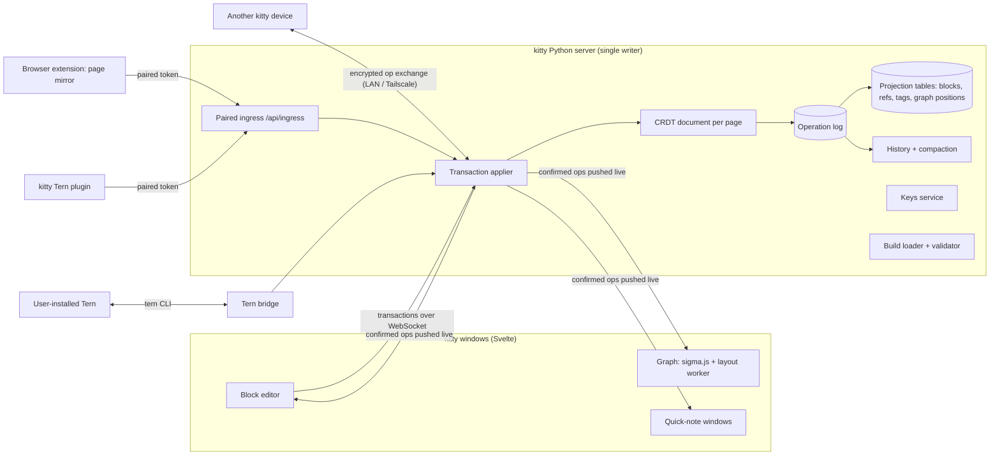
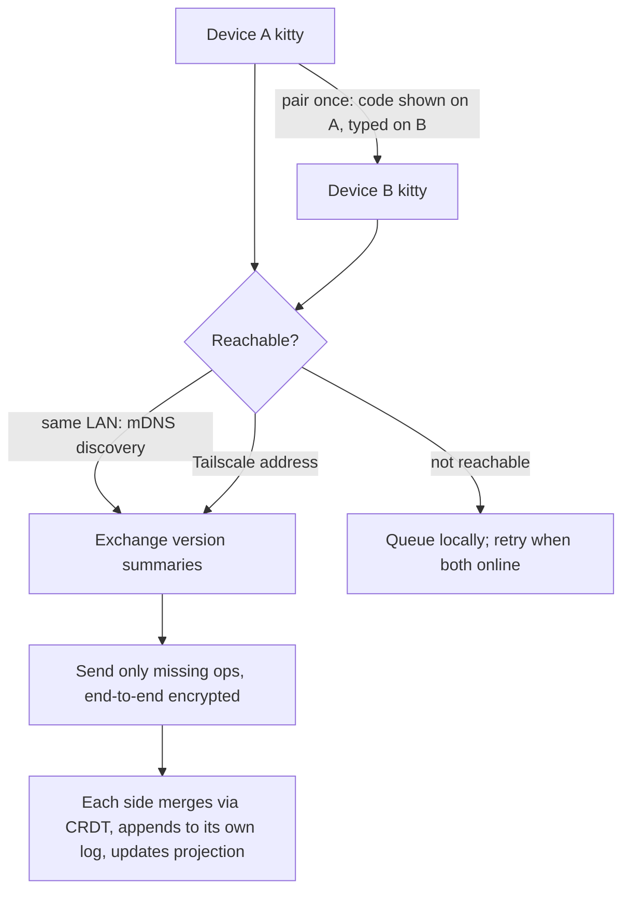

# kitty! platform design: block backend, sync, Tern, builds, keys, web mirror, tags

This document records the outcome of a design interview held on 2026-10-31. kitty! keeps its
current stack (Svelte 5 + TypeScript, Tauri, a Python server, SQLite). It adopts the parts of
Notion's architecture that make a local-first app better:
- one universal block model;
- server-applied transactions;
- an append-only operation log with version history;
- live push to every window.

It adds peer-to-peer CRDT sync across one person's devices. It rejects the parts that solve
multi-tenant cloud problems kitty does not have: Postgres sharding, Redis, S3, a Node service,
and a React rewrite. The Tern bridge is already built (branch `feature/tern-bridge-20261031`,
commit `e759532`). Everything else is designed but not started. Build order is in
[Build order](#build-order). Edits from different devices are merged with Loro (Q5).

## Terms

- **block**: the one record type for content: id, type, properties, parent, order key. A page is a block whose children are blocks, as in Notion's data model. *Avoid:* node, element, row.
- **page**: a block of type `page`; opening it shows its child blocks. *Avoid:* document, note.
- **operation**: one atomic change to one block (set a property, move, insert text). The operations made by one user action form a **transaction**. *Avoid:* event, mutation, patch.
- **operation log**: the append-only list of every transaction, stored in SQLite and never rewritten. It powers version history, point-in-time restore and sync. *Avoid:* event store, journal, history table.
- **projection**: ordinary SQLite tables (blocks, refs, tags, graph positions) rebuilt from the operation log, so search, backlinks and the graph stay fast to read. *Avoid:* cache, view, materialization.
- **build**: a shareable, versioned file describing one person's kitty: modules, settings, theme, layout, dock and graph preferences, and custom CSS. It never contains notes or keys. *Avoid:* config, profile, preset, dotfile.
- **Tern bridge**: kitty driving a user-installed Stencil Tern through Tern's own command line. kitty never ships Tern. *Avoid:* Tern backend, Tern embed.
- **kitty Tern plugin**: a Luau plugin installed into Tern that shows kitty notes and tasks inside Tern and sends captures back to kitty. *Avoid:* Tern extension, Tern add-on.

## Why

The user, in their own words: kitty should be "something that really impresses notion senior
engineers". Concretely, that means:
- Adapt Notion's atomic block backend ("everything is atomic and you can upgrade from there").
- Add Stencil's Tern.
- Let people share their exact kitty build "like nixos".
- Let people live-edit their kitty and see it change.
- Store keys for apply-ai and any AI use.
- Mirror the website they are on into kitty to take notes on it.
- Later, add a browser pop-up for notes.
- Auto-attach tags when a keyword appears.

Hard rule from the user: "dont adapt any of these if it makes kitty worse". Explicit decision:
**do not rewrite kitty in React; keep Svelte.**

### What kitty is today (verified in the code)

- **Server and push:** the Python standard-library HTTP server on `127.0.0.1` is the only process that writes to SQLite (WAL mode, one global mutation lock). The terminal WebSocket is the only push channel; every other view polls.
- **Notes are stored four ways:**
  - `note_blocks`: UUID, `parent_id`, an integer `ordering` renumbered on every edit, and no type;
  - a canvas JSON blob in `note_pages.document`;
  - Markdown `documents`;
  - `quick_notes`.
- **Saving an outline** deletes and re-inserts every block on the page (`src/kitty/core/note_blocks.py:66-97`). There is no note history.
- **Settings are spread across:**
  - `config/modules.yaml` (restart required);
  - browser `localStorage` (theme, dock, graph);
  - SQLite rows (AI, notes, study);
  - hard-coded themes (`web/src/lib/themes.ts`).
- **Keys:**
  - OpenRouter comes from an owner-only `.private/openrouter-key` file or an environment variable.
  - Anthropic, USAJOBS and Brave come only from environment variables.
  - There is no keyring.
- **Graph:** Canvas 2D with d3-force on the main thread, plus optional 3D through `3d-force-graph`. Capped at 180 atlas nodes per section and 300 nodes per mind map.
- **Request guard:** checks exact Host and Origin plus an `X-Kitty-Request` header. This stops web pages but not local programs.

### Notion facts that shaped the design (primary sources)

- **Data model:** one block record with `type`, `properties`, `content` (child ids) and `parent`. "Turn into" changes only `type`. ([data model](https://www.notion.com/blog/data-model-behind-notion))
- **Write path:** the client turns a user action into operations grouped as a transaction, applies it locally, queues it, and sends it to `/saveTransactions`. The server checks and commits it, then pushes new versions over a WebSocket.
- **Single writer:** "only a single parent process ever writes to SQLite" on desktop. ([WASM SQLite](https://www.notion.com/blog/how-we-sped-up-notion-in-the-browser-with-wasm-sqlite))
- **Conflict handling:** last-write-wins per block until July 2025. Since then, an in-house CRDT (RGA plus Peritext) handles text only. ([CRDT post](https://www.notion.com/blog/how-notion-handles-concurrent-editing-with-crdts))
- **History:** Notion keeps scheduled version snapshots, not a replayable log of every edit. Linear is the example of an append-only sync log.
- **Infrastructure kitty does not need:** Postgres sharding by workspace, Redis (used as a task queue), and the S3 data lake. All of them solve multi-tenant scale.

## Architecture overview



### Write path for one edit

```mermaid
sequenceDiagram
  participant W as Window (editor)
  participant S as kitty server
  participant D as SQLite
  participant O as Other windows
  W->>W: echo keystroke locally (pending)
  W->>S: transaction {ops, base version} over WebSocket
  S->>S: apply to page CRDT, check cycles/limits
  S->>D: BEGIN; append op log row; update projection; COMMIT
  S-->>W: ack (seq) — pending cleared
  S-->>O: push ops (seq)
  Note over S,D: later: peer sync sends ops after the peer's last seq
```

### Sync between devices



## Locked decisions

### Q1: Adding Tern means the Tern bridge plus a kitty Tern plugin

| Option | UX | Correct | Risk | Cost |
|---|---|---|---|---|
| A. Tern bridge only | mixed | good | good | good |
| **B. Tern bridge plus kitty Tern plugin** | **good** | **good** | **mixed** | **good** |
| C. Tern replaces herdr when installed | mixed | mixed | poor | good |
| D. Embed Tern's web client in an iframe | poor | poor | poor | poor |

**Decision: B.** The two parts work in opposite directions:
- **Bridge (kitty → Tern):** kitty detects a user-installed `tern` (`$KITTY_TERN` or PATH) and drives a dedicated Tern session named `kitty` through Tern's command line.
- **Plugin (Tern → kitty):** the plugin, kept in kitty's repo under `integrations/tern/` and installed with `tern plugin link`, adds a kitty Inbox block and palette commands such as "Capture pane or browser selection to a kitty note".

herdr stays the bundled in-window terminal. Risk: Tern is a beta, so every Tern feature must disappear cleanly when `tern` is absent or misbehaves.

Why the alternatives lost:
- **A:** one-way only.
- **C:** takes the in-window terminal away from anyone who has Tern installed.
- **D:** cannot run at all. Tern's web client requires WebGPU, and `navigator.gpu` was missing in kitty's WebKitGTK 2.54.1 window even with the flag forced. It also downloads a 68 MB wasm from build.stencil.so.
- **Bundling Tern in any form:** Tern is proprietary and its terms forbid providing it to third parties.

**Status: the bridge is built** (see [Verified facts](#verified-facts)). The plugin waits for pairing (Q7).

### Q2: Sync is offline-first and peer-to-peer between one person's devices

| Option | UX | Correct | Risk | Cost |
|---|---|---|---|---|
| **A. Peer-to-peer, offline-first** | **good** | **good** | **mixed** | **good** |
| B. One home kitty orders every change | mixed | good | good | good |
| C. Several people, hosted server | good | mixed | poor | poor |
| D. No sync yet | poor | good | good | good |

**Decision: A.** Any kitty syncs with any other kitty, and offline edits on both sides merge
deterministically. There is no kitty-hosted cloud. Risk: a CRDT library and a second
representation of each page. The mitigation is that the operation log is append-only and every
page can be restored.

Why the alternatives lost:
- **B:** makes one machine special.
- **C:** needs accounts, permissions and hosting. It remains reachable later on the same design.
- **D:** delays the hard problem the user cares about most.

### Q3: Everything is a block, including every canvas element

| Option | UX | Correct | Risk | Cost |
|---|---|---|---|---|
| **A. Everything, including canvas elements** | **good** | **mixed** | **poor** | **mixed** |
| B. Text content only; a canvas is one block | good | good | mixed | good |
| C. Keep separate tables; add a type column | mixed | mixed | good | good |

**Decision: A** (chosen against the recommendation of B). Pages, outline items, documents,
quick notes and every canvas element (sticky, shape, text box, image, ink) become rows of one
typed block table with a fractional order key. Canvas elements carry `x`, `y`, `w`, `h`,
`rotation` and `z` as properties.

What it costs, and the required mitigations:
- **Migration:** it is a one-way migration of every note. It ships with a reversible JSON export and a migration test on synthetic data.
- **Ink volume:** dense ink adds row volume. Q18 bounds it by grouping strokes.
- **Graph noise:** the graph filters canvas geometry out by default.

Why the alternatives lost: B kept freeform geometry out of the tree, but the user wants one
uniform model. C leaves the content silos in place.

### Q4: Keep Svelte; no React rewrite

| Option | UX | Correct | Risk | Cost |
|---|---|---|---|---|
| **A. Keep Svelte 5 + TypeScript + Tauri** | **good** | **good** | **good** | **good** |
| B. Rewrite in React | mixed | mixed | poor | mixed |

**Decision: A**, stated directly by the user. Nothing in Notion's block model, sync or offline
design depends on React.

### Q5: Loro merges the blocks

| Option | UX | Correct | Risk | Cost |
|---|---|---|---|---|
| **A. Loro: one document per page; LoroTree for structure, maps for properties, rich text** | **good** | **good** | **mixed** | **good** |
| B. Yjs (pycrdt) with hand-written parent/order and cycle check | good | mixed | mixed | good |
| C. Automerge 3 | good | mixed | poor | mixed |
| D. kitty's own CRDT | good | mixed | poor | good |

**Decision: A** (user, after Finish). Loro is the only option with a proven tree move
(Kleppmann's move operation, cycles refused) and fractional sibling order built in, plus
history and checkout that back version history and point-in-time restore. Its Python package
(`loro` 1.17) runs inside kitty's server next to SQLite. Risk: kitty's on-disk sync format
follows Loro's. Mitigation: the SQLite projection and the JSON export stay readable without
Loro, and the server wraps Loro behind a small `PageDoc` interface.

Why the alternatives lost: B makes kitty re-implement tree moves; C's Python package is
pre-release (stable PyPI 0.1.2); D is months of correctness work Loro already proves.

### Q6: The local kitty server applies every edit

| Option | UX | Correct | Risk | Cost |
|---|---|---|---|---|
| **A. Server applies; windows send transactions over WebSocket** | **good** | **good** | **good** | **good** |
| B. Each window runs the CRDT in WebAssembly | good | mixed | mixed | mixed |
| C. Both | good | mixed | mixed | poor |

**Decision: A.** This keeps a single writer, as Notion does on desktop. On loopback a round trip
is about 1 ms, and the editor echoes keystrokes locally until the server acknowledges them. It
also replaces kitty's polling with live push to every window, quick notes included. Weakest
point: a window cannot edit while its server is down, which cannot happen in the desktop app.

Why the alternatives lost: B and C add a WebAssembly CRDT of about 1 MB to every window and
bring back multiple writers.

### Q7: Outside programs reach kitty by pairing

| Option | UX | Correct | Risk | Cost |
|---|---|---|---|---|
| **A. Pairing with revocable, scoped tokens** | **good** | **good** | **good** | **good** |
| B. Fixed port and one shared secret | good | mixed | poor | good |
| C. No network ingress (CLI and native messaging) | mixed | good | good | mixed |

**Decision: A.**
- kitty writes its current address to an owner-only `.private/endpoint.json`.
- A client requests pairing and the user approves it in kitty.
- The client receives a revocable token limited to scopes such as `capture` and `read`.
- Settings lists paired clients and can revoke each one.
- The ingress lives under its own route prefix (`/api/ingress/*`), separate from the browser-only guard.
- Extensions call it only from background or side-panel pages, never from content scripts (Chrome Local Network Access rules).

The same mechanism pairs devices for sync (Q16).

Why the alternatives lost:
- **B:** any local program could impersonate any client.
- **C:** native messaging needs Home Manager packaging per browser on NixOS.

### Q8: A build is one file, shared as a file or link, with diff and rollback

| Option | UX | Correct | Risk | Cost |
|---|---|---|---|---|
| **A. One schema-versioned build file** | **good** | **good** | **good** | **good** |
| B. A Nix flake per build | poor | good | mixed | good |
| C. Hosted gallery with accounts | good | mixed | poor | poor |

**Decision: A.** `kitty-build.json` holds:
- the schema version and the kitty version it was made with;
- enabled modules;
- every setting, including history retention (Q20) and the tag mode (Q13);
- theme tokens;
- dock and graph preferences;
- Tern plugin on or off;
- custom CSS (Q9).

It never contains notes, keys, tokens or personal data. Installing:
- fetches a local file or an `https` link (a gist or repo raw URL);
- validates it against the schema;
- shows a diff of what changes;
- applies it in one step;
- keeps the previous build for one-click rollback.

Settings now in `localStorage` and scattered SQLite rows move into the build, so they survive a
browser profile and become shareable.

Why the alternatives lost: B shuts out non-Nix users. C means operating a service. A static
gallery page that lists build links can be added later.

### Q9: Live configuration: the build file is live, including custom CSS and theme tokens

| Option | UX | Correct | Risk | Cost |
|---|---|---|---|---|
| A. The build file is live | good | good | good | good |
| **B. A plus live custom CSS and theme tokens** | **good** | **good** | **mixed** | **good** |
| C. B plus user scripts | good | mixed | poor | good |

**Decision: B.**
- The user can edit the build file in a split pane inside kitty, or in any editor; kitty watches the file.
- Every save is validated and pushed over the WebSocket to all windows.
- An error shows inline with its line number, and kitty keeps the last good build.
- The Settings screens edit the same file.
- Custom CSS and theme tokens restyle kitty as the user types.
- A safe-mode shortcut and launch flag load kitty without custom CSS.
- Module changes still require a restart, and the live view says so.

Why C lost: a shared build that runs scripts could steal notes and keys. Scripts need a sandbox
and a permission model before they are safe.

### Q10: Keys live in one kitty Keys service

| Option | UX | Correct | Risk | Cost |
|---|---|---|---|---|
| **A. kitty Keys service: OS keyring, then owner-only file; inject per command** | **good** | **good** | **good** | **good** |
| B. automic-vault only | poor | mixed | poor | good |
| C. kitty's own encrypted vault with a passphrase | mixed | mixed | mixed | good |

**Decision: A.** A new `src/kitty/secrets.py` holds named secrets (openrouter, anthropic,
usajobs, brave, and user-defined ones).
- **Storage, in order of preference:**
  1. the OS keyring through Secret Service (KeePassXC or gnome-keyring), via Python `keyring`;
  2. the existing owner-only `.private/` file;
  3. environment variables.
- **Consumers:** every current consumer (`web_ai._key`, `triage/openrouter._key`, the Anthropic client) reads through it. apply-ai and any AI feature use it.
- **Keys screen:** shows only whether each key is set and where it is stored, never the value.
- **Other programs:** `kitty keys run +OPENROUTER -- command` injects the key into that one command's environment, following automic-vault's model.
- **macOS:** kitty can use automic-vault itself as the store.

Verified fact: automic-vault is macOS-only (Keychain, Touch ID, code signing) and deliberately
never returns a secret to an app.

Why the alternatives lost: B breaks kitty on Linux. C makes kitty own its cryptography and a
passphrase prompt.

### Q11: The website you're on appears in kitty as a live page mirror from your everyday browser

| Option | UX | Correct | Risk | Cost |
|---|---|---|---|---|
| **A. Extension streams the current tab to kitty** | **good** | **good** | **mixed** | **good** |
| B. kitty opens the site in its remote-controlled Firefox | mixed | good | mixed | good |
| C. Real video through the Wayland screencast portal | mixed | mixed | mixed | poor |

**Decision: A.** The feature is feasible as a mirror rather than video. A kitty extension sends
the current tab to kitty over the paired ingress (Q7):
- URL and title;
- readable text (Defuddle or Readability);
- the current selection;
- a JPEG from `tabs.captureVisibleTab` every few seconds and on scroll (Chrome caps it at 2 per second).

kitty shows the mirror in a pane beside a note. Clicking a passage quotes it into the note as a
block that links back to the URL.

Privacy rules:
- Mirroring is off until the user turns it on for a tab.
- Banking and password pages are never sent by default (a deny list plus password-field detection).
- Screenshots are kept only when quoted or pinned.

Why the alternatives lost:
- **B:** kitty's apply-ai Firefox is isolated for job sites by repo rule.
- **C:** gives pixels with no URL or text. WebKitGTK cannot capture the screen, and a Rust PipeWire pipeline is costly.

### Q13: Tag keywords: suggest, or always attach, chosen in a setting

| Option | UX | Correct | Risk | Cost |
|---|---|---|---|---|
| **A. Suggest, with opt-in auto-attach** | **good** | **good** | **good** | **good** |
| B. Always attach automatically | mixed | poor | mixed | good |
| C. Only after the fact, on the tag page | mixed | good | good | good |

**Decision: A, extended at the user's request.** A global Tags setting has two modes:
- **Suggest** (the default for new installs): matching keywords get a faint underline, and Tab or a click attaches the tag.
- **Always attach:** every keyword match attaches immediately.

Each tag can override the global mode in either direction.

How tags are stored and matched:
- A tag is a block of type `tag` holding its keywords and aliases. A tagged block shows on the tag page as a backlink.
- Matching uses one Aho-Corasick pass on casefolded whole words. It skips code, URLs and existing `#tag`/`[[link]]` tokens, and by default ignores keywords shorter than 3 characters. It runs debounced on the server when a transaction is applied.
- Automatic attachments are marked `auto`. Removing one is remembered per block and tag, so it never re-attaches.
- Each tag page lists the remaining unlinked mentions, with "Link all".

Why the alternatives lost: B with no per-tag escape hatch floods the graph with false links. C
misses the moment of writing.

### Q14: The graph reaches 10,000+ blocks at 60 fps with sigma.js and a layout worker

| Option | UX | Correct | Risk | Cost |
|---|---|---|---|---|
| **A. sigma.js (WebGL) plus ForceAtlas2 in a Web Worker, positions saved** | **good** | **good** | **good** | **good** |
| B. cosmos.gl (layout and drawing on the GPU) | good | mixed | mixed | good |
| C. kitty's own WebGL renderer | good | mixed | mixed | good |

**Decision: A.**
- Layout runs off the main thread.
- Settled positions are stored in a projection table, so reopening is instant and only changed blocks re-settle.
- WebGL draws the graph; WebGL2 is confirmed in kitty's window.
- 3D stays for small graphs.
- kitty ships a benchmark page with synthetic graphs of 1k, 10k and 50k nodes that reports frame times. No independent 10k-node, 60 fps benchmark exists, so kitty measures its own.
- The server caps of 180 and 300 nodes are lifted for this renderer.

Weakest point: CPU layout slows past about 100k nodes, where B would win.

Why the alternatives lost: B relies on float render targets untested on WebKitGTK and has
thinner labels and picking. C re-solves label rendering and picking.

### Q15: Version history keeps every transaction, then compacts

| Option | UX | Correct | Risk | Cost |
|---|---|---|---|---|
| A. Keep every transaction forever | good | good | good | good |
| B. Snapshots every few minutes | mixed | good | good | good |
| **C. Every transaction within a retention window, then daily snapshots** | **mixed** | **good** | **mixed** | **good** |

**Decision: C** (chosen over the recommended A). Within the window (30 days, Q20), every
transaction is kept for exact point-in-time restore. Older history is folded into one snapshot
per page per day.

The history panel:
- groups transactions into editing sessions per device;
- has a slider that previews the page at any moment;
- restores by appending a new transaction and never rewrites the past.

Deleted blocks and pages go to Trash, which follows the same window.

Compaction must not break sync. A peer whose last-seen sequence number is older than the
compaction horizon gets a full snapshot of the affected pages instead of individual operations.

Why the alternatives lost: A keeps unbounded data. B loses fine-grained restore for recent
work.

### Q16: Devices find each other directly after pairing

| Option | UX | Correct | Risk | Cost |
|---|---|---|---|---|
| **A. Direct and paired: LAN discovery or Tailscale, end-to-end encrypted** | **good** | **good** | **good** | **good** |
| B. A plus an optional self-hostable relay | good | good | mixed | mixed |
| C. Through a synced folder | mixed | good | mixed | good |

**Decision: A.**
- **Pairing:** two kittys pair once (a code shown on one is typed on the other) and exchange keys.
- **Discovery:** mDNS on the LAN, or a stored Tailscale address.
- **Exchange:** peers swap version summaries and send only the missing operations, encrypted end to end.

Weakest point: two devices that are never online at the same time. B's relay can be added later
without changing the protocol.

Why the alternatives lost: B needs a service to run. C hands trust and timing to the folder tool.

### Q17: The block editor is kitty's own Svelte block editor

| Option | UX | Correct | Risk | Cost |
|---|---|---|---|---|
| **A. kitty's own: one contenteditable per block** | **good** | **good** | **mixed** | **good** |
| B. ProseMirror/Tiptap, one document per page | good | mixed | mixed | mixed |
| C. Keep the textarea outline and add features | mixed | mixed | good | good |

**Decision: A.** Each block on screen is one block in the database, rendered as one small
contenteditable. Features:
- a shared selection and keyboard model across blocks;
- a drag handle on hover;
- drag and drop between any blocks and pages;
- a `/` menu, and "turn into" that changes only `type`;
- Markdown shortcuts as you type (`# `, `- `, `[] `, `---`);
- Esc to select blocks and Ctrl+Shift+arrows to move them;
- text batches sent as text operations.

Required browser tests: cross-block selection, IME composition, and copy/paste across blocks.

Why the alternatives lost: B fights the block model; ProseMirror treats a block split as
delete-plus-insert. C cannot show inline formatting.

### Q21: Build order: block backend first

| Option | UX | Correct | Risk | Cost |
|---|---|---|---|---|
| **A. Block backend, then editor, then peer sync, then graph; others slot between** | **mixed** | **good** | **good** | **good** |
| B. Pairing and website mirror first | good | good | good | good |
| C. Four parallel worktrees | good | mixed | mixed | good |

**Decision: A** (chosen over the recommended C). This avoids building the mirror and tags on the
old notes API and then moving them. See [Build order](#build-order).

## Routine choices

- **Q12, extension browsers:** Firefox (sidebar) and Chrome-family browsers (side panel), from one codebase using `webextension-polyfill`. The UI branches between `sidebar_action` and `chrome.sidePanel`. Firefox builds are signed as an unlisted add-on through Mozilla. Safari waits for a macOS kitty build.
- **Q18, ink:** strokes drawn together within a short burst (a few seconds) form one `ink` block, with points stored compactly as one property, written once when the burst ends.
- **Q19, publishing:** the repo stays private. Only the engineering blog post is published. It covers local persistence, the operation log, sync, and graph performance with real measured numbers.
- **Q20, retention window:** every transaction is kept for **30 days**, then compacted into daily snapshots. The value is a setting in the build file.

## Data model sketch

```sql
-- One table for all content (projection; rebuilt from the op log)
CREATE TABLE blocks (
  id TEXT PRIMARY KEY,               -- UUID v4
  type TEXT NOT NULL,                -- page, text, heading, todo, toggle, quote, code, image,
                                     -- document, quick_note, canvas, sticky, shape, ink, tag, ...
  parent_id TEXT REFERENCES blocks(id),
  order_key TEXT NOT NULL,           -- fractional index (rocicorp/fractional-indexing, Python port)
  properties TEXT NOT NULL,          -- JSON: title, checked, x/y/w/h, keywords, points, ...
  text TEXT NOT NULL DEFAULT '',     -- plain text for search/backlinks
  created_at TEXT, updated_at TEXT,
  deleted_at TEXT                    -- Trash
);
CREATE INDEX blocks_children ON blocks(parent_id, order_key);

CREATE TABLE op_log (                -- append-only
  seq INTEGER PRIMARY KEY AUTOINCREMENT,
  device_id TEXT NOT NULL,
  txn_id TEXT NOT NULL,
  page_id TEXT NOT NULL,
  at TEXT NOT NULL,
  ops BLOB NOT NULL                  -- CRDT update bytes + readable op summary
);
CREATE TABLE page_snapshots (page_id TEXT, day TEXT, state BLOB, PRIMARY KEY(page_id, day));
CREATE TABLE block_refs (source_id TEXT, target_id TEXT, kind TEXT, PRIMARY KEY(source_id, target_id, kind));
CREATE TABLE block_tags (block_id TEXT, tag_id TEXT, origin TEXT CHECK(origin IN ('manual','auto')),
                         PRIMARY KEY(block_id, tag_id));
CREATE TABLE tag_rejections (block_id TEXT, tag_id TEXT, PRIMARY KEY(block_id, tag_id));
CREATE TABLE graph_positions (block_id TEXT PRIMARY KEY, x REAL, y REAL, layout_version INTEGER);
CREATE TABLE peers (device_id TEXT PRIMARY KEY, name TEXT, public_key BLOB, last_seq INTEGER, address TEXT);
CREATE TABLE clients (id TEXT PRIMARY KEY, name TEXT, token_hash TEXT, scopes TEXT, created_at TEXT, revoked_at TEXT);
```

Migration: a new numbered migration creates these tables, and a one-time Python step converts
the existing content:

| Existing content | Becomes |
|---|---|
| `note_pages` | `page` blocks |
| `note_blocks` | typed child blocks, with dense `ordering` converted to `order_key` |
| canvas JSON elements | child blocks with geometry properties; ink grouped per Q18 |
| `documents` | `document` page blocks whose Markdown is split into blocks |
| `quick_notes` | `quick_note` blocks |

Old tables stay read-only for one release. A full JSON export is written before the migration
runs.

## Build order

1. **Block backend:** the tables above and the migration; server-applied transactions over a WebSocket with acknowledgements; the operation log; projection updates; live push to every window; history with 30-day compaction and Trash.
2. **Block editor** (Q17) on top of it.
3. **Peer sync** (Q16) using Loro (Q5).
4. **Graph** (Q14) with its benchmark page.
5. **Slotted in between, each a separate pull request:**
   - pairing and ingress (Q7), which unblocks the kitty Tern plugin (Q1) and the web mirror extension (Q11/Q12);
   - builds with live config (Q8/Q9);
   - Keys (Q10);
   - auto-tags (Q13).

The Tern bridge (Q1, first half) is already done.

## Verified facts

- **Tern bridge implemented** on branch `feature/tern-bridge-20261031`, commit `e759532`:
  - **Code:** `src/kitty/core/tern.py`, `src/kitty/web_tern.py`, `web/src/lib/TernPanes.svelte`, plus dock wiring.
  - **Routes:** `GET /api/terminal/tern` and `POST /api/terminal/tern/{open,run,focus,capture}`. A capture saves the pane text as a quick note.
  - **Automated checks:** full pytest passed (2724 passed, 3 skipped); `svelte-check` reported 0 errors; all 53 web tests passed, including the dock browser tests for both Tern present and absent; the production build passed.
  - **Live smoke** against real Tern 0.9.8 on an isolated daemon: opened a tab, captured `hello-kitty`, saved it as a quick note through the HTTP routes, saw the `pane_exited` event, rejected a multi-line command (400), and returned 404 for an unknown block.
- **Tern constraints:**
  - Proprietary closed beta that requires a Stencil sign-in, so it cannot be bundled.
  - Its web client needs WebGPU, which is missing in WebKitGTK 2.54.1 (tested).
  - It has no text-mode attach command, so it cannot be streamed into xterm.js.
  - A probe plugin's `tern.fetch` could forge kitty's Origin and `X-Kitty-Request` headers, which is why Q7 requires real tokens.
- **automic-vault:** real and active (587 stars, Apache-2.0, release 4.21.2 on 2026-10-28), but macOS-only, with no API that returns a secret.
- **Browser and webview capture:** Firefox lacks `tabCapture`, but `captureVisibleTab` works in both Firefox and Chrome. WebKitGTK has no reliable `getDisplayMedia` on Linux. niri supports portal screencasting.
- **Existing tag and link parsing:** kitty already extracts `#tag` and `[[page]]` (`src/kitty/core/note_blocks.py:13-15`) and finds unlinked title mentions.
- **Loro, the CRDT candidate:** Python package `loro` 1.17; a native movable tree (Kleppmann's move operation) with fractional sibling order; history and checkout. Benchmark: 2.43 s to replay 260K edits and 4.5 ms to load, versus Yjs at 2.56 s and 19 ms, and Automerge at 13.5 s and 652 ms.

## Risks

- **Migrating every note (Q3)** is one-way. Mitigations: a full JSON export first, a synthetic migration test, and old tables kept read-only for one release.
- **Canvas as blocks** raises row and operation volume. Mitigations: ink bursts (Q18) and filtering geometry out of the graph.
- **CRDT bugs could mis-merge text.** Mitigations: the append-only log, 30-day exact restore, and property-based merge tests across two simulated devices.
- **Compaction against offline peers:** a peer older than the horizon needs a snapshot transfer. This path needs its own test.
- **A contenteditable editor** has edge cases (IME, cross-block selection). They need dedicated browser tests.
- **Custom CSS can make kitty unreadable.** Mitigation: safe mode.
- **The web mirror extension** sees pages. Mitigations: per-tab opt-in, the deny list, and scoped tokens.
- **Tern is a beta** whose command line or plugin API may change. Mitigation: everything Tern-related degrades to nothing when it fails.
- **No keyring may be running on niri.** The fallback is the owner-only file, and the Keys screen says so.

## Deferred

- **Browser note pop-up (feature 5):** research only, as requested. It will reuse the Q12 extension: Chrome side panel or Firefox sidebar, with network calls only from extension pages over the paired ingress.

## Open threads

- **Q5:** resolved after Finish; the user chose Loro.
- **Self-hostable relay (Q16 B):** noted as a later addition for devices never online at the same time. Not scheduled.
- **Static build gallery page (Q8):** possible later. Not scheduled.
- **User scripts in builds (Q9 C):** need a sandbox and permission design first. Not scheduled.
