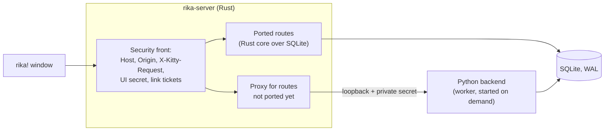

# Rust core: a gradual rewrite, a minimal base and download modules

Status: milestones 0 and 1 built; milestone 2 under way: `/api/modules`, `/api/bootstrap` and
the migration runner are Rust; milestone 3 built for its first pack, the Brain (branch
`feat/rust-core`).

## Goal

Replace the Python core with Rust one feature at a time, without a big-bang
switch-over, while making rika! as light and fast as possible. The installer
ships a minimal base (the app shell and Rika in text form); every other feature
is a module, off on a fresh install and downloaded, signature-checked, when the
user turns it on.

## Where the time and size go today (measured 2026-11-11)

| Measurement | Value |
| --- | --- |
| Desktop backend (PyInstaller onefile) start to readiness | 10.0 s |
| The same Python server, unfrozen, start to readiness | 0.45 s |
| Importing all of `kitty.web_server` | 0.36 s |
| Backend sidecar / LearnHarness / herdr download | 409 MB / 275 MB / 29 MB |
| rika!'s own Python code / web UI | 5 MB / 9 MB |
| Python core / Python tests | 86,552 lines in 317 files / 52,862 lines (4,838 tests) |

So 9.5 of the 10 seconds is the onefile unpacking 409 MB to `/tmp` on every
launch, and most of the download is a few third-party payloads (on-device speech
~350 MB, LearnHarness 275 MB, job-discovery stack ~210 MB, PyMuPDF 64 MB, sympy
~55 MB).

## Architecture: strangler

- **`rika-server` owns the browser-facing contract.** It serves the UI and
  enforces the same rules as `RequestHandler._security`, `_authorize` and
  `kitty.web_auth` today: exact Host and Origin, `Sec-Fetch-Site`, the
  `X-Kitty-Request` header and JSON content type on mutations, the per-launch UI
  secret as a header (or WebSocket subprotocol), one-time browser codes, and
  single-use link tickets. Same response headers (CSP and friends) and the same
  refusal message.
- **Routes move one feature at a time.** A ported route is answered by Rust;
  every other `/api` request and WebSocket upgrade is forwarded to the Python
  backend on loopback, authenticated with a secret only `rika-server` holds (the
  backend's existing desktop readiness line). The page never sees the Python
  origin.
- **Python becomes optional.** When every enabled module's routes are ported,
  `rika-server` does not start Python at all. Features whose libraries have no
  Rust equivalent (sympy, python-jobspy) stay Python workers inside their modules
  until they are replaced.
- **One database, both sides.** SQLite in WAL mode with a 5 s busy timeout (as
  `kitty.db.connection` sets) lets both processes read and write during the
  transition. Each write stays one transaction, all-or-nothing (the CLI fix in
  `1bcd774` is the pattern). The migration chain moves to Rust before the first
  launch that can run without Python.
- **The desktop shell embeds it.** `rika-server` is a library crate the Tauri
  shell runs in-process (no sidecar to start for ported features), plus a
  standalone binary for `kitty-web`-style browser use and tests.

## Modules

Folded into the same work: a module gates code (Rust and remaining Python) and
lists the packs it needs. Packs are the large payloads, signed with the
embedded updater key and installed under `$XDG_DATA_HOME/kitty/packs/`. A pack
shared by two modules downloads once. Activation stays at start-up.

| Module | Contains | Large payload |
| --- | --- | --- |
| `notes` | Notes, quick notes, backlinks, tags, canvas, web mirror | – |
| `documents` | Documents & PDF | PDF engine |
| `maps` | Mind maps | – |
| `calendar` | Calendar, tasks, Google Calendar sync | – |
| `study` | Study timer, guide, plans, exams, progress | – |
| `flashcards` | FSRS flashcards, Anki import | – |
| `math` | Topics, lessons, sprints, answer checking | sympy worker (until replaced) |
| `learnharness` | LearnHarness | LearnHarness app (275 MB) |
| `opportunities`, `goals` | Opportunities, goals | – |
| `brain` | Brain/atlas home, the 3D graph look | its views and the 3D engine (1.6 MB of web code); **built**, the first pack |
| `mail` | Rika's Gmail drafts | – |
| `voice` | Rika voice input and speech | speech engine and models |
| `devices` | Pairing and sync | – |
| `terminal` | herdr dock, Tern, agent tabs | herdr (29 MB) |
| `applyai` | Job search and applications | discovery worker (python-jobspy) |

Build format 1 selections are upgraded when read: `workspace` becomes notes,
documents, maps, calendar, study, flashcards, math, learnharness and
opportunities, and every format-1 selection also gets goals, brain, mail, voice
and devices, which used to be always on. `kitty init` keeps writing an empty
selection: base only.

## Milestones

0. **Fast start now.** Ship the Python backend as a PyInstaller onedir (unpacked
   once at install, not on every launch). Target: under 1 s to readiness, measured
   on the built `.deb`. *Built:* the onedir took the `.deb` backend from 11.2 / 10.9 s
   to 3.3 / 2.9 s; the rest was mDNS probing (about 1.75 s) inside
   `WebApplication.__init__`, now on a background thread, which took the same server
   on a fresh workspace from 2.77 to 0.93 s. The installed size grows to 1.15 GiB
   (the bytes that used to be unpacked to `/tmp` on every launch) until milestone 3
   moves the large payloads into packs.
1. **The seam.** `server/` crate `rika-server`: static UI, the full security
   front, and a proxy (HTTP and WebSocket) to the Python backend. Verified by
   porting the web security tests to run against it and by running the browser
   suites through it. *Built:* a 1.5 MB release binary; `tests/test_ui_secret.py`
   runs every rule against both servers; the seven browser suites that start a real
   server pass through it (`KITTY_RIKA_SERVER`). Measured on one workspace: a
   forwarded API call costs 0.6 ms more (9.6 vs 9.0 ms), and the page and its
   scripts, now served by Rust, are faster (0.8 vs 1.9 ms and 1.4 vs 2.2 ms). The
   worker (`kitty-web --worker`) answers only requests carrying the front's private
   secret, and trusts the forwarded connection ports agent verification needs only
   on those. Not yet: the desktop shell still starts the Python sidecar directly.
2. **Base in Rust.** Port the base's routes (bootstrap, modules, build and
   settings, themes, keys, effects, Rika text chat) and the migration runner, so
   a base-only install starts without Python. Module registry with requirements
   and packs; UI gating per new module.

   Inventory (2026-11-12): what each base route group touches and what must exist in Rust
   before it can move.

   | Route group | Python handler | Data it touches | Tests | Blocks porting |
   | --- | --- | --- | --- | --- |
   | Modules `GET/POST /api/modules` | ~~`WebApplication.set_modules`~~, `modules_state` | `config/build.json` (`modules`), careers templates | `test_web_modules.py`, `test_modules.py` | **Ported** (below) |
   | Bootstrap `GET /api/bootstrap` | ~~`WebApplication._bootstrap`~~ | modules state; with applyai, jobs, tracks and today's digest in SQLite | `test_web_bootstrap.py`, `test_web_modules.py` | **Ported** (below) |
   | Build and settings `/api/build/*` | `web_build.py`, `core/builds/{store,project,share}` | build file, `data/build-history/`, settings rows projected into SQLite | `test_web_build.py`, `test_builds.py`, browser `settings`/`build` suites | the watcher's live push goes out over `web_live`'s WebSocket (Python), and `project.sync` writes SQLite; `fetch` needs an HTTPS client |
   | Themes | no route: the theme list and `theme.base` live in the build (`document.theme_ids`, already in Rust) | build file | as build | moves with the build routes |
   | Keys `/api/keys/*` | ~~`web_keys.py`~~, `core/keys.py` | OS keyring (Secret Service over D-Bus) or owner-only file | `test_keys.py` | **Ported** (below); Python's AI providers keep reading the same store until they move |
   | Effects `/api/effects/*` | ~~`web_effects.py`~~, `web_effects_worker.py`, `core/effects.py`, `effect_kinds` | effect tables in SQLite | `test_effects.py` | **Ported** (below); executors and `submit_application`'s preconditions stay on the worker's internal routes |
   | Rika text chat `/api/rika/*` | `web_rika.py`, ~~`web_rika_memory.py`~~, `core/rika/*` | conversations, plans, memory in SQLite; AI provider calls | `test_web_rika*.py`, `test_rika_*.py`, `test_rika_data_parity.py` | history, routing memory, memory index and preferences **ported** (below); AI client and streaming WebSocket; Rika's tools reach every module's Python core |
   | Migration runner | `kitty.db.migrations` (kept for the CLI, TUI, MCP, demo reset and tests) | the SQLite schema (55 SQL files) | `test_migration_parity.py`, `test_front_migrations.py`, `test_migrations.py`, `test_migration_numbers.py` | **Ported** (below) |

   *Built (first slice):* `/api/modules` is answered by rika-server (`server/src/modules.rs`)
   with Python's responses and error messages (`kitty.modules.normalize_modules`, `store.edit`
   refusals, the 500 for an exception Python had no handler for), and the same atomic,
   `flock`ed write of `config/build.json`; the careers templates are compiled in. Python's
   handler is gone; `modules_state` stays for bootstrap and the build push. The worker's
   readiness line now also carries its `config_dir`, frozen `modules` and `version`.
   `tests/test_web_modules.py` runs the route through the front and compares every answer
   with the Python functions as the reference. Deliberate difference: a pre-build
   `modules.yaml` written by hand while rika! runs is not parsed (the worker migrated it at
   start; the next start reads it). Since Python no longer serves every route, plain
   `kitty-web` now execs rika-server with itself as `--worker`, and the desktop backend
   refuses to run without the front: a Python-only install (a checkout without
   `cargo build --release --manifest-path server/Cargo.toml`) no longer serves the website.
   Measured on one synthetic workspace (median of 300 fresh-connection GETs, two alternating
   runs each): `GET /api/modules` went from 6.3 / 6.5 ms (forwarded to Python) to 1.06 /
   1.02 ms (Rust), while a still-forwarded route stays at 5.8 ms; start to announcement is
   unchanged (1.2 to 1.4 s, the worker dominates); the release binary grew from 1.82 to
   1.91 MB.

   *Built (second slice): the migration runner.* `server/src/migrations.rs` applies the same
   numbered files (compiled in by `server/build.rs` from `src/kitty/db/migrations/`) with the
   same bookkeeping as `kitty.db.migrations.migrate`: one `BEGIN ... COMMIT` script per
   migration with its `schema_version` row, `PRAGMA foreign_key_check` before the commit,
   `-- foreign_keys: off` set around the transaction, versions applied by number (a lower
   number landing late still applies). rusqlite with SQLite bundled (FTS5 and the trigram
   tokenizer included). rika-server resolves the workspace as `Settings.load` does
   (`server/src/settings.rs`: `--root`, `$KITTY_HOME`, the root markers, `$KITTY_DB` from the
   environment or the root's `.env`) and migrates it at start-up before it starts the worker
   (`server/src/startup.rs`); the worker opens it with `open_workspace(auto_migrate=False)`,
   which refuses a database still behind the files, and its readiness line names the
   database it opened, which must be the one the front migrated. The desktop shell now
   passes the workspace to rika-server with `--root`; in desktop mode the front creates
   files owner-only (`umask 077`, as the backend does). `--demo`'s throwaway workspace is
   made, migrated and removed by the front and handed to the worker as `--demo-workspace`.
   The three Python-step migrations:
   - `047` (`search:build`) is folded into SQL: the script now queues every existing record,
     blocks included, in `search_pending`, and `search.sync`, which every query runs first,
     builds their documents (`page_titles_within` now syncs too; it was the one reader that
     did not). Both runners read the same file, so they agree; a fresh database has nothing
     to queue.
   - `033` (`blocks.legacy:migrate_notes`) and `039` (`blocks.tags:backfill`) are not
     ported: they convert only what a pre-block workspace (rika! 0.3.33 and older) holds,
     through the whole block store (transactions, op log, ordering keys, tagging), a large
     port for a one-time upgrade. On every other database they are no-ops, so the Rust
     runner applies their scripts alone; when the database has notes, documents or quick
     notes (033) or `#tags` (039) to convert, it stops before that migration and the front
     runs the Python runner once through the worker program (`--migrate-database DB`, in
     `kitty-web` and the desktop backend), then checks that nothing is left. Without a
     worker program (a future base-only install) the front refuses with "open the
     workspace once with rika! 0.3.36". Fresh and current workspaces never start Python
     for migrations. A front that stops before readiness ends its stderr with the reason
     (`rika-server: ...`); the desktop shell captures that stderr, shows the last line in an
     error dialog (the app exits when it is dismissed) and writes the whole text to
     `.private/startup-error.log`; before, it discarded it and the window never appeared.

   Tracked exception to "no two live implementations": `kitty.db.migrate` stays for its
   other callers, the CLI and TUI (`open_workspace`), the MCP server, `demo.reset`, the
   pre-block conversion above and the tests' fixtures, and is deleted when those callers
   move to Rust. `tests/test_migration_parity.py` keeps the two from drifting: a fresh
   database, every prefix of the numbered files and every released set with gaps (main's
   releases up to v0.3.33), each migrated by both runners and each upgraded to the latest
   schema by both, must give the same `sqlite_master`, pragmas and rows of every table (FTS
   shadow tables included; clock values and the random device id compared by shape), plus
   a seeded v0.3.33 database upgraded both ways and the stop-and-hand-over on one with notes.

   *Built (third slice): bootstrap.* `GET /api/bootstrap` is answered by rika-server
   (`server/src/bootstrap.rs`): `{"demo", "modules"}`, and with ApplyAI the tracks, the four
   job counts, this week's total and streak and today's digest text, computed over rusqlite
   as `tracks.weekly_targets`, `jobs.count_jobs` with the job views and
   `today.build_digest`/`digest_text` do (stored timestamps read as `kitty.dates.parse`
   reads them, including rejecting hour 24 rather than rolling it into the next day;
   `sources.safe_error`'s redaction with the worker's environment and `.env`,
   Python's 503 for a busy database). Python's handler is deleted; the functions it
   composed stay (other routes and the CLI use them) and are the reference in
   `tests/test_web_bootstrap.py`, which compares the front's answer with them on a
   synthetic workspace covering every digest section. Deliberate difference: the digest's
   two `apply.yaml` settings (`deadline_window_days`, `archive_after_days`) are the ones the
   worker validated at start, sent in its readiness line; a hand edit followed by
   `/api/reload` reaches them at the next start.

   Measured on one synthetic ApplyAI workspace (400 jobs; medians; base commit and this
   branch run alternately twice on a machine also running other agents' suites): start to
   announcement is unchanged within the noise, fresh 4.7 / 3.5 s before and 4.9 / 4.0 s after,
   existing 3.6 / 3.1 s and 3.8 / 3.7 s, since the worker's start dominates and both runners
   cost the same: a fresh database takes 0.30 s in Python and 0.33 s in Rust (SQLite's own
   work), a current one 0.7 ms in Python and 12 ms for a whole `rika-server migrate` process.
   `GET /api/bootstrap` (median of 300 fresh-connection GETs) went from 8.9 / 9.7 / 13.7 /
   10.4 ms (forwarded to Python) to 5.0 / 3.5 / 2.9 / 2.9 ms, while a still-forwarded route
   (`/api/dashboard`) stayed at 7.3-14.8 ms. A cold answer is most of its time in SQLite
   parsing the schema, so the front keeps its database connection open between answers. The
   release binary grew from 1.91 to 5.96 MB (SQLite bundled, `regex`).

   *Built (fourth slice): keys.* `GET /api/keys` and `POST /api/keys/{set,remove,move}` are
   answered by rika-server (`server/src/keys/`) with `kitty.core.keys`' rows, order, checks and
   refusals: a zbus Secret Service client reads and writes the items Python's keyring stack
   makes (label, `service`/`username`/`application` attributes, `text/plain`), and the
   owner-only files are opened as Python opens them (`O_NOFOLLOW`, 600/700, links refused).
   `web_keys.py` is deleted; `kitty.core.keys` stays for the AI providers, `kitty keys` and
   `kitty doctor`. `tests/test_keys.py` drives the routes through the front, and its interop
   test runs a private gnome-keyring on its own session bus where Python and the front write
   and read each other's items. Measured (median of 300 fresh-connection GETs, two alternating
   runs, file store): `GET /api/keys` went from 8.7 / 8.8 ms (forwarded) to 1.03 / 1.00 ms,
   while a still-forwarded route (`/api/account`) stayed at 7.4-8.1 ms; start to announcement
   unchanged (2.1-2.2 s before, 2.0-2.2 s after); the release binary grew from 8.74 to
   10.61 MB (zbus).

   *Built (fifth slice): effects.* The front makes this launch's window session
   (`ui-<hex24>`) and hands it to the worker as the second line of its handshake, so effect
   approvals made by the front and by Python's inline views are bound to the same session.
   `GET /api/effects` and `POST /api/effects/{approve,execute,deny}` are answered by rika-server
   (`server/src/effects/`): the kernel protocol of `kitty.core.effects` over the effect tables
   (canonical digest, one immediate claim transaction re-checking every precondition, the
   single-use two-minute approval, append-only events) with `delete_block`'s preconditions in
   SQL. Two parts need Python and run on the worker's internal routes, which pages cannot reach
   (`kitty.web_effects_worker`): `submit_application`'s preconditions (`choose_resume` with the
   config) and executing, where the final re-check, the `executed` event and the block store's
   delete share one transaction. `web_effects.py` is gone; `web_auth.window_user` replaces its
   `user`. `tests/test_effects.py` drives the routes through the front with Python's kernel as
   the reference, including a parity test that every approval recomputes Python's digest and
   every refusal names what `effects.changed_names` names. Measured (median of 300
   fresh-connection GETs, two alternating runs): `GET /api/effects` went from 7.3 / 8.6 ms to
   0.73 / 0.77 ms, a still-forwarded route stayed at 7.0-9.2 ms; start to announcement
   unchanged within the noise (1.4-2.1 s before, 1.8-2.0 s after); the binary grew from 10.61
   to 10.81 MB.

   Next: the build routes once the live channel can be driven from Rust.
3. **Packs.** Signed pack builds and index in the release pipeline; download,
   verify and atomic install in the shell; Settings → Modules with size and
   progress.

   *Built:* the module registry is one file, `src/kitty/modules.json` (ids, labels, the packs
   each module needs), read by `kitty.modules` and compiled into rika-server;
   `tests/test_modules.py` fails if the build schema, `api.ts` or `buildCore.ts` drift from it.
   A new module `brain` (the atlas home, 3D and 2D, and the 3D graph look) needs pack `brain`
   and is off by default: `DEFAULT_MODULES` (a workspace without a selection) is every module
   needing no download; `kitty-web --demo` turns every module on. `/api/brain` is now the
   brain module's route. Without the module, or with its files missing, the home's stage is
   one "Brain isn't installed · Download" widget leading to Settings → Modules, and the
   home-look and 3D-look switches are hidden (2D only); every other view is unchanged.

   Pack format: `web/vite.config.ts` marks every chunk holding a module of a pack's patterns
   (for the Brain: `src/lib/brain/`, `three`, `3d-force-graph`) and the chunks only those reach,
   fails the build if the base imports one statically, and writes `dist/pack-files.json`.
   `scripts/build-packs.py` (run by `scripts/build-desktop.sh` after the web build) writes
   `rika-pack-<id>-<version>.tar.gz` (a `pack.json` plus `web/<files>`, reproducible), removes
   those files from the website the installers carry, and writes the index `packs.json`
   (`format`, `version`, per pack `file`, `size`, `sha256`, `installed_size`). The release
   workflow signs the index with the updater key (`tauri signer sign`, the installers' setup);
   `scripts/publish-desktop-release.py` uploads archives, index and signature to the release
   and checks each upload's size; `scripts/validate-desktop-release.py` verifies the uploaded
   index against `tauri.conf.json`'s updater key and each archive's size and SHA-256, and the
   workflow checks the `.deb`'s website carries none of the pack's files. The releases
   repository is now named `ZacharySF/rika` (GitHub redirects `kitty-releases`); every
   reference moved.

   rika-server (`server/src/packs.rs`): `GET /api/packs` lists each pack (built-in, installed,
   downloading with progress, outdated, available, unavailable, with sizes and the last error)
   from its own version's index,
   `https://github.com/ZacharySF/rika/releases/download/v<version>/packs.json`, fetched over
   HTTPS (reqwest with rustls and ring, the updater's stack), verified with `minisign-verify`
   against the key and version compiled in from `desktop/tauri.conf.json` (its trusted comment
   must name `packs.json`), cached 10 min in memory and, verified again on read, on disk for
   offline listing. `POST /api/packs/install {id}` streams the archive into a `.tmp-` folder,
   refuses it unless size and SHA-256 match the signed index, unpacks it (regular files and
   folders only, no path leaving the pack, exact unpacked size, a matching `pack.json`), moves it
   beside the others and makes it installed by one atomic write of `installed.json` under a
   `flock`; the old version goes only after that. Anything that fails leaves the previous state,
   and a start sweeps unreferenced folders and day-old downloads. `POST /api/packs/uninstall
   {id}` is refused while a module needing it is selected. A pack counts only for the exact app
   version (its chunks import the base's hashed chunks). The static route serves a missing
   website file from an installed pack. `POST /api/modules` refuses (409) to turn on a module
   whose pack is not ready; the CLI's `kitty modules enable` does not check (the home then shows
   the card). Packs live under `$XDG_DATA_HOME/kitty/packs/`. `KITTY_PACKS_URL` and
   `KITTY_PACKS_KEY` are test-only overrides; the test harnesses point the index at a closed
   loopback port so no test reaches GitHub.

   Tests: `tests/test_packs.py` (22, through the front: signed install, progress, bad
   signature, signature of another file, tampered index, other version, missing signature,
   bad hash, truncated, oversized, escaping path, wrong manifest, failed update keeps the old
   install, sweep, uninstall gate, built-in, offline cache, the front's secret, Origin, Host,
   `Sec-Fetch-Site`, `X-Kitty-Request` and content-type rules), Rust unit tests for index
   verification and unpacking, release-guard and publisher tests, and
   `web/tests/packs.browser.test.mjs` (the built website without the Brain, Settings → Modules
   download with progress, turning the Brain on, the Brain drawn from the pack after a restart,
   removal).

   Measured (this build): the website the installer carries went from 11,928,862 to
   10,291,704 bytes (−1,637,158, 13.7 %: seven chunks, three.js and 3d-force-graph included);
   the installers carry the website twice (the backend's `_internal/website` and Tauri's
   embedded `frontendDist`), so the base install drops at least 1.6 MB, and the pack download is
   a 0.5 MB archive. A full `.deb` was not rebuilt for this change (the installed size is
   dominated by the backend, 1.15 GiB, until the next packs). rika-server grew from 1.91 to
   4.68 MB (the HTTPS client, rustls with ring, gzip and tar).

   *Built (second step): the base download.* The Python packs, LearnHarness and herdr are now
   packs too, on the same signed index, verification and atomic install. Measured: the
   backend onedir of the 0.3.36 build (`425506f`, `du -b` of `_internal/`; libraries assigned
   to a pack by name, so shared FFmpeg/X11 libraries count with speech):

   | Payload in the 1.10 GiB (1,177,355,543 B) onedir | Size | Now |
   | --- | --- | --- |
   | Speech: ctranslate2, av (FFmpeg), onnxruntime, tokenizers, hf_xet, faster-whisper | 344.9 MB | pack `voice` (module `voice`) |
   | LearnHarness: the Next.js app and its Node.js binary | 270.0 MB | pack `learnharness` (module `learnharness`) |
   | Job aggregators: tls_client, pandas, numpy and OpenBLAS, python-jobspy | 168.5 MB | pack `discovery` (ApplyAI) |
   | Math: sympy, mpmath, lark, antlr4 | 29.6 MB | pack `math` (module `math`) |
   | PyMuPDF (61.6 + 36.2 + 3.1 MB), ICU 41 MB, libpython 32.5 MB, zstandard 23.9 MB, libvips 18.7 MB, cryptography 14.4 MB, loro 11.2 MB, website 10.3 MB, the rest | 318.0 MB | base |

   herdr (29 MB) was a separate sidecar in the installers; it is pack `herdr` (Terminal).
   Modules: `math` and `learnharness` left Workspace and `voice` left the core, each needing its
   pack; ApplyAI needs `discovery` and Terminal `herdr`. `DEFAULT_MODULES` (a workspace without
   a selection) is now the registry's explicit `default`, every module but the Brain, so
   pre-module workspaces and test fixtures are unchanged; a saved selection from before keeps
   Workspace but has Math, LearnHarness and Voice off.

   How it works: `kitty.packs.PYTHON` names each Python pack's distributions;
   `scripts/build-packs.py` copies them and everything they need that the base does not
   (closure over the locked environment's metadata; numpy goes into both `discovery` and
   `voice` so each stands alone) into `python/`, and `desktop/package_backend.py` excludes the
   packs' own modules and their large libraries (`backend_excludes`) from the freeze. Archives
   keep only the executable bit and use GNU tar names (Next.js paths exceed ustar);
   `server/src/packs.rs` now keeps executables 0755 and accepts dotted names below a pack's
   top level (`learnharness/.next/`). The front passes the installed packs' folders to the
   worker as `$KITTY_PACKS`; `kitty.packs.state()` first probes what the program carries
   itself, then appends each Python pack's `python/` to `sys.path` (after the bundle) and sets
   `$KITTY_HERDR` to the herdr pack's binary. The readiness line reports `packs.built_in`
   (shown as Included) and `packs.missing`, which `/api/modules` and `/api/bootstrap` carry as
   `modules.missing`. A module on without its pack degrades like the Brain: its routes
   (`/api/math`, `/api/extensions/learnharness`, `/api/rika/voice`, `/api/terminal` but Tern
   and agent skills) answer 409 "<pack> isn't installed: download it in Settings > Modules,
   then restart rika!", its views show the "… isn't installed · Download" card
   (`PackMissing.svelte`), voice input answers `voice.error`, and the JobSpy source reports an
   error instead of an empty result. Worker packs are loaded at start, so a download needs a
   restart. The desktop shell no longer bundles herdr, and LearnHarness's licences and
   corresponding source travel in its pack.

   Tests: `tests/test_base_packs.py`: a base worker (this Python with every pack library
   hidden, no LearnHarness, no herdr) starts with `DEFAULT_MODULES`, lists the five downloads
   and 409s each pack route while the rest serve; each worker pack (the three Python ones
   built from the real locked libraries) is built, published signed, installed through the
   front, used after a restart and removed; program packs keep layout, modes and reproducible
   bytes; `$KITTY_PACKS` is validated; JobSpy without its pack is an error. Rust unit tests
   cover the new unpack rules; `web/tests/workspaceModules.test.mjs` the view gating.

   Measured on the built `.deb`s (0.3.36, this machine; both builds stop afterwards at updater
   signing without the release key, after the `.deb` is written). Start to ready is rika-server
   `--desktop` with the installed backend behind it until its readiness line, median of five,
   on a new workspace (base only) and on the same workspace again:

   | | Before (`425506f`) | After (this change) |
   | --- | --- | --- |
   | `.deb` download | 466,391,472 B (445 MiB) | 137,661,216 B (131 MiB), −70.5 % |
   | Installed (`data/`) | 1,240,559,554 B | 298,879,634 B, −75.9 % |
   | `Installed-Size` | 1,217,335 KiB | 293,398 KiB |
   | Backend onedir | 1,177,355,543 B | 271,848,522 B |
   | Start to ready, new / existing workspace | 1.13 / 0.87 s | 1.12 / 0.87 s |

   The packs, downloaded only with their modules (archive / unpacked): `voice` 128.5 / 444.0 MB,
   `learnharness` 89.7 / 276.1 MB, `discovery` 71.5 / 205.0 MB, `herdr` 10.7 / 30.3 MB, `math`
   6.4 / 29.6 MB, `brain` 0.45 / 1.6 MB. Start to ready does not change: a base start never
   imported the pack libraries; the gain is the download and the disk. Next: PyMuPDF (the
   largest base library) as a Documents pack once Workspace is split.
4. **Modules, one by one.** Notes and blocks (loro is already Rust), calendar,
   study, flashcards (`fsrs` crate), goals, maps, opportunities, brain, search,
   devices, terminal, documents, mail, voice (whisper in Rust), math and
   ApplyAI last (their workers are replaced, or stay as packs). Each module's
   Python tests become its parity tests before its Python is deleted.

   *Built (calendar):* the calendar's local routes are answered by rika-server
   (`server/src/calendar/`): `GET /api/calendar`, `GET /api/calendar/events/{id}`,
   `GET /api/calendar/reminders` and `POST /api/calendar/{calendars, calendars/delete, events,
   events/{id}, tasks, undo, reminders/dismiss, time, import-jobs, import, availability}`, with
   `kitty.core.calendar`'s values, stored rows (the same `json.dumps` text and source
   fingerprints), order of checks and refusals, including the 409 for Outlook's read-only
   calendars (`calendar_remote`) on create, edit, delete, move and import. `dateutil.rrule` is
   ported for the frequencies the calendar accepts (`rrule.rs`: the per-year masks, nth
   weekdays, week numbers, Easter, BYSETPOS, COUNT and UNTIL). It stands on a base every module
   port shares, `server/src/ported/`: one registration in `front.rs` for all route groups, the
   module guard and its 403, the workspace connection kept open between answers,
   `WebApplication.mutate`'s `record_events` capture, Python's value semantics (`==`,
   truthiness, `strip`, `casefold`, `json.dumps`, `float.__repr__`) and Python's `datetime`
   (the C `fromisoformat` grammar, `isoformat`, PEP 495 folds, mixed-zone comparison,
   `datetime_exists`) over the IANA database compiled in with jiff.

   Stay on Python, forwarded: `/api/calendar/google/*` (OAuth, Google's API and previews that
   propose effects in the worker's window session), `GET /api/calendar/export` and
   `POST /api/calendar/import/preview` (the `icalendar` library and the CSV reader; a reviewed
   preview is then written by the front's `/api/calendar/import`). `web_calendar.py` keeps only
   those; the five core functions nothing else called (`wall_instant`, `delete_calendar`,
   `availability`, `dismiss_reminder`, `import_reviewed`) and the calendar entries of
   `record_events.ROUTES` are deleted. The rest of `kitty.core.calendar` stays for Rika's tools,
   the phone and atlas views, Google and Outlook sync, the previews and the export, and is the
   reference in `tests/test_calendar.py`, which drives every route through the front: the former
   core tests as requests (`KITTY_TEST_NOW` is the front's test clock), 18 recurrence rules
   expanded and stored exactly as Python does, a sequence of this/future/all edits and their
   undo compared row by row with `edit_event` and `undo` on a copy of the database, task and
   calendar saves against `save_task` and `save_calendar`, the snapshot, reminders and source
   dates against `occurrences`, `tasks`, `activity`, `due_reminders` and `import_jobs` with and
   without ApplyAI, wall times against `datetime` itself, the read-only refusals against
   `create_event` and `edit_event`, and the `record_events` rows. The calendar tests of
   `web/tests/workbench.browser.test.mjs` (the one calendar suite that starts a real server)
   pass through the front.

   Deliberate differences: zones are the database compiled into the binary (jiff-tzdb, 2026f
   now), not the one Python reads (the system's, else its `tzdata` package), and a name must
   be an exact IANA key (the system's `posix/` and `right/` copies are refused). Checked on this
   machine, whose system database is 2026c: of 609 zones, twelve wall times each, both folds,
   the front and Python agree on all but the November 2026 change of six zones the two
   releases date differently (Winnipeg and its two aliases, Inuvik, Havana and its alias).
   Until the remaining Python calendar code moves, the worker and the front can so disagree
   on an offset near a transition a newer release moved. Search folds case as `str.casefold`
   does for the letters of common text (ß, ς, ligatures and the like) and as lower case for
   the rest (Cherokee, Greek with iota subscript).

   Measured on one synthetic workspace (60 events, 10 repeating series, 30 tasks; a six-week
   answer of 232 occurrences; median of 300 fresh-connection GETs, the base commit `0ad43f6`
   and this branch as release builds run alternately twice, on a machine at load 12 running
   other agents' builds, so the absolute values are high): `GET /api/calendar` went from 71.2 /
   75.8 ms (forwarded to Python) to 36.1 / 36.4 ms, `GET /api/calendar/reminders` from 42.5 /
   43.5 ms to 13.4 / 13.6 ms, while a still-forwarded route (`/api/calendar/google/status`)
   stayed at 13.1-13.7 ms: under that load a reminders answer costs what a request costs at
   all. The release binary grew from 10.82 to 11.70 MB (jiff with its zone database). Start-up
   and memory were not measured for this change. Not yet looked at: `instant` resolves its
   zone by name on every call, which the snapshot does several times per occurrence.

   *Built (search):* `GET /api/search` is answered by rika-server (`server/src/search/`). The
   index's documents are made from their source rows as `kitty.core.search` and
   `blocks.searchdocs` make them, with the same SQL and order, and `search.sync` folds the
   `search_pending` queue into `search_docs` the same way (`docs.rs`), so either writer gives
   the same rows and rowids. Queries are answered as Python answers them (`query.rs`), over
   Python's `str` operations with CPython's Unicode facts (`text.rs`, and `tables.rs`,
   generated by `tests/search_tables.py`). The front answers the route itself (`front.rs`), so
   a search no longer waits for the worker. The Python route is deleted; `kitty.core.search`
   stays for the callers that have not moved (notes, backlinks, the atlas, the CLI and the
   TUI). `tests/test_search_parity.py` compares the two implementations on the same
   workspace, and the existing search tests run through the front.

   Measured on one synthetic workspace (the script's notes, tasks and events; median of fresh-
   connection GETs, the base commit and this branch as release builds run alternately twice, on
   a machine at load 20 to 25 running other builds and tests, so the absolute values are high):
   `GET /api/search?q=alpha` (30 hits) went from 25.9 / 27.5 ms (forwarded to Python) to 9.7 /
   10.8 ms, a two-word query with `limit=50` from 43.5 / 40.9 ms to 30.1 / 32.1 ms, while a
   still-forwarded route (`/api/quick-notes`) stayed at 26 to 31 ms. Start-up, memory and
   binary size were not measured for this change.

   *Built (quick notes, reads):* `GET /api/quick-notes` and `GET /api/quick-notes/<id>` are
   answered by rika-server (`server/src/quick_notes/`) from the `quick_note` root blocks, in
   Python's order and shape. The writes stay on Python: every change is a block transaction
   (`kitty.core.blocks`), and the block engine has not moved. The route test moved onto the
   front, with a check of the front's answers against `kitty.core.quick_notes`
   (`tests/test_quick_notes.py`). Measured only after the move (the study entry below).

   *Built (goals):* every `/api/goals` route is answered by rika-server (`server/src/goals/`):
   the list, one goal with its links and suggestions, the search for things to link, create,
   edit, delete, link, unlink, a manual measure's value and a suggestion's decision. Measures
   computed from linked data, progress (Python's `round`), days left in the calendar's zone,
   the validation and every refusal follow `kitty.core.goals`; `measures_json` is written as
   `json.dumps` writes it. The Python handlers are deleted. The morning brief
   (`/api/rika/brief*`, `/api/rika/alerts`) stays on Python (its sweep classifies with a model
   and runs on the worker's scheduler), and `kitty.core.goals` stays for Rika's tools, the
   brief and the demo seed. `tests/test_goals_parity.py` compares the front with the Python
   core on the same workspace (reads, then each write and the rows it leaves), and
   `tests/test_web_goals.py` runs through the front. Measured only after the move (the study entry below).

   *Built (study):* the study routes are answered by rika-server (`server/src/study/`): the
   workspace with its statistics (`stats.rs`), the observed timer and its commands, guides
   and spaced returns, sessions, the six collections and plan generation. The timer logs one
   finished phase and starts the next when it is observed, a retried request answers what it
   answered first (the request fingerprint is Python's, so a retry across the upgrade is
   not a conflict), and sums are taken in Python's order, so the floating-point totals are
   the same. Content events for these mutations are recorded by the front
   (`ported/events.rs` gained the study rules). `POST /api/study/settings` stays on Python:
   it edits the build file. The Python handlers are deleted; `kitty.core.study` stays for
   Rika's tools and the build's projection. `tests/test_study_parity.py` runs one scenario
   over every route, with the refusals between, through the front and through the Python
   core on two copies of a workspace at the same clock readings (`KITTY_TEST_NOW`), and
   compares every answer, the rows left and the events recorded.

   Measured on one synthetic workspace (6 subjects, 200 sessions, 40 goals; median of 200
   fresh-connection GETs; the commit before this port with its Python handlers against this
   one, release builds, run alternately twice): `GET /api/study/timer` (polled while the
   Study screen or the Focus widget is open) went from 4.93 / 4.63 ms to 0.55 / 0.48 ms and
   `GET /api/study` from 8.33 / 8.54 ms to 2.82 / 3.12 ms, while a still-forwarded route
   (`/api/flashcards`) stayed at 5.1 to 5.5 ms. In the same runs the already-ported
   `GET /api/goals` took 12.2 to 12.7 ms (each of the 40 goals sums the 200 sessions) and
   `GET /api/quick-notes` 0.4 ms; their Python times were not measured.

   *Built (flashcards):* every `/api/flashcards` route is answered by rika-server
   (`server/src/flashcards/`): decks, note types and notes with their generated cards
   (`store.rs`), the overview, browser, statistics and the review session (`review.rs`),
   card rendering with the allowlisted HTML (`render.rs`, `html.rs` after Python's
   `html.parser`, `entities.rs`), scheduling (`scheduler.rs`) and Anki packages and CSV in
   and out (`anki.rs`). Scheduling is py-fsrs 6's `review_card` in the same f64 operations
   in the same order, so a review stores the numbers py-fsrs stored;
   `tests/test_flashcard_scheduling_parity.py` compares single reviews and whole histories
   with py-fsrs for equality, not within a tolerance. (An earlier draft used the `fsrs`
   crate; it computes in f32 and caps stability at 36500 days, which py-fsrs does not.)
   `serde_json` now reads floats with `float_roundtrip`: without it a stored float could
   read back one bit off, which showed as a different stability after a review.
   The group stands on the shared kit (`crate::ported`): the module guard, the connection
   and the content events are the kit's, and `ported/events.rs` gained the flashcard
   rules; `flashcards/pyjson.rs` and `pytime.rs` are the module's own value formats. The
   Python route file is deleted. `kitty.core.flashcards` keeps what Rika's tools call
   (built-in decks and types, saving a deck or a note, deleting a note) and the renderer
   the tests use as the reference; `tests/test_flashcards.py` runs through the front and
   checks that a note Rika's tool writes and one the route writes are the same rows and
   render the same. The clock for tests is `KITTY_TEST_CLOCK`, a file the shared clock
   re-reads, so a test moves time without restarting the front. Not measured.
   *Built (opportunities):* the opportunities' own routes are answered by rika-server
   (`server/src/opportunities/`): `GET /api/opportunities` (the filtered, ranked list with
   its sources, profile and schedule), `GET /api/opportunities/{id}` and
   `POST /api/opportunities`, `/import`, `/favorites`, `/{id}`, `/{id}/delete`,
   `/{id}/project`, `/{id}/items`, `/{id}/project-details` and `/{id}/calendar`, with
   `kitty.core.opportunities`' values, stored rows, order of checks and refusals.
   `canonical_url` is Python 3.12's `urllib.parse` and `ipaddress` restated (`url.rs`):
   `urlsplit` with its bracket and NFKC checks, the netloc's user, host and port as the
   result's properties read them (an empty user passes, a port that is not 0 to 65535 in
   ASCII digits is refused), `parse_qsl` unescaping each run of ASCII on its own, and
   `urlencode(sorted(...))`. `valid_date` keeps `datetime.isoformat()` text; `rank` folds
   case with CPython's table (`search/text.rs`); `availability` orders times as Python's
   aware datetimes do, a date lasting through its day in the opportunity's zone; the list
   is sorted by score, deadline and id. The deadline's calendar event is written by
   `calendar::core::create_event`. The built-in sources are added in one statement when one
   is missing, not by eight `INSERT OR IGNORE` on every list as in Python; the rows are the
   same. Content events are recorded by the front (their rules were already in
   `ported/events.rs`). The port found one fault in the shared kit: `fromisoformat` took a
   date followed by a bare separator (`2027-01-11T`) as a date; it is refused now, as
   CPython refuses it, for the calendar, study and goals too.

   Stay on Python, forwarded: `POST /api/opportunities/settings` (it edits the build file
   and starts or stops the monitoring scheduler, a thread of the worker), `POST
   /api/opportunities/discover` (a task on the worker's runner that fetches the public
   sources with `PoliteHttp`, `icalendar` and the HTML parsers) and `POST
   /api/opportunities/sources/{id}` (the sources are discovery's). `web_opportunities.py`
   keeps those and the scheduler; the handlers of the moved routes are deleted.
   `kitty.core.opportunities` stays whole: discovery calls its validation and
   `upsert_discovered`, the settings route its settings, and the functions behind the moved
   routes are what the existing tests (`tests/test_opportunities.py`, the calendar's seed)
   call and what the port is compared with. `tests/test_opportunities_parity.py` runs one
   scenario over every moved route, with the refusals between, through the front and
   through the Python core on two copies of a workspace holding a profile and discovered
   opportunities with evidence, at the same clock readings, and compares every answer, the
   rows left in the opportunity and calendar tables and the events recorded; sends a table
   of 271 awkward URLs (`tests/fixtures/opportunity_urls.json`, which the same test checks
   against Python and `cargo test` against `url.rs`) and 47 date values through the front
   against `canonical_url` and `valid_date`; and checks that the three forwarded routes
   still answer behind the front and that Python answers none of the moved ones. The demo
   boundary test of `tests/test_opportunities.py` runs through the front (`--demo`).

   Differences: as for the calendar, a zone must be an exact key of the database compiled
   in. A host outside ASCII is lowered with Rust's Unicode tables, Python 3.12's are
   Unicode 15.0; the characters `_checknetloc` refuses are that version's nineteen. A body
   with a lone surrogate escape is refused by the front as malformed JSON, where Python
   answered that the field holds invalid Unicode (400 both).
   *Built (mind maps):* the mind-map routes are answered by rika-server (`server/src/schema/`):
   `GET /api/schema` (the list), `/api/schema/map`, `/api/schema/export`, `/api/schema/network`
   (`network.rs`) and `/api/schema/jobs`, and `POST /api/schema/{create, import, save, add-node,
   delete, undo, import-jobs, transfer}`. The validation of a document and the order of its
   refusals follow `kitty.core.schema_maps.graph`; `graph_json`, `viewport_json` and the undo
   snapshot in `previous_json` (with its partner after a transfer) are written as `json.dumps`
   writes them, numbers kept as the integer or float they were sent as; new ids are
   `uuid4().hex`; a transfer's arithmetic on positions and its clamp to the canvas give
   Python's integer or float. A link is judged as `urllib.parse.urlsplit` judges it (`url.rs`:
   the scheme, a host, no credentials, a numeric port, bracketed IPv6 and IPvFuture hosts, and
   the characters whose NFKC form hides a separator, listed from `unicodedata` 15.0). The two
   routes over tracked jobs are a second route group that belongs to ApplyAI, as the longest
   prefix in `ROUTE_MODULES` gave them; without ApplyAI the live view of a job or company
   source is `unavailable` and a save, an added node or an import that would make a new such
   link is the 403 of a disabled module. Content events are recorded by the front: the two
   schema rules already in `ported/events.rs` are the ones in `record_events.ROUTES`, and
   `/api/schema/transfer` has no rule in either and takes the general shape. `serde_json`
   now parses floats to the exact double (`float_roundtrip`), as `json.loads` does: a stored
   coordinate is read and written back on every change of its map and must not drift.

   Stayed on Python at first, forwarded (since moved: *Built (backlinks)* below): `GET
   /api/schema/backlinks` and `POST /api/schema/backlinks/apply`.
   They scan notes, study, flashcards, the calendar and jobs through `kitty.core.backlinks`
   (574 lines over `kitty.core.search`'s phrase matching and snippet redaction), which
   `/api/backlinks` and the notes' page connections also use; it moves as one piece.
   `web_schema.py` kept only those two. All of `kitty.core.schema_maps` stays: Rika's tools
   call `load`, `create`, `save`, `add_node`, `delete`, `undo` and `workspace`, the backlinks
   and the pages' concept maps call `graph`, `_row`, `_write` and the validators, and
   `transfer`, `import_jobs`, `job_options`, `network` and `export` are the reference of
   `tests/test_schema_maps.py` and of the parity test.

   `tests/test_schema_parity.py` runs one scenario over every route, with the refusals
   between (252 requests, 190 of them refused: every refusal of a document, the 500 Python gives for an
   unhashable value, undo and redo, a split, its paired undo and redo, the merge back, a drop
   beside existing nodes and one that reaches the canvas edge, the network with and without
   merged labels, deletes and a pair whose partner is gone), through the front and through
   the Python core on two copies of a workspace at the same clock readings, and compares
   every answer, the `schema_maps` rows as text and the events recorded; a second scenario
   does the same with the workspace module alone, and a third checked that the backlink routes
   still answered behind the front (now `tests/test_backlinks_parity.py`). The
   web tests of `tests/test_schema_maps.py` and `tests/test_web_modules.py` go through the
   front. 12,000 generated links (460 accepted) were judged the same by the front and by
   `schema_maps._url`.

   Known differences: a query integer (`id`, `offset`, `map_ids`) is read as `int()` reads
   ASCII digits, signs, spaces and underscores, not other Unicode digits; a number past a
   double's range (`1e999`) is "Malformed JSON body" to the front's JSON reader, where Python
   read infinity and the core refused the value; `-0` in a
   body is a float to serde_json and an integer to Python (a browser never sends it); labels
   are case-folded as the calendar entry above says; IPv6 literals are parsed by Rust's
   `Ipv6Addr`, not `ipaddress`.

   Measured on one synthetic workspace (20 maps of 40 nodes, 30 subjects, 200 note pages;
   median of 300 fresh-connection GETs; the commit before this port, `71e9694`, with its
   Python handlers against the port, `adc24b7`, release builds run alternately twice, at load
   2.1 to 2.5): `GET /api/schema` went from 4.75 / 4.45 ms (forwarded to Python) to 0.27 /
   0.50 ms and `GET /api/schema/map?id=` from 4.84 / 5.10 ms to 0.66 / 0.60 ms, while a
   still-forwarded route (`/api/calendar/google/status`) took 3.5 to 5.2 ms in both. The
   release binary grew from 12.82 to 13.10 MB. Start-up and memory were not measured.

   *Built (backlinks):* the backlink routes are answered by rika-server (`server/src/backlinks/`):
   `GET /api/schema/backlinks` (with `map_id`, each node's suggested references; with `term`
   and an optional `exclude=<kind>:<id>`, the linked mentions of a free term),
   `POST /api/schema/backlinks/apply` (link the suggestions of the chosen nodes into the map)
   and `POST /api/backlinks/related` (the note pages and cards linked with, mentioning or
   related to a text). Candidates come from the full-text index with Python's FTS5 phrase
   queries and SQL, in its order, after the `search_pending` queue is folded (`crate::search`);
   the token matcher, the light singular, label phrases, `[[wikilinks]]`, the ranking
   (wikilinks first, then the kinds in turn, newest first in each), the `PER_NODE` and
   `PER_TERM` bounds and `truncated` are `kitty.core.backlinks`' (`text.rs`, `scan.rs`). The
   five redaction expressions are matched by hand as CPython's `re` matches them (leftmost,
   greedy, with its backtracking), with `\w`, `\s` and `\d` as `str.isalnum`, `str.isspace` and
   `str.isdecimal` (the last a new table in `search/tables.rs`) and `re.I` letting `ſ` match
   `s` and `İ`/`ı` match `i`. Related records weigh the text's terms with `math.log` (libm's,
   as CPython's) over the index's document frequencies, sum bm25 in SQLite's row order and
   round as `round(x, 6)` (`related.rs`); `exclude=note_page:<id>` reads the id as `int()`
   does, so a digit that is no decimal (`²`) is Python's `ValueError` (400) and one past
   SQLite's integers its `OverflowError` (500). Linking reads and writes the map through
   crate::schema (`Maps`, `graph`, `_write`): reference nodes take `target_id`'s ids (a sha1
   for an id that is not a plain key), edges `uuid5(NAMESPACE_URL, ...)` ids, positions
   `cos`/`sin` around the node as floats clamped to the canvas, so `graph_json` is stored byte
   for byte as Python stored it; the content event is the front's (`ported/events.rs` had the
   rule). The candidate statements are compiled once per request and run for every term, as
   Python's `sqlite3` reused them from its statement cache. Without ApplyAI jobs and ApplyAI
   calendar copies are not searched and job sources show no live data; without the workspace
   module the three routes are its 403. `web_schema.py` and `web_backlinks.py` are deleted.

   Stays on Python, forwarded: `GET /api/blocks/backlinks`. It does not use
   `kitty.core.backlinks`: it is the block API's read snapshot (`block_api.backlinks`:
   references from `block_refs`, `[[links]]` from `block_topics`, unlinked title mentions
   through `search.phrase_blocks` and an `re.I` pattern of the title, tagged blocks, each with
   its excerpt and `((id@seq))` citation at the op-log sequence of the same read), which Rika's
   `get_backlinks` tool and the agent policy's filtering share; it moves with the block API's
   reads. `kitty.core.backlinks` stays for its remaining Python callers: `page_connections`
   (the atlas' notebook graph, `kitty.web_atlas`) and `phrase`, `TOKEN`, `STOPWORDS` and
   `snippet` (the documents' topics, `kitty.core.documents`); the rest is the reference of the
   parity test and of the core tests (`tests/test_schema_backlinks.py`,
   `tests/test_related_references.py`, `tests/test_search_index.py`, `tests/test_note_blocks.py`,
   `tests/test_web_modules.py`).

   `tests/test_backlinks_parity.py` runs one scenario over the three routes (161 requests, 53
   of them refused: every refusal of a query and a body, stale revisions, the node and edge
   limits, the `int()` errors of an exclusion; suggestions before and after linking, linking
   again without a change, a record written directly to the database and found after the
   queue is folded, 47 snippets around fragments each redaction turns on) through the front
   and through the Python core on two copies of a workspace at the same clock reading, and
   compares every answer, the `schema_maps` rows as text and the events recorded; the same
   scenario runs with the workspace module alone and without it; 6,100 generated texts give
   the same tokens, phrases, wikilinks, redaction and snippets through `rika-server
   backlinks-text` (test-only) as through the core; and the worker answers none of the three
   routes while `/api/blocks/backlinks` still answers behind the front. Against the binary of
   `main` before this change the scenarios fail (the routes are 404 once the handlers are
   gone). The web tests of `tests/test_schema_backlinks.py` and
   `tests/test_related_references.py` go through the front; the backlink case of
   `tests/test_record_events.py` is gone (the parity test compares the event).

   Known differences: `map_id` is read as the mind maps' query integers are (ASCII digits
   only); where two records of the linked or unlinked group tie completely (score, folded
   title and id text), Python's order followed its hash-seeded set iteration, which differed
   from one start to the next, and the front's follows the records' keys; bm25 is summed in the
   row order of the bundled SQLite (3.54.1; Python's is 3.53.1), which the parity test finds
   the same.

   Measured on one synthetic workspace (200 note pages, 30 subjects, a map of 40 nodes of
   which 10 labels match; median of 300 fresh-connection requests; `main` at `5cb1cdc`
   against this branch, release builds run alternately twice, at load 2.5 to 2.7):
   `GET /api/schema/backlinks?term=topology` went from 5.34 / 6.26 ms (forwarded to Python)
   to 1.43 / 2.23 ms, `POST /api/backlinks/related` from 8.21 / 6.74 ms to 4.71 / 4.34 ms, and
   the map's suggestions (`?map_id=`) from 9.73 / 9.88 ms to 7.86 / 7.15 ms: the 40 labels run
   360 FTS5 phrase queries (nine each: eight kinds, two for flashcards) in SQLite either way,
   and before the statements were compiled once per request the front took as long as Python
   (9.5 to 10.6 ms). A
   still-forwarded route (`/api/calendar/google/status`) took 3.9 to 5.0 ms in both. The
   release binary grew from 14.80 to 15.10 MB. Start-up and memory were not measured.

   *Built (blocks):* the block engine and the block routes are answered by rika-server
   (`server/src/blocks/`). The engine (`order.rs`, `doc.rs`, `crdt.rs`, `store.rs`,
   `tagging.rs`, `searchdocs.rs`, `actor.rs`) is `kitty.core.blocks`' transaction path:
   fractional keys, the page document and its operations (insert, set, text splices in code
   points, move with its cycle and depth checks, delete, restore, purge, the release/adopt
   pair of a move between pages), the base-revision check, `separate_keys`, the revision bump,
   one `op_log` row per page with the operations as `json.dumps` writes them, the auto-tags
   (*always* tags attached in the same transaction, *suggest* matches in the ack; the
   Aho-Corasick matcher, casefolding and skip spans of `autotag`), `block_refs`,
   `block_topics`, `block_tags`, `tag_rejections` and the block documents of the search index.
   Every operation is mirrored into the page's Loro document with the calls Python's
   `LoroPageDoc` makes, on the `loro` crate 1.17.1 with the internal crates pinned to the
   versions Python's `loro` 1.17.1 wheel is built from, so `op_log.crdt` and the `page_crdt`
   snapshots are the same bytes Python writes (the parity test compares them as bytes); the
   process cache of recently written documents is kept as Python keeps it. The text rules
   (`text.rs`: `((ref))`, `[[link]]` and `#tag` tokens, the skip expressions with `re.I`,
   `str.isprintable`, CPython's simple case tables in `tables.rs`, generated by
   `tests/block_tables.py`) and `difflib.SequenceMatcher` (`difflib.rs`) are matched by hand.

   Routes moved: the live channel's `txn` message (the front applies a window's transaction
   itself; the worker's `POST /api/internal/live/txn` is gone), `GET /api/blocks/{page,
   history, history/preview, sessions, citations, trash, pages, search, backlinks}`, `POST
   /api/blocks/{history/restore, sessions/undo, trash/restore, pages/create, insert, update,
   move, delete, inbox}` (`routes.rs`, `history.rs`, `sessions.rs`, `api.rs`) and `POST
   /api/quick-notes/{create, save, delete}` (crate::quick_notes with `quick.rs`), each
   written as the person at this device. A mutation the front answers now nudges the live
   channel, as `WebApplication.mutated` did. `web_quick_notes.py` is deleted; `web_blocks.py`
   keeps only the history compaction on the worker's scheduler; `web_live.py` keeps the
   event stream; `record_events`' quick-note rule is gone (those writes are in `op_log`).

   Stays on Python: `kitty.core.blocks` (with `block_api`, `notes`, `quick_notes`, `ingress`)
   for its other callers: Rika's tools and the MCP server (`agent_access`), `kitty notes`,
   the Notes, Documents and tag routes (`web_notes.py`, `web_documents.py`, `web_tags.py`,
   next to port), captures from paired clients, peer merges (`merge`, the `put` operation
   and `via` actors), history compaction and retention, and the pre-block conversions 033 and
   039. Python's and Rust's `transact` write the same rows; `tests/test_blocks_parity.py`
   keeps them from drifting.

   `tests/test_blocks_parity.py` runs one scenario (262 requests and 36 live transactions,
   most of them refusals: every field check, stale revisions, cycles, Trash and history 409s,
   a compacted moment's 410, unknown and compacted citations, an agent session undone with a
   user's later edit kept as a conflict, moves within and between pages, auto-tag attachment
   and suggestions, every quick-note validation) through the front and through the Python
   core on two copies of a seeded workspace, with a file clock (`KITTY_TEST_CLOCK`) and, new,
   deterministic IDs (`KITTY_TEST_UUIDS`, a counter file the front's `uuid4` reads; the
   reference patches `uuid.uuid4` with the same formula), and compares every answer and the
   rows of `blocks`, `op_log` (Loro bytes included), `page_crdt`, `page_snapshots`, the tag
   and reference tables, `search_docs` (by identity), `note_notebooks` and `record_events`;
   again without the workspace module (every route 403, the live txn rejected 403); and the
   worker answers none of the moved routes. Against the base binary the scenario fails (404,
   and the live txn a 503 reject). `tests/test_blocks_text.py` compares 7,609 generated texts
   through `rika-server blocks-text` (test-only) with the Python expressions, `difflib` and
   `clean_name`. The scenario avoids what CPython itself orders by string hash (a branching
   subtree moved between pages or deleted at once, several new mentions or auto-tags whose
   relative order would show); the front orders those by insertion or ID.

   Known differences: a body with a lone surrogate escape is "Malformed JSON body" (400) from
   the front's JSON reader, where Python answered "Quick note text must be valid Unicode"
   (400), or 403 without the workspace module; an integer past 64 bits in an operation is read
   as a float by serde_json and converted to Loro as a float, as Python's `loro` converts an
   int it cannot hold.

   Measured on one synthetic workspace (a page of 200 blocks and 50 more pages; median of 300
   fresh-connection requests and of 300 live transactions over one socket; the base commit
   `ea8e6c1` with its Python handlers against this branch, release builds run alternately
   twice, at load 8 to 11): `GET /api/blocks/page` went from 5.48 / 5.32 ms (forwarded to
   Python) to 1.29 / 1.77 ms, `GET /api/blocks/pages` from 3.20 / 3.47 ms to 0.80 / 1.41 ms and
   a window's text transaction, ack received, from 4.76 / 4.46 ms to 1.23 / 1.79 ms, while a
   still-forwarded route (`GET /api/tags`) took 2.7 to 3.0 ms in both. The release binary grew
   from 15.10 to 19.98 MB (Loro). Start-up and memory were not measured.

   *Built (math):* every `/api/math` route but one is answered by rika-server
   (`server/src/math/`): topics and the next task, problems, answers, lessons, sprints and
   their history, mixed review, the Grinstead & Snell exercises (list, item, issue, answers,
   ratings) and own-book problems (add, edit, rate, delete), with `kitty.core.math`'s values,
   stored rows, order of checks and refusals, the module guard and the math pack's 409.
   Generation is Python's to the character: `pyrandom.rs` is CPython 3.12's `random.Random`
   (the Mersenne Twister, string seeds through SHA-512, `_randbelow`, `choice`, `shuffle`,
   `sample`), `frac.rs` `fractions.Fraction` over i128, and `templates/` the 75 generators of
   the eight strands in registration order, so a stored `(template_id, seed)` gives the same
   prompt, answer, steps, mistakes and choices on either side. Number and choice checks
   (`checking.rs`) keep a typed answer exact (`big.rs`: a 500-character decimal or fraction
   does not fit i128), read `\d` as CPython's `str.isdecimal` and refuse `Decimal`'s
   InvalidOperation exponents. Mastery, reviews and FIRe-lite credit run on the flashcards'
   py-fsrs port with no learning steps. The topic graph moved into
   `src/kitty/core/math/topics.json` and the textbook's citation, topic links and authored
   answers into `textbook.json`, read by Python and compiled into the front, so they exist
   once; the exercises themselves (GNU FDL) stay outside the binary: the worker's readiness
   line names their folder (`math_textbook`) and the front reads `exercises.json` from it.

   Stay on Python: SymPy. An expression answer's equivalence and the TeX of an expression
   (a revealed answer, a lesson example's `answer_md`) come from the worker's internal
   `POST /api/internal/math/expression` (`kitty.web_math`, over `kitty.core.math.cas`), which
   the front calls outside its database lock, as Python checked outside its write lock, and
   which pages cannot reach. `POST /api/math/explain` is forwarded: it proposes an
   `ai_request` effect in the worker's window session with the AI settings' fingerprint and
   the OpenRouter key, all the AI client's. `web_math.py` keeps those two and `stop` (the CAS
   worker); its other handlers are deleted. `kitty.core.math` stays whole: explain calls
   `practice.explain_text`, `_attempt` and `_problem_for` and the generators, the internal
   route `checking`, `cas` and `Problem.canonical`, and the rest is the reference of the
   parity test and of the core tests (`tests/test_math_generators.py`, `test_math_calculus.py`,
   `test_math_discrete.py`, `test_math_linalg.py`, `test_math_checking.py`,
   `test_math_mastery.py`, `test_math_mixed.py`, `test_math_library.py`,
   `test_math_textbook.py`, `test_math_migration.py`).

   `tests/test_math_parity.py`: through `rika-server math` (test-only), every template over
   240 seeds and every faded step of 30 (over 20,000 problems) and each topic's pick over 120
   seeds equal Python's; more than 50,000 typed answers (exact, decimal, TeX and percent
   forms, near misses at one to seven figures, the templates' mistakes, other scripts'
   digits, huge exponents, nonsense) get Python's verdict and feedback; a lesson's draws for
   every topic, sprint problems and the 706 exercises' topic links and problems match. Then
   one scenario over every route (the refusals between, reveals, SymPy verdicts and TeX,
   lessons, reviews, implicit credit, sprints, the textbook, books, ten and 410 days later)
   runs through the front and through the Python core on two copies of a workspace at the
   same clock readings (`KITTY_TEST_CLOCK`) and the same `secrets` draws
   (`KITTY_TEST_MATH_RANDOM`, test-only: the front draws from `random.Random(n)`, the
   reference's `secrets` is the same generator), and compares every answer and the eight math
   tables (random ids and py-fsrs' wall-clock card ids masked); again without the math module
   (every route 403); and the worker answers none of the moved routes while explain still
   answers behind the front. Against `main`'s binary the parity tests fail (the routes are 404
   once the handlers are gone). `tests/test_web_math.py` and `test_web_math_library.py` run
   through the front; the answer-leak check of the first no longer looks inside the random
   `problem_id` (about one run in a hundred, its hex held the answer's digits).

   Known differences: a JSON integer past 64 bits is a float to the front's JSON reader
   (Python kept it an int); a decimal exponent so large or small that Python would expand a
   power of ten of millions of digits (minutes and gigabytes, or a MemoryError) is judged at
   once with the exponent bounded, which gives the exact comparison's result; a sprint
   history's `timezone` is a key of the zone database compiled in, as for the calendar;
   `\d` and `str.isdigit` are CPython's Unicode 15.0 tables while the textbook's keyword
   patterns use the regex crate's case folding (the parity test finds the same topics for
   every exercise).

   Measured on one synthetic workspace (8 mastered topics, 200 attempts, 30 book problems,
   3 textbook cards; median of 300 fresh-connection requests; `main` at `ea8e6c1` against this
   branch, release builds run alternately twice, at load 3.3 to 4.5): `GET /api/math/topics`
   went from 5.61 / 3.36 ms (forwarded to Python) to 1.34 / 0.69 ms, `GET /api/math/next` from
   4.36 / 3.25 ms to 0.99 / 0.62 ms, `GET /api/math/mixed` from 5.59 / 3.33 ms to 1.14 /
   0.53 ms, `POST /api/math/problems` from 5.94 / 3.95 ms to 0.67 / 0.72 ms and
   `GET /api/math/textbook` (706 exercises) from 9.58 / 5.13 ms to 7.21 / 4.37 ms, most of it
   the 400 KB answer itself; a still-forwarded route (`/api/calendar/google/status`) took 2.7
   to 4.7 ms in both. The release binary grew from 15.10 to 16.35 MB. Start-up and memory
   were not measured.

   *Stays on Python (devices):* every `/api/devices` route (`GET /api/devices`, `POST
   /api/devices/{name, pair/show, pair/cancel, pair/enter, sync, unpair, address, pause}`) is
   still forwarded to the worker, and `web_devices.py` is kept. The routes have no state of
   their own: each is one call on the worker's live `kitty.core.sync.service.SyncService`, and
   its answers are that object's memory as much as the database: the pairing code with its
   expiry and three tries (spent by the peer listener's handshake thread), each peer's status,
   error and `online`, the devices the mDNS browser has seen, the listening port and the
   keyring error. `pair/enter` runs the SPAKE2 + Noise `XXpsk3` handshake itself, and `sync`,
   `address` and `pause` only wake the scheduler thread. Answering them in the front means
   moving the service with them: the peer listener (Noise `IK`/`XXpsk3`, `noise.py`,
   `channel.py`), mDNS (`discovery.py`), the scheduler and the protocol (`protocol.py`),
   whose puller merges every batch through `kitty.core.blocks.merge` (op_log, History, tags,
   the projection, live push) — the blocks core, which is not ported yet. A front that only
   read `sync_device`/`sync_peer` would answer stale pairing and peer states, and splitting
   the pairing code between two processes would weaken the code's single-owner try count. The
   devices move once the blocks merge is in Rust, together with the service, against
   `tests/test_sync_{noise,channel,discovery,service}.py` and a Python peer on the other end.
   `kitty.core.sync` stays for `web_devices`, `kitty.core.reposync` (`peers`) and those tests.
   `tests/test_web_devices.py` now also checks the front's forwarding with `KITTY_SYNC=off`
   (the worker's 503, its 400 for an unexpected body, the origin guard's 403); the two-server
   test already pairs and syncs through a front, and `web/tests/devices.browser.test.mjs`
   passes with the front. Measured (median of 300 fresh-connection `GET /api/devices`, one
   synthetic workspace, load about 5): 4.32 ms from Python directly, 5.25 ms through the front.

   *Built (notes and tags):* the Notes and tag routes are answered by rika-server on the block
   engine (`server/src/notes/`, `server/src/tags/`): `GET /api/notes` (folders, notebooks, up to
   500 pages and the privacy preferences; a search through crate::search's `page_matches`),
   `/api/notes/tags`, `/api/notes/pages/<n>` (the canvas document read back from the canvas
   blocks), `/pages/<n>/export` (the portable copy with its references in base64), `/blocks` (the
   outline with live references, expanded under Python's budgets and cut at the same UTF-8
   byte, and citation counts), `/mentions`, `/map`, `/api/notes/blocks/<id>/contexts`,
   `/api/notes/topics` and `/api/notes/attachments/<id>` (the registered PNG, `image/png` with
   the front's headers, `files.rs`); `POST /api/notes/{daily, resolve, reorder, folders,
   folders/<n>[/delete], notebooks, notebooks/<n>, pages, pages/<n>[/viewport | /delete |
   /organize | /map], preferences, cleanup}`; and every `/api/tags` route (list, page, find,
   settings, create, update, delete, link-all, attach, remove). Each page or tag write is one
   block transaction as the person at this device. A canvas save is `notes.normalize`
   (`canvas.rs`: its refusals in Python's order and message, numbers stored as the floats
   `float()` makes) turned into blocks as `kitty.core.blocks.convert` turns it: element and ink
   block IDs by `uuid5`, runs of strokes cut at 64 strokes or 20,000 points, then `sync_tree`
   (the longest increasing run of order keys kept, `keys_between`, `props_diff` with Python's
   `==`, so `1`, `1.0` and `True` are one value and a stored integer coordinate is no change).
   A daily date is read as the expression's `\d` and then `strptime`'s own patterns read it
   (other scripts' digits in the year and in a day's second digit); without one it is today in
   the computer's zone (jiff's system zone, as libc's `localtime`) on the test clock. A clashing
   tag name is quoted as `repr` quotes it (crate::builds' `repr_str`). A tag page's unlinked
   mentions keep Python's `LIKE` filter in SQL while every term is ASCII; with another term the
   front reads the candidate blocks in the same order and applies the `LIKE` (ASCII case
   folding) and `instr(casefold(text))` conditions itself, as the bundled SQLite has no user
   function. Notes privacy and the tag mode live in the build file: their two routes edit
   `settings.notes` and `settings.tags` through the front's build service
   (`builds::edit_settings`, `project::editing`: the projected revision is checked inside the
   `BEGIN IMMEDIATE`, then the file is written and projected before the commit), as
   `project.editing` did. Content events are recorded by the front: the Notes rules of
   `record_events.ROUTES` are now in `ported/events.rs` (a reorder's entity from its `kind`).
   `web_tags.py` is deleted and `web_notes.py` keeps only the two writes below.

   Stay on Python, forwarded: `POST /api/notes/attachments` and `POST /api/notes/import`. They
   decode untrusted images and PDFs with Pillow and PyMuPDF (re-encoded pixels, rasterized PDF
   pages, the decompression-bomb and pixel limits) and run as tasks on the worker's runner,
   whose `/api/tasks/<id>` the page polls; the rasters are those libraries' bytes, which a Rust
   decoder would not reproduce. `kitty.core.notes`, `note_blocks`, `concept_maps` and
   `blocks.tags` stay for their other callers: Rika's tools and the MCP server
   (`rika/workspace_tools`, `rika/dumps`, `rika/memory`, `rika/outward`, `block_api`'s tag
   tools), captures (`ingress`), the Documents routes (`web_documents`, `documents`), the
   atlas' page connections (`backlinks`), the demo workspace, `workspace` opening, the Brain,
   the pre-block conversions 033 (`blocks.legacy`) and 039 (`tags.backfill`), and the parity
   and core tests (`tests/test_notes.py`, `test_note_blocks.py`, `test_concept_maps.py`,
   `test_related_references.py`).

   `tests/test_notes_parity.py` runs one scenario over every moved route (371 requests, 253 of
   them refused: every canvas refusal, stale revisions of pages, viewports, folders, notebooks,
   preferences and the tag mode, folder cycles, missing pages and parents, path numbers past
   `2**53`, offsets, block IDs that parse but are not canonical, tag-name clashes and the 500 of
   a tag created without a name; saves that reorder, change and trash canvas elements and put
   them back, daily pages, resolving, a page's map, link-all with an ASCII and a non-ASCII term,
   the cleanup at 0 days' retention) through the front and through the Python core on two copies
   of a seeded workspace (registered references on disk, orphaned rasters, the build file) at
   the same clock readings (`KITTY_TEST_CLOCK`) and UUIDs (`KITTY_TEST_UUIDS`), and compares
   every answer (the PNG bytes included), the rows of `blocks`, `op_log` (Loro bytes included),
   `page_crdt`, `page_snapshots`, the reference and tag tables, `tag_settings`, `search_docs`,
   the notebooks, folders, attachments, preferences and page maps, `schema_maps`,
   `record_events` and `build_state`, the build file's text and the files left under
   `data/notes-attachments`; again without the workspace module (every route 403); and the
   worker answers none of the moved routes while the two forwarded writes still answer behind
   the front. Against `main`'s binary the scenario fails (the routes are 404 once the handlers
   are gone). The web tests of `tests/test_notes.py` and `tests/test_concept_maps.py` run
   through the front, as `tests/test_web_tags.py` already did; `tests/test_record_events.py`,
   `tests/test_web_brain.py` and
   `tests/test_related_references.py` write Notes through the core (with the event the front
   records), and `tests/test_ui_secret.py`, `tests/test_web_clients.py` and
   `tests/test_web_rika.py` use routes the worker still answers. The scenario avoids what
   Python's Loro mirror orders by string hash: two properties removed by one `set`, and a
   branching subtree (a page with elements) trashed at once; the front orders those by
   insertion or ID.

   Known differences: an invalid build file's 409 from the preferences or the tag mode carries
   no `problems` list (the front's module answers are `{"error"}`); a JSON integer past 64 bits
   is a float to the front's reader, so such a canvas number is refused with the range message
   where Python's `math.isfinite` raised `OverflowError` (500); a lone surrogate escape is
   "Malformed JSON body" (400) as for every front-answered body.

   Measured on one synthetic workspace (51 pages, one of 200 outline blocks, a canvas of 200
   elements, 20 tags; median of 300 fresh-connection requests; `main` at `aa05445` with its
   Python handlers against this branch, release builds run alternately twice, at load 14 to 15):
   `GET /api/notes` went from 5.42 / 5.28 ms (forwarded to Python) to 1.16 / 1.19 ms, a page's
   `/blocks` from 7.07 / 7.58 ms to 2.59 / 2.28 ms, the canvas page from 7.50 / 8.78 ms to
   3.45 / 3.13 ms, `GET /api/tags` from 4.98 / 4.82 ms to 0.79 / 0.56 ms and `POST
   .../viewport` from 11.23 / 9.51 ms to 4.33 / 3.45 ms, while a still-forwarded route
   (`/api/calendar/google/status`) took 3.4 to 4.9 ms in both. The release binary grew from
   21.23 to 21.75 MB. Start-up and memory were not measured.

   *Built (documents):* the saved-document routes are answered by rika-server
   (`server/src/documents/`): `GET /api/documents` (the list), `GET /api/documents/<id>`,
   `GET /api/documents/originals?page_id=|document_id=` (retained source metadata), `GET
   /api/documents/originals/<hash>` (the private original as an attachment, with its symlink,
   size and 12 MiB checks), `POST /api/documents` (create), `POST /api/documents/<id>`
   (revision-checked save) and `POST /api/documents/topics`, with `kitty.core.documents`'
   answers, refusals (its `notes.keys`/`text`/`integer` messages included), order of checks
   and the module guard. A save goes through the block engine as Python's did: `convert.rs`
   is `split_document` (`str.splitlines`, fences, the heading, code, quote, divider and list
   kinds, the 2,000-chunk cap), `document_specs` (chunk IDs kept through `difflib`'s opcodes),
   `sync_tree` for a document's chunks (the longest already-ordered run keeps its keys,
   `keys_between`, restores, moves, `set` diffs keeping `tag_*` states, sorted deletes) and
   `insert_ops`, so `op_log` (Loro bytes included) and the chunk rows are Python's. Topics use
   the backlinks' tokens, phrases, stop words and redacted snippets (`backlinks/text.rs`, now
   crate-visible) and `notes.page_texts` (an ink stroke is an empty line before the outline).

   Stay on Python: `POST /api/documents/{prepare, import}` and `POST /api/documents/<id>/note`
   (pymupdf's PDF text extraction, the worker's task runner, and note-page creation through
   `note_blocks`, which moves with the Notes routes) and `GET /api/documents/<id>/pdf`
   (pymupdf's Story export). `web_documents.py` keeps only those; `kitty.core.documents`
   stays whole for them (they call `prepare`, `import_notes`, `document` and `pdf`), for
   `tests/test_documents.py` and as the parity reference.

   `tests/test_documents_parity.py` runs one scenario (79 requests: every read, refusal, a
   Markdown document with fences, CRLF, `\u2028` and vertical tabs, saves that keep, reorder,
   retype and drop chunks, stale and malformed revisions, topic scopes over folders, notebooks
   and a canvas page, downloads of good, missing and tampered originals) through the front and
   the Python core on two copies of a seeded workspace with `KITTY_TEST_CLOCK` and
   `KITTY_TEST_UUIDS`, comparing every answer (downloads by bytes, type and disposition) and
   the blocks, `op_log`, `page_crdt`, tag, search and `record_events` rows; again without the
   workspace module (every route 403); and the worker answers none of the moved routes while
   PDF export and prepare still answer behind the front. Against `main`'s binary the scenario
   fails (the worker's real clock and IDs differ from the first create on).

   Measured on one synthetic workspace (40 note pages, 20 documents; median of 300
   fresh-connection requests; `main`'s binary at `aa05445` against this branch, run once each
   at load about 5): `GET /api/documents` went from 3.40 ms (forwarded to Python) to 0.44 ms,
   `GET /api/documents/<id>` from 2.53 to 0.49 ms, `POST /api/documents/topics` from 11.13 to
   4.89 ms and a revision-checked `POST /api/documents/<id>` save from 4.49 to 1.99 ms. The
   release binary grew from 21.23 to 21.42 MB. Start-up and memory were not measured.

   *Built (terminal: Settings → Agents and the local terminal routes):* Settings → Agents is
   answered by rika-server (`server/src/agents/`): `GET /api/agents` (the host guarantee, the
   newest hundred sessions, the policy in force, its versions, the retention floor, the
   purposes and the mediated tools), `GET /api/agents/session?id=[&before=]` (one session, a
   page of 200 journal rows newest first, its hold and the planted files changed since its
   launch) and `POST /api/agents/sessions/{hold, end}`, with `kitty.web_agents`' refusals and
   `kitty.core.agent_sessions`, `agent_policy`, `agent_access` and `blocks.retention`'s rows and
   order. The host guarantee is probed as `kitty.core.confine` probes it (the Landlock ABI from
   `landlock_create_ruleset(NULL, 0, VERSION)`, `uname`, the TIOCSTI filter only for the
   machines it is written for, `closures` and the routes still open, `confine.py`); planted
   files are hashed with SHA-256 at the paths pathlib spells for each project folder (empty
   and `.` parts dropped, a leading `//` kept) and a folder's first 200 names in code-point
   order (`sessions.rs`); the floor counts the replay window, one pinned citation per
   distinct `((block@seq))` in live block text and the live user holds, and past the size cap
   (200,000 op_log rows) reports the oldest reasons as released without releasing them
   (`retention.rs`). A hold and an end are one `BEGIN IMMEDIATE` transaction with whole-second
   stamps; an end revokes the session's token and ends a pending, confined or unconfined
   session. `GET /api/terminal/agents` and a socket GET without an upgrade (426) are answered
   by `server/src/terminal.rs` behind the Terminal module and the herdr pack's 409, from the
   herdr binary, session and workspace folder the worker's readiness line names (`terminal`):
   the worker resolves `$KITTY_HERDR` after the installed packs and the workspace's `.env`,
   so the front does not guess them. `web_agents.py` loses its page reads and the hold and
   end handlers, `web_terminal.py` those two GETs.

   Stay on Python, forwarded, each for a reason that is not the route's shape:
   - `POST /api/agents/policy/{simulate, apply}`: a policy is YAML read by PyYAML's
     `safe_load` (YAML 1.1: `on` and `yes` are booleans, `1:20` is an integer, dates are
     dates), and PyYAML's own error text, with its line and column, is part of the answer's
     `problems`; apply answers with the overview, so `web_agents._overview` stays for it.
   - The agent ingress, `/api/ingress/agent/{launch, exchange, session, call}`, unchanged and
     forwarded as before: launch and exchange consume the pending launches only the worker
     holds (the nonce lives nowhere else) and verify the launcher from `/proc` against the
     connection ports the front reports; `call` runs the mediated tools over the Python block
     engine and journals in the same transaction; `session` shares their token check, which
     ends a session whose process exited. Approvals stay bound to the window session and the
     worker still answers only requests with the front's private secret.
   - The rest of the Terminal module is process supervision inside the worker, not state the
     front could read: `POST /api/terminal/session` issues single-use tokens kept in the
     worker's memory for the WebSocket upgrade it serves (a herdr client on a pty it relays);
     `GET /api/terminal/activity` and `POST /api/terminal/focus` run herdr's CLI on each
     request; `POST /api/terminal/agents` registers a mediated launch among those pending
     launches, writes the per-launch hook and starts the herdr tab. Every
     `/api/terminal/tern` route goes through `TernRuntime`, the Tern daemon the worker starts
     and stops (status asks its socket, the plugin routes run `tern plugin`, settings change
     the override the runtime holds, a capture is a quick note through the block engine).
   - Agent skills (`/api/terminal/agent-skills`, `/settings`, `/open`): the per-kind opt-in
     and the five-second catalogue cache are the worker's `AgentSkills`, which the Agent-tab
     launch (hooks and the skill checklist), Rika's roster and the dock's `now` read in memory,
     and in the demo the opt-in exists only there (nothing is written); `/open` needs the
     desktop opener the worker holds. They move with the launch path and the roster.

   `kitty.core` stays whole: `_overview` for apply uses `agent_sessions.listing` and
   `host_guarantee`, `agent_policy.active`, `source` and `versions` and `retention.status`;
   `Launches.prepare` calls `host_guarantee`, the terminal launch and token check
   `agent_sessions.end`, the demo seed `retention.hold`; `agent_sessions.detail` and
   `planted_changes` remain the parity test's reference, and `retention.release` that and a
   core test's (`tests/test_agent_mediation.py`).

   `tests/test_agents_parity.py` runs one scenario (49 requests, 23 of them refused: a query on
   the overview, `before` out of range, empty, negative, eleven digits or an Arabic-Indic
   digit, a missing or extra parameter, unknown sessions, bodies without or with extra keys or
   a non-boolean hold) over the demo's five sessions plus a confined session with a live
   token, a pending one, an old one with a journal outside the History window, pinned
   citations (repeated, deleted, malformed) and a project spelled with `//./` whose planted
   files were created, changed, removed or made unreadable, through the front and through the
   Python core on two copies of the workspace at the same clock reading (one with
   microseconds), and compares every answer and the sessions, clients, holds, journal, policy
   and event rows left; the same overview past the size cap and on a fresh workspace (the
   built-in policy); `GET /api/terminal/agents` with the session name from the workspace's
   `.env`, the 426, and the module's 403 and the pack's 409 on both routes. Against `main`'s
   binary four of its six tests fail (the routes are 404 once the handlers are gone; the
   guard tests pass because the guard was the same). The page-route tests of
   `tests/test_agent_mediation.py`, the herdr instructions of `tests/test_terminal_agents.py`
   and the handshake test of `tests/test_web_terminal.py` run through the front.

   Known differences: a session's stored `report` or `baseline` holding `NaN` or `Infinity`
   (Python's JSON reader takes them, the front's does not) and a planted folder holding a
   file name that is no UTF-8 (Python's surrogate escapes) are a 500 at the front.

   Measured on one synthetic workspace (the demo's five sessions, 256 journal rows, a hold
   and a planted file; median of 300 fresh-connection GETs; `main` at `2599464` against this
   branch, release builds run alternately twice, at load 6.5 to 7.9): `GET /api/agents` went
   from 3.43 / 3.30 ms (forwarded to Python) to 0.53 / 0.75 ms, `GET /api/agents/session?id=`
   (200 journal rows and the planted scan) from 3.72 / 3.80 ms to 1.23 / 1.60 ms and
   `GET /api/terminal/agents` from 2.63 / 2.91 ms to 0.21 / 0.14 ms, while a still-forwarded
   route (`/api/calendar/google/status`) took 2.8 to 3.7 ms in both. The release binary grew
   from 16.35 to 16.46 MB (16,347,088 to 16,458,192 bytes). Start-up and memory were not
   measured.

   *Built (Rika's local state and the account's local half):* rika-server answers `GET
   /api/rika/history` (`server/src/rika/history.rs`), the routing memory (`GET /api/rika/routes`,
   `POST /api/rika/routes/forget`, `routes.rs`), the memory index and preferences (`GET
   /api/rika/memory[?q=]`, `POST /api/rika/{preferences, preferences/<id>,
   preferences/<id>/delete, memory/rebuild}`, `memory.rs`) and `GET /api/account` with `POST
   /api/account/onboarding` (`server/src/account.rs`), with the deleted handlers' refusals and
   order of checks and the answers and rows of `kitty.core.rika.store`, `routes`, `memory` and
   `mail.draft_shape`. History reads each of the five tables' newest 51 rows older than
   `before`, sorts them stably (a tie keeps messages, actions, approvals, plans, drafts, reversed
   on the way out) and shapes every row it read, as Python did. A plan's items are
   `dumps.public_items` (a choice indexed as Python indexes, negative included, and its 500s for
   malformed items) with the five `outward` tools of `tools.registry()` listed in Rust; the
   scenario's plans call every registered tool, so a tool that turns outward in Python fails it.
   The routing readout does `decimal.Decimal`'s arithmetic (`decimal.rs`: sums and the quotient
   by long division rounded to 28 significant digits, then `quantize`d to eight places, both
   half to even, then `float()`) and counts the fourteen days in the personal calendar's zone on
   the test clock (a naive stamp in the computer's zone, as `astimezone` reads it). The index
   runs `memory.SOURCES`' SQL verbatim (signatures, rows fetched before the inserts, `x or ""`,
   `str(ref)`, `off` for a source whose module is off), so `rika_index` and
   `rika_index_sources` get the same rows and rowids; a search's terms are the `\w+` runs of
   `str.lower()` (the interpreter's `isalnum` and lower-case tables, final sigma included) as
   FTS5 prefix terms ranked by bm25. Preferences keep `_text` and `_room`'s limits (40, 4,000
   characters in all, 500 each, in code points) inside the same `BEGIN IMMEDIATE`, and a
   preference number is `\d{1,18}` in any script, as `int()` reads it. `configured` is the
   worker's `GoogleConnection.configured`, sent in its readiness line (`google_configured`):
   the worker read the client ID and secret after the workspace's `.env`. `web_rika_memory.py`
   is deleted, `web_rika.py` loses its history branch and `web_account.py` its GET and the
   onboarding write.

   Stay on Python, forwarded, each for a reason that is not the route's shape:
   - Rika's conversation: `POST /api/rika/{messages, dumps, plans/<id>, approvals/<id>,
     actions/<id>/undo}` and the `/api/rika/stream` socket all go through Rika's loop in the
     worker: the AI providers and their streaming, the tools that reach every module's Python
     core, the job queue, the approvals waiting in memory and the hub that pushes every token,
     action, plan and voice event.
   - Voice and speech, `GET|POST /api/rika/voice`, `POST /api/rika/voice/model`, `GET
     /api/rika/speech/<id>`: the voice pack's Whisper engine and speech, and a model download
     running in the worker with its progress in memory.
   - The agent roster, `GET /api/rika/agents`, `POST /api/rika/agents/<id>/{open, skill}`: the
     roster the worker polls from herdr and Tern, Tern's window opener and agent skills. The
     brief (`/api/rika/brief*`, `/alerts`, above) and Rika's Gmail (`/api/rika/mail*`, Gmail's
     API and the held-send dispatcher) stay too.
   - Usage, `GET /api/usage`, `/api/usage/session`, `POST /api/usage/settings`
     (`web_usage.py`): the answers are the worker's `Usage` object as much as the tables. Its
     per-kind opt-in is loaded once and held in memory, and the terminal activity cards
     (`web_terminal`) and Rika's roster (`rika/agents`) read it and its paced log reading
     (`agent_usage.sync`, the Claude Code, Codex and omp JSON-lines readers with their cursors,
     every five seconds at most) in that process. A front that wrote `usage.json` would leave
     the worker's cards on the old opt-in, and a second reader would sync the same logs into
     the same cursors. Usage moves with the roster and the launch path, as agent skills do.
   - Google sign-in, `POST /api/account/google/{start, poll, cancel, disconnect}`: the attempt
     (state, PKCE verifier, nonce, ticket) lives in the worker's `GoogleConnection` with the
     loopback callback server it starts, the identity token is verified with google-auth, and
     disconnect also ends a pending attempt.
   - Connected apps, `GET /api/clients`, `POST /api/clients/{approve, deny, revoke}`
     (`web_clients.py`): the waiting pairing requests exist only in the worker's
     `clients.Pairing`, beside the client ingress that pairs and authenticates the browser
     extension and the Tern plugin, and a revoke also drops that client's live mirrors.
   - The page mirror, `GET /api/mirror`, `GET /api/mirror/<id>/image` (`web_mirror.py`):
     frames are kept only in the worker's memory, arrive through that ingress and are pushed
     over the live channel as they come.
   - The phone, `GET /api/phone`, `POST /api/phone/{network, devices, devices/remove}`
     (`web_phone.py`): the answer reports the second HTTP listener the worker runs for
     `/phone/v1/*` (whether it listens, its address, why it could not open), choosing a network
     restarts it, and adding a phone issues a five-minute setup code held in its memory.

   `kitty.core.rika` stays whole. Rika's loop records and recalls routes and shortcuts
   (`routes.record`, `recall`, `shortcut`, `undone`) and refreshes the index and retrieves from
   it before a model request, and its memory tools (`memory_tools`) call `memory.refresh`,
   `search`, `add_preference` and `delete_preference`, so both processes write `rika_index`,
   with the same SQL. `store.history`, `routes.listing`, `summary` and `forget` and
   `memory.index`, `rebuild` and `update_preference` remain the parity test's reference
   (`routes.seed_demo` seeds the demo's routes); `web_account.state` stays for poll and
   disconnect.

   `tests/test_rika_data_parity.py` runs one scenario (119 requests, 51 of them refused: a
   query on the account, routes or a write, onboarding bodies that are empty, carry another
   key or a non-boolean, `before` values that are short, long, full-width or carry `;`,
   another parameter, forget bodies without a string signature or past 2,000 characters,
   unknown and already-forgotten signatures, a search past 300 characters or with NUL,
   preferences that are blank, NUL, 501 characters, the forty-first and the edit past 4,000
   characters, numbers that are unknown, zero or eighteen nines, nineteen digits and letters,
   which the worker's 404 answers, and a second delete) over a seeded workspace: forty
   exchanges with every cost, route and source shape, actions, approvals, plans and drafts
   tied at one instant, plans of every kind with a note page, a missing page and items asking
   with a positive and a negative choice, routes with exact, repeating, exponent and 27-digit
   costs, active and inactive shortcuts, replies on both sides of a Los Angeles midnight and
   the window's edge, and a row in every indexed source. It runs through the front (with and
   without `KITTY_GOOGLE_CLIENT_*`) and through the Python core on two copies of the workspace
   at the same clock readings (`KITTY_TEST_CLOCK`), comparing every answer and the preference,
   index (rowids included), route, shape, shortcut, onboarding, message, action, approval,
   plan, draft and `record_events` rows; again without Workspace (the notes, calendar and task
   sources `off`); and the worker answers none of the moved routes while chat, plans, the
   roster, usage and Google sign-in still answer behind the front. Against `main`'s binary the
   scenario fails: with the Python handlers in place at the routing summary (the worker's real
   clock), and with them gone at the first request (404). `tests/test_web_rika_memory.py` and
   `tests/test_google_connection.py`'s local half run through the front; `test_web_rika.py`,
   `test_rika_agents.py` and `test_web_rika_mail.py`, whose demo sites are the worker alone
   with in-process stand-ins, read history with `store.history`.

   Known differences: a stored cost that Python's `Decimal` or `float` takes but is no finite
   decimal here (`NaN`, `Infinity`, grouping underscores) is a 500 at the front, as is a JSON
   integer past 64 bits in a route or plan, which the front's reader takes as a float.

   Measured on one synthetic workspace (the scenario's seed: 90 messages, 12 actions, 8
   approvals, four plans of 64 items, three drafts, six routes and the indexed sources; median
   of 300 fresh-connection requests; `main` at `5590fc1` with its Python handlers against this
   branch, release builds run alternately twice, at load 4.6 to 7.4): `GET /api/rika/history`
   went from 4.02 / 4.39 ms (forwarded to Python) to 2.75 / 2.77 ms (parsing and shaping the
   plans' 256 items is 1.2 ms of it), `GET /api/rika/routes` from 3.65 / 3.35 ms to 0.64 / 0.62
   ms, `GET /api/rika/memory` from 3.78 / 3.40 ms to 0.22 / 0.25 ms, a search on a current index
   (`?q=enzyme`) from 3.86 / 4.15 ms to 0.93 / 1.34 ms, a `POST /api/rika/preferences/<id>` edit
   from 4.25 / 4.52 ms to 0.32 / 0.40 ms and `GET /api/account` from 2.95 / 2.90 ms to 0.11 /
   0.27 ms, while a still-forwarded route (`/api/calendar/google/status`) took 2.9 to 3.7 ms in
   both. The release binary grew from 22.04 to 22.24 MB (22,044,240 to 22,242,256 bytes).
   Start-up and memory were not measured.

## Rules for every step

- The Python suite and the browser suites pass against whatever mix serves the
  routes. A route is ported only with its tests, and its Python is deleted in
  the same change (no two live implementations of one route).
- CLAUDE.md's hard rules carry over unchanged: never submit an application,
  never invent applicant facts, read-only Gmail for status sync, approvals bound
  to the window session.
- Measure before and after: start-up time, memory, request latency, download
  size.
