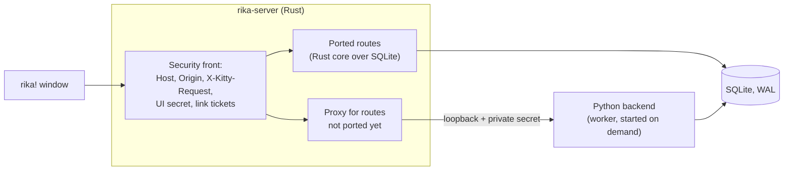

# Rust core: a gradual rewrite, a minimal base and download modules

Status: milestones 0 and 1 built; milestone 2 under way: `/api/modules`, `/api/bootstrap` and
the migration runner are Rust; milestone 3 built for its first pack, the Brain (branch
`feat/rust-core`).

## Goal

Replace the Python core with Rust one feature at a time, without a big-bang
switch-over, while making rika! as light and fast as possible. The installer
ships a minimal base (the app shell and Rika in text form); every other feature
is a module, off on a fresh install and downloaded, signature-checked, when the
user turns it on.

## Where the time and size go today (measured 2026-11-11)

| Measurement | Value |
| --- | --- |
| Desktop backend (PyInstaller onefile) start to readiness | 10.0 s |
| The same Python server, unfrozen, start to readiness | 0.45 s |
| Importing all of `kitty.web_server` | 0.36 s |
| Backend sidecar / LearnHarness / herdr download | 409 MB / 275 MB / 29 MB |
| rika!'s own Python code / web UI | 5 MB / 9 MB |
| Python core / Python tests | 86,552 lines in 317 files / 52,862 lines (4,838 tests) |

So 9.5 of the 10 seconds is the onefile unpacking 409 MB to `/tmp` on every
launch, and most of the download is a few third-party payloads (on-device speech
~350 MB, LearnHarness 275 MB, job-discovery stack ~210 MB, PyMuPDF 64 MB, sympy
~55 MB).

## Architecture: strangler

- **`rika-server` owns the browser-facing contract.** It serves the UI and
  enforces the same rules as `RequestHandler._security`, `_authorize` and
  `kitty.web_auth` today: exact Host and Origin, `Sec-Fetch-Site`, the
  `X-Kitty-Request` header and JSON content type on mutations, the per-launch UI
  secret as a header (or WebSocket subprotocol), one-time browser codes, and
  single-use link tickets. Same response headers (CSP and friends) and the same
  refusal message.
- **Routes move one feature at a time.** A ported route is answered by Rust;
  every other `/api` request and WebSocket upgrade is forwarded to the Python
  backend on loopback, authenticated with a secret only `rika-server` holds (the
  backend's existing desktop readiness line). The page never sees the Python
  origin.
- **Python becomes optional.** When every enabled module's routes are ported,
  `rika-server` does not start Python at all. Features whose libraries have no
  Rust equivalent (sympy, python-jobspy) stay Python workers inside their modules
  until they are replaced.
- **One database, both sides.** SQLite in WAL mode with a 5 s busy timeout (as
  `kitty.db.connection` sets) lets both processes read and write during the
  transition. Each write stays one transaction, all-or-nothing (the CLI fix in
  `1bcd774` is the pattern). The migration chain moves to Rust before the first
  launch that can run without Python.
- **The desktop shell embeds it.** `rika-server` is a library crate the Tauri
  shell runs in-process (no sidecar to start for ported features), plus a
  standalone binary for `kitty-web`-style browser use and tests.

## Modules

Folded into the same work: a module gates code (Rust and remaining Python) and
lists the packs it needs. Packs are the large payloads, signed with the
embedded updater key and installed under `$XDG_DATA_HOME/kitty/packs/`. A pack
shared by two modules downloads once. Activation stays at start-up.

| Module | Contains | Large payload |
| --- | --- | --- |
| `notes` | Notes, quick notes, backlinks, tags, canvas, web mirror | – |
| `documents` | Documents & PDF | PDF engine |
| `maps` | Mind maps | – |
| `calendar` | Calendar, tasks, Google Calendar sync | – |
| `study` | Study timer, guide, plans, exams, progress | – |
| `flashcards` | FSRS flashcards, Anki import | – |
| `math` | Topics, lessons, sprints, answer checking | sympy worker (until replaced) |
| `learnharness` | LearnHarness | LearnHarness app (275 MB) |
| `opportunities`, `goals` | Opportunities, goals | – |
| `brain` | Brain/atlas home, the 3D graph look | its views and the 3D engine (1.6 MB of web code); **built**, the first pack |
| `mail` | Rika's Gmail drafts | – |
| `voice` | Rika voice input and speech | speech engine and models |
| `devices` | Pairing and sync | – |
| `terminal` | herdr dock, Tern, agent tabs | herdr (29 MB) |
| `applyai` | Job search and applications | discovery worker (python-jobspy) |

Build format 1 selections are upgraded when read: `workspace` becomes notes,
documents, maps, calendar, study, flashcards, math, learnharness and
opportunities, and every format-1 selection also gets goals, brain, mail, voice
and devices, which used to be always on. `kitty init` keeps writing an empty
selection: base only.

## Milestones

0. **Fast start now.** Ship the Python backend as a PyInstaller onedir (unpacked
   once at install, not on every launch). Target: under 1 s to readiness, measured
   on the built `.deb`. *Built:* the onedir took the `.deb` backend from 11.2 / 10.9 s
   to 3.3 / 2.9 s; the rest was mDNS probing (about 1.75 s) inside
   `WebApplication.__init__`, now on a background thread, which took the same server
   on a fresh workspace from 2.77 to 0.93 s. The installed size grows to 1.15 GiB
   (the bytes that used to be unpacked to `/tmp` on every launch) until milestone 3
   moves the large payloads into packs.
1. **The seam.** `server/` crate `rika-server`: static UI, the full security
   front, and a proxy (HTTP and WebSocket) to the Python backend. Verified by
   porting the web security tests to run against it and by running the browser
   suites through it. *Built:* a 1.5 MB release binary; `tests/test_ui_secret.py`
   runs every rule against both servers; the seven browser suites that start a real
   server pass through it (`KITTY_RIKA_SERVER`). Measured on one workspace: a
   forwarded API call costs 0.6 ms more (9.6 vs 9.0 ms), and the page and its
   scripts, now served by Rust, are faster (0.8 vs 1.9 ms and 1.4 vs 2.2 ms). The
   worker (`kitty-web --worker`) answers only requests carrying the front's private
   secret, and trusts the forwarded connection ports agent verification needs only
   on those. Not yet: the desktop shell still starts the Python sidecar directly.
2. **Base in Rust.** Port the base's routes (bootstrap, modules, build and
   settings, themes, keys, effects, Rika text chat) and the migration runner, so
   a base-only install starts without Python. Module registry with requirements
   and packs; UI gating per new module.

   Inventory (2026-11-12): what each base route group touches and what must exist in Rust
   before it can move.

   | Route group | Python handler | Data it touches | Tests | Blocks porting |
   | --- | --- | --- | --- | --- |
   | Modules `GET/POST /api/modules` | ~~`WebApplication.set_modules`~~, `modules_state` | `config/build.json` (`modules`), careers templates | `test_web_modules.py`, `test_modules.py` | **Ported** (below) |
   | Bootstrap `GET /api/bootstrap` | ~~`WebApplication._bootstrap`~~ | modules state; with applyai, jobs, tracks and today's digest in SQLite | `test_web_bootstrap.py`, `test_web_modules.py` | **Ported** (below) |
   | Build and settings `/api/build/*` | `web_build.py`, `core/builds/{store,project,share}` | build file, `data/build-history/`, settings rows projected into SQLite | `test_web_build.py`, `test_builds.py`, browser `settings`/`build` suites | the watcher's live push goes out over `web_live`'s WebSocket (Python), and `project.sync` writes SQLite; `fetch` needs an HTTPS client |
   | Themes | no route: the theme list and `theme.base` live in the build (`document.theme_ids`, already in Rust) | build file | as build | moves with the build routes |
   | Keys `/api/keys/*` | `web_keys.py`, `core/keys.py` | OS keyring (Secret Service over D-Bus) or owner-only file | `test_keys.py` | a Secret Service client in Rust; Python's AI providers keep reading the same store until they move |
   | Effects `/api/effects/*` | `web_effects.py`, `core/effects.py`, `effect_kinds` | effect tables in SQLite | `test_effects.py` | executors call into Python modules (blocks, applications); approvals are bound to the worker's `ui_session`, which would have to move to the front |
   | Rika text chat `/api/rika/*` | `web_rika.py`, `core/rika/*` | conversations, plans, memory in SQLite; AI provider calls | `test_web_rika*.py`, `test_rika_*.py` | AI client and streaming WebSocket; Rika's tools reach every module's Python core |
   | Migration runner | `kitty.db.migrations` (kept for the CLI, TUI, MCP, demo reset and tests) | the SQLite schema (55 SQL files) | `test_migration_parity.py`, `test_front_migrations.py`, `test_migrations.py`, `test_migration_numbers.py` | **Ported** (below) |

   *Built (first slice):* `/api/modules` is answered by rika-server (`server/src/modules.rs`)
   with Python's responses and error messages (`kitty.modules.normalize_modules`, `store.edit`
   refusals, the 500 for an exception Python had no handler for), and the same atomic,
   `flock`ed write of `config/build.json`; the careers templates are compiled in. Python's
   handler is gone; `modules_state` stays for bootstrap and the build push. The worker's
   readiness line now also carries its `config_dir`, frozen `modules` and `version`.
   `tests/test_web_modules.py` runs the route through the front and compares every answer
   with the Python functions as the reference. Deliberate difference: a pre-build
   `modules.yaml` written by hand while rika! runs is not parsed (the worker migrated it at
   start; the next start reads it). Since Python no longer serves every route, plain
   `kitty-web` now execs rika-server with itself as `--worker`, and the desktop backend
   refuses to run without the front: a Python-only install (a checkout without
   `cargo build --release --manifest-path server/Cargo.toml`) no longer serves the website.
   Measured on one synthetic workspace (median of 300 fresh-connection GETs, two alternating
   runs each): `GET /api/modules` went from 6.3 / 6.5 ms (forwarded to Python) to 1.06 /
   1.02 ms (Rust), while a still-forwarded route stays at 5.8 ms; start to announcement is
   unchanged (1.2 to 1.4 s, the worker dominates); the release binary grew from 1.82 to
   1.91 MB.

   *Built (second slice): the migration runner.* `server/src/migrations.rs` applies the same
   numbered files (compiled in by `server/build.rs` from `src/kitty/db/migrations/`) with the
   same bookkeeping as `kitty.db.migrations.migrate`: one `BEGIN ... COMMIT` script per
   migration with its `schema_version` row, `PRAGMA foreign_key_check` before the commit,
   `-- foreign_keys: off` set around the transaction, versions applied by number (a lower
   number landing late still applies). rusqlite with SQLite bundled (FTS5 and the trigram
   tokenizer included). rika-server resolves the workspace as `Settings.load` does
   (`server/src/settings.rs`: `--root`, `$KITTY_HOME`, the root markers, `$KITTY_DB` from the
   environment or the root's `.env`) and migrates it at start-up before it starts the worker
   (`server/src/startup.rs`); the worker opens it with `open_workspace(auto_migrate=False)`,
   which refuses a database still behind the files, and its readiness line names the
   database it opened, which must be the one the front migrated. The desktop shell now
   passes the workspace to rika-server with `--root`; in desktop mode the front creates
   files owner-only (`umask 077`, as the backend does). `--demo`'s throwaway workspace is
   made, migrated and removed by the front and handed to the worker as `--demo-workspace`.
   The three Python-step migrations:
   - `047` (`search:build`) is folded into SQL: the script now queues every existing record,
     blocks included, in `search_pending`, and `search.sync`, which every query runs first,
     builds their documents (`page_titles_within` now syncs too; it was the one reader that
     did not). Both runners read the same file, so they agree; a fresh database has nothing
     to queue.
   - `033` (`blocks.legacy:migrate_notes`) and `039` (`blocks.tags:backfill`) are not
     ported: they convert only what a pre-block workspace (rika! 0.3.33 and older) holds,
     through the whole block store (transactions, op log, ordering keys, tagging), a large
     port for a one-time upgrade. On every other database they are no-ops, so the Rust
     runner applies their scripts alone; when the database has notes, documents or quick
     notes (033) or `#tags` (039) to convert, it stops before that migration and the front
     runs the Python runner once through the worker program (`--migrate-database DB`, in
     `kitty-web` and the desktop backend), then checks that nothing is left. Without a
     worker program (a future base-only install) the front refuses with "open the
     workspace once with rika! 0.3.36". Fresh and current workspaces never start Python
     for migrations. A front that stops before readiness ends its stderr with the reason
     (`rika-server: ...`); the desktop shell captures that stderr, shows the last line in an
     error dialog (the app exits when it is dismissed) and writes the whole text to
     `.private/startup-error.log`; before, it discarded it and the window never appeared.

   Tracked exception to "no two live implementations": `kitty.db.migrate` stays for its
   other callers, the CLI and TUI (`open_workspace`), the MCP server, `demo.reset`, the
   pre-block conversion above and the tests' fixtures, and is deleted when those callers
   move to Rust. `tests/test_migration_parity.py` keeps the two from drifting: a fresh
   database, every prefix of the numbered files and every released set with gaps (main's
   releases up to v0.3.33), each migrated by both runners and each upgraded to the latest
   schema by both, must give the same `sqlite_master`, pragmas and rows of every table (FTS
   shadow tables included; clock values and the random device id compared by shape), plus
   a seeded v0.3.33 database upgraded both ways and the stop-and-hand-over on one with notes.

   *Built (third slice): bootstrap.* `GET /api/bootstrap` is answered by rika-server
   (`server/src/bootstrap.rs`): `{"demo", "modules"}`, and with ApplyAI the tracks, the four
   job counts, this week's total and streak and today's digest text, computed over rusqlite
   as `tracks.weekly_targets`, `jobs.count_jobs` with the job views and
   `today.build_digest`/`digest_text` do (stored timestamps read as `kitty.dates.parse`
   reads them, `sources.safe_error`'s redaction with the worker's environment and `.env`,
   Python's 503 for a busy database). Python's handler is deleted; the functions it
   composed stay (other routes and the CLI use them) and are the reference in
   `tests/test_web_bootstrap.py`, which compares the front's answer with them on a
   synthetic workspace covering every digest section. Deliberate difference: the digest's
   two `apply.yaml` settings (`deadline_window_days`, `archive_after_days`) are the ones the
   worker validated at start, sent in its readiness line; a hand edit followed by
   `/api/reload` reaches them at the next start.

   Measured on one synthetic ApplyAI workspace (400 jobs; medians; base commit and this
   branch run alternately twice on a machine also running other agents' suites): start to
   announcement is unchanged within the noise, fresh 4.7 / 3.5 s before and 4.9 / 4.0 s after,
   existing 3.6 / 3.1 s and 3.8 / 3.7 s, since the worker's start dominates and both runners
   cost the same: a fresh database takes 0.30 s in Python and 0.33 s in Rust (SQLite's own
   work), a current one 0.7 ms in Python and 12 ms for a whole `rika-server migrate` process.
   `GET /api/bootstrap` (median of 300 fresh-connection GETs) went from 8.9 / 9.7 / 13.7 /
   10.4 ms (forwarded to Python) to 5.0 / 3.5 / 2.9 / 2.9 ms, while a still-forwarded route
   (`/api/dashboard`) stayed at 7.3-14.8 ms. A cold answer is most of its time in SQLite
   parsing the schema, so the front keeps its database connection open between answers. The
   release binary grew from 1.91 to 5.96 MB (SQLite bundled, `regex`).

   Next: the build routes once the live channel can be driven from Rust.
3. **Packs.** Signed pack builds and index in the release pipeline; download,
   verify and atomic install in the shell; Settings → Modules with size and
   progress.

   *Built:* the module registry is one file, `src/kitty/modules.json` (ids, labels, the packs
   each module needs), read by `kitty.modules` and compiled into rika-server;
   `tests/test_modules.py` fails if the build schema, `api.ts` or `buildCore.ts` drift from it.
   A new module `brain` (the atlas home, 3D and 2D, and the 3D graph look) needs pack `brain`
   and is off by default: `DEFAULT_MODULES` (a workspace without a selection) is every module
   needing no download; `kitty-web --demo` turns every module on. `/api/brain` is now the
   brain module's route. Without the module, or with its files missing, the home's stage is
   one "Brain isn't installed · Download" widget leading to Settings → Modules, and the
   home-look and 3D-look switches are hidden (2D only); every other view is unchanged.

   Pack format: `web/vite.config.ts` marks every chunk holding a module of a pack's patterns
   (for the Brain: `src/lib/brain/`, `three`, `3d-force-graph`) and the chunks only those reach,
   fails the build if the base imports one statically, and writes `dist/pack-files.json`.
   `scripts/build-packs.py` (run by `scripts/build-desktop.sh` after the web build) writes
   `rika-pack-<id>-<version>.tar.gz` (a `pack.json` plus `web/<files>`, reproducible), removes
   those files from the website the installers carry, and writes the index `packs.json`
   (`format`, `version`, per pack `file`, `size`, `sha256`, `installed_size`). The release
   workflow signs the index with the updater key (`tauri signer sign`, the installers' setup);
   `scripts/publish-desktop-release.py` uploads archives, index and signature to the release
   and checks each upload's size; `scripts/validate-desktop-release.py` verifies the uploaded
   index against `tauri.conf.json`'s updater key and each archive's size and SHA-256, and the
   workflow checks the `.deb`'s website carries none of the pack's files. The releases
   repository is now named `ZacharySF/rika` (GitHub redirects `kitty-releases`); every
   reference moved.

   rika-server (`server/src/packs.rs`): `GET /api/packs` lists each pack (built-in, installed,
   downloading with progress, outdated, available, unavailable, with sizes and the last error)
   from its own version's index,
   `https://github.com/ZacharySF/rika/releases/download/v<version>/packs.json`, fetched over
   HTTPS (reqwest with rustls and ring, the updater's stack), verified with `minisign-verify`
   against the key and version compiled in from `desktop/tauri.conf.json` (its trusted comment
   must name `packs.json`), cached 10 min in memory and, verified again on read, on disk for
   offline listing. `POST /api/packs/install {id}` streams the archive into a `.tmp-` folder,
   refuses it unless size and SHA-256 match the signed index, unpacks it (regular files and
   folders only, no path leaving the pack, exact unpacked size, a matching `pack.json`), moves it
   beside the others and makes it installed by one atomic write of `installed.json` under a
   `flock`; the old version goes only after that. Anything that fails leaves the previous state,
   and a start sweeps unreferenced folders and day-old downloads. `POST /api/packs/uninstall
   {id}` is refused while a module needing it is selected. A pack counts only for the exact app
   version (its chunks import the base's hashed chunks). The static route serves a missing
   website file from an installed pack. `POST /api/modules` refuses (409) to turn on a module
   whose pack is not ready; the CLI's `kitty modules enable` does not check (the home then shows
   the card). Packs live under `$XDG_DATA_HOME/kitty/packs/`. `KITTY_PACKS_URL` and
   `KITTY_PACKS_KEY` are test-only overrides; the test harnesses point the index at a closed
   loopback port so no test reaches GitHub.

   Tests: `tests/test_packs.py` (22, through the front: signed install, progress, bad
   signature, signature of another file, tampered index, other version, missing signature,
   bad hash, truncated, oversized, escaping path, wrong manifest, failed update keeps the old
   install, sweep, uninstall gate, built-in, offline cache, the front's secret, Origin, Host,
   `Sec-Fetch-Site`, `X-Kitty-Request` and content-type rules), Rust unit tests for index
   verification and unpacking, release-guard and publisher tests, and
   `web/tests/packs.browser.test.mjs` (the built website without the Brain, Settings → Modules
   download with progress, turning the Brain on, the Brain drawn from the pack after a restart,
   removal).

   Measured (this build): the website the installer carries went from 11,928,862 to
   10,291,704 bytes (−1,637,158, 13.7 %: seven chunks, three.js and 3d-force-graph included);
   the installers carry the website twice (the backend's `_internal/website` and Tauri's
   embedded `frontendDist`), so the base install drops at least 1.6 MB, and the pack download is
   a 0.5 MB archive. A full `.deb` was not rebuilt for this change (the installed size is
   dominated by the backend, 1.15 GiB, until the next packs). rika-server grew from 1.91 to
   4.68 MB (the HTTPS client, rustls with ring, gzip and tar).

   Next packs: LearnHarness, the speech engine, the discovery worker and herdr, each once its
   module owns its routes.
4. **Modules, one by one.** Notes and blocks (loro is already Rust), calendar,
   study, flashcards (`fsrs` crate), goals, maps, opportunities, brain, search,
   devices, terminal, documents, mail, voice (whisper in Rust), math and
   ApplyAI last (their workers are replaced, or stay as packs). Each module's
   Python tests become its parity tests before its Python is deleted.

## Rules for every step

- The Python suite and the browser suites pass against whatever mix serves the
  routes. A route is ported only with its tests, and its Python is deleted in
  the same change (no two live implementations of one route).
- CLAUDE.md's hard rules carry over unchanged: never submit an application,
  never invent applicant facts, read-only Gmail for status sync, approvals bound
  to the window session.
- Measure before and after: start-up time, memory, request latency, download
  size.
