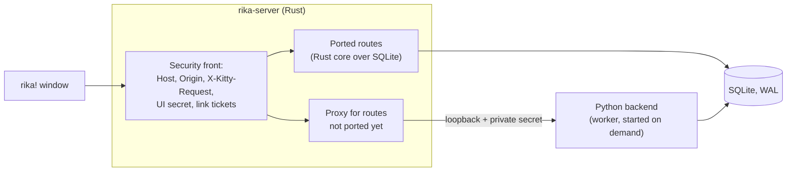

# Rust core: a gradual rewrite, a minimal base and download modules

Status: milestones 0 and 1 in progress (branch `feat/rust-core`).

## Goal

Replace the Python core with Rust one feature at a time, without a big-bang
switch-over, while making rika! as light and fast as possible. The installer
ships a minimal base (the app shell and Rika in text form); every other feature
is a module, off on a fresh install and downloaded, signature-checked, when the
user turns it on.

## Where the time and size go today (measured 2026-11-11)

| Measurement | Value |
| --- | --- |
| Desktop backend (PyInstaller onefile) start to readiness | 10.0 s |
| The same Python server, unfrozen, start to readiness | 0.45 s |
| Importing all of `kitty.web_server` | 0.36 s |
| Backend sidecar / LearnHarness / herdr download | 409 MB / 275 MB / 29 MB |
| rika!'s own Python code / web UI | 5 MB / 9 MB |
| Python core / Python tests | 86,552 lines in 317 files / 52,862 lines (4,838 tests) |

So 9.5 of the 10 seconds is the onefile unpacking 409 MB to `/tmp` on every
launch, and most of the download is a few third-party payloads (on-device speech
~350 MB, LearnHarness 275 MB, job-discovery stack ~210 MB, PyMuPDF 64 MB, sympy
~55 MB).

## Architecture: strangler

- **`rika-server` owns the browser-facing contract.** It serves the UI and
  enforces the same rules as `RequestHandler._security`, `_authorize` and
  `kitty.web_auth` today: exact Host and Origin, `Sec-Fetch-Site`, the
  `X-Kitty-Request` header and JSON content type on mutations, the per-launch UI
  secret as a header (or WebSocket subprotocol), one-time browser codes, and
  single-use link tickets. Same response headers (CSP and friends) and the same
  refusal message.
- **Routes move one feature at a time.** A ported route is answered by Rust;
  every other `/api` request and WebSocket upgrade is forwarded to the Python
  backend on loopback, authenticated with a secret only `rika-server` holds (the
  backend's existing desktop readiness line). The page never sees the Python
  origin.
- **Python becomes optional.** When every enabled module's routes are ported,
  `rika-server` does not start Python at all. Features whose libraries have no
  Rust equivalent (sympy, python-jobspy) stay Python workers inside their modules
  until they are replaced.
- **One database, both sides.** SQLite in WAL mode with a 5 s busy timeout (as
  `kitty.db.connection` sets) lets both processes read and write during the
  transition. Each write stays one transaction, all-or-nothing (the CLI fix in
  `1bcd774` is the pattern). The migration chain moves to Rust before the first
  launch that can run without Python.
- **The desktop shell embeds it.** `rika-server` is a library crate the Tauri
  shell runs in-process (no sidecar to start for ported features), plus a
  standalone binary for `kitty-web`-style browser use and tests.

## Modules

Folded into the same work: a module gates code (Rust and remaining Python) and
lists the packs it needs. Packs are the large payloads, signed with the
embedded updater key and installed under `$XDG_DATA_HOME/kitty/packs/`. A pack
shared by two modules downloads once. Activation stays at start-up.

| Module | Contains | Large payload |
| --- | --- | --- |
| `notes` | Notes, quick notes, backlinks, tags, canvas, web mirror | – |
| `documents` | Documents & PDF | PDF engine |
| `maps` | Mind maps | – |
| `calendar` | Calendar, tasks, Google Calendar sync | – |
| `study` | Study timer, guide, plans, exams, progress | – |
| `flashcards` | FSRS flashcards, Anki import | – |
| `math` | Topics, lessons, sprints, answer checking | sympy worker (until replaced) |
| `learnharness` | LearnHarness | LearnHarness app (275 MB) |
| `opportunities`, `goals`, `brain` | Opportunities, goals, Brain/atlas home | – |
| `mail` | Rika's Gmail drafts | – |
| `voice` | Rika voice input and speech | speech engine and models |
| `devices` | Pairing and sync | – |
| `terminal` | herdr dock, Tern, agent tabs | herdr (29 MB) |
| `applyai` | Job search and applications | discovery worker (python-jobspy) |

Build format 1 selections are upgraded when read: `workspace` becomes notes,
documents, maps, calendar, study, flashcards, math, learnharness and
opportunities, and every format-1 selection also gets goals, brain, mail, voice
and devices, which used to be always on. `kitty init` keeps writing an empty
selection: base only.

## Milestones

0. **Fast start now.** Ship the Python backend as a PyInstaller onedir (unpacked
   once at install, not on every launch). Target: under 1 s to readiness, measured
   on the built `.deb`.
1. **The seam.** `server/` crate `rika-server`: static UI, the full security
   front, and a proxy (HTTP and WebSocket) to the Python backend. Verified by
   porting the web security tests to run against it and by running the browser
   suites through it.
2. **Base in Rust.** Port the base's routes (bootstrap, modules, build and
   settings, themes, keys, effects, Rika text chat) and the migration runner, so
   a base-only install starts without Python. Module registry with requirements
   and packs; UI gating per new module.
3. **Packs.** Signed pack builds and index in the release pipeline; download,
   verify and atomic install in the shell; Settings → Modules with size and
   progress.
4. **Modules, one by one.** Notes and blocks (loro is already Rust), calendar,
   study, flashcards (`fsrs` crate), goals, maps, opportunities, brain, search,
   devices, terminal, documents, mail, voice (whisper in Rust), math and
   ApplyAI last (their workers are replaced, or stay as packs). Each module's
   Python tests become its parity tests before its Python is deleted.

## Rules for every step

- The Python suite and the browser suites pass against whatever mix serves the
  routes. A route is ported only with its tests, and its Python is deleted in
  the same change (no two live implementations of one route).
- CLAUDE.md's hard rules carry over unchanged: never submit an application,
  never invent applicant facts, read-only Gmail for status sync, approvals bound
  to the window session.
- Measure before and after: start-up time, memory, request latency, download
  size.
